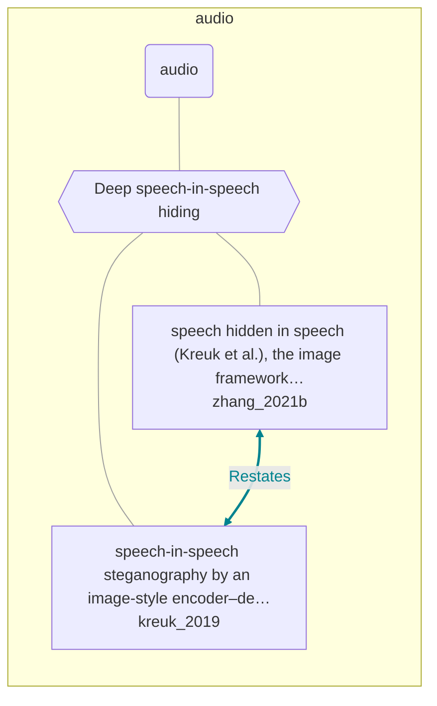

# Approach map — audio

Built by `tools/build_approach_map.py` from `C:\Users\user\Documents\GitHub\hypersteg_chess\hypersteg_novelty_kit_20261108\literature\verified_claims`, the features table `C:\Users\user\Documents\GitHub\hypersteg_chess\hypersteg_novelty_kit_20261108\maps\approach_features.tsv` and the technique taxonomy `C:\Users\user\Documents\GitHub\hypersteg_chess\hypersteg_novelty_kit_20261108\maps\technique_taxonomy.tsv`. View: `both`. Overview: [approach_map.md](approach_map.md).

- approaches: 2
- techniques: 1

## Legend

| link | arrow | colour | source |
| --- | --- | --- | --- |
| taxonomy (family → technique → approach) | `---` | #9e9e9e, thin | technique taxonomy and features table |
| Supports | `-->` | #2e7d32, thick | stated by a paper (ledger edge) |
| Rebuts | `-.->` | #c62828, thick | stated by a paper (ledger edge) |
| Depends-on | `==>` | #6a1b9a, thick | stated by a paper (ledger edge) |
| Refines | `-->` | #1565c0, thick | stated by a paper (ledger edge) |
| Qualifies | `-.->` | #ef6c00, thick | stated by a paper (ledger edge) |
| Restates | `<-->` | #00838f, thick | stated by a paper (ledger edge) |
| Duplicate-of | `o--o` | #757575, thick | stated by a paper (ledger edge) |
| Supersedes | `--x` | #4e342e, thick | stated by a paper (ledger edge) |

## Techniques

| technique | parent | name | definition | grounded by | approaches |
| --- | --- | --- | --- | --- | --- |
| `au-deep-speech-hiding` | — | Deep speech-in-speech hiding | Encoder-decoder networks with differentiable spectral transforms hide speech in speech. | `kreuk_2019:approach-hide-and-speak` | 2 |

## Lineage edges (1)

| source | kind | target | lifted_from | ledger line |
| --- | --- | --- | --- | --- |
| `zhang_2021b:surveyed-speech-in-speech` | Restates | `kreuk_2019:approach-hide-and-speak` | — | zhang_2021b.md:169 |

## Approaches

| address | name | family | technique | channel | key | access | capacity | mechanism | landable | mechanism_evidence | carrier | acquisition |
| --- | --- | --- | --- | --- | --- | --- | --- | --- | --- | --- | --- | --- |
| `kreuk_2019:approach-hide-and-speak` | speech-in-speech steganography by an image-style encoder–decoder network with differentiable STFT and inverse-STFT layers | audio | au-deep-speech-hiding | transform-domain | shared-model | training | one to five speech messages in one speech carrier of unchanged dimension; quality falls as the count rises | m-spectral-audio-hiding | yes | own | speech audio (STFT magnitudes) | weight-trained |
| `zhang_2021b:surveyed-speech-in-speech` | speech hidden in speech (Kreuk et al.), the image framework carried over with differentiable STFT layers | audio | au-deep-speech-hiding | transform-domain | — | training | — | m-spectral-audio-hiding | yes | own | speech audio | weight-trained |
