# Approach map — foundations-theory

Built by `tools/build_approach_map.py` from `C:\Users\user\Documents\GitHub\hypersteg_chess\hypersteg_novelty_kit_20261108\literature\verified_claims`, the features table `C:\Users\user\Documents\GitHub\hypersteg_chess\hypersteg_novelty_kit_20261108\maps\approach_features.tsv` and the technique taxonomy `C:\Users\user\Documents\GitHub\hypersteg_chess\hypersteg_novelty_kit_20261108\maps\technique_taxonomy.tsv`. View: `both`. Overview: [approach_map.md](approach_map.md).

- approaches: 20
- techniques: 15

```mermaid
flowchart LR
  subgraph fam_foundations_theory_g["foundations-theory"]
    fam_foundations_theory("foundations-theory")
    tech_ft_balanced_partition{{"Balanced partition"}}
    tech_ft_capacity_laws{{"Capacity laws"}}
    tech_ft_complexity_theoretic{{"Complexity-theoretic security"}}
    tech_ft_constructions{{"Constructions with stated security"}}
    tech_ft_informal_limits{{"Informal limits and terminology"}}
    tech_ft_information_theoretic{{"Information-theoretic security"}}
    tech_ft_keyed_feature_function{{"Keyed function of a robust feature"}}
    tech_ft_keyed_parity{{"Keyed parity embedding"}}
    tech_ft_public_key_steganography{{"Public-key steganography"}}
    tech_ft_rejection_sampling{{"Rejection sampling"}}
    tech_ft_security_models{{"Security models"}}
    tech_ft_shared_sample_robust_code{{"Shared-sample robust code"}}
    tech_ft_subliminal_channel{{"Subliminal channels"}}
    tech_ft_uniform_cover{{"Uniform-cover schemes"}}
    tech_ft_universal_compression{{"Universal-compression stegosystems"}}
    n_anderson_1998_approach_limits_of_steganography["a survey of what steganography can and cannot do, the obsta…<br/>anderson_1998"]
    n_anderson_1998_approach_parity_embedding["parity embedding: the selection channel argument leads to h…<br/>anderson_1998"]
    n_anderson_1998_approach_public_key_steganography["public-key steganography: encrypt under the recipient's pub…<br/>anderson_1998"]
    n_anderson_1998_selection_channel_book_cipher["Selection channel — the shared pad that chooses which cover…<br/>anderson_1998"]
    n_cachin_1998_approach_balanced_partition["the balanced-partition stegosystem: split the covertext alp…<br/>cachin_1998"]
    n_cachin_1998_approach_information_theoretic_model["an information-theoretic model of steganography against a p…<br/>cachin_1998"]
    n_cachin_1998_approach_universal_repetition_times["the universal stegosystem: Willems' repetition-times compre…<br/>cachin_1998"]
    n_cachin_2004_approach_balanced_partition["the balanced-partition stegosystem for arbitrary known dist…<br/>cachin_2004"]
    n_cachin_2004_approach_information_theoretic_model["an information-theoretic model of steganography against a p…<br/>cachin_2004"]
    n_cachin_2004_approach_uniform_cover_schemes["perfectly secure stegosystems for uniform covertext: a key-…<br/>cachin_2004"]
    n_cachin_2004_approach_universal_stegosystem["the universal stegosystem: approximate the covertext distri…<br/>cachin_2004"]
    n_hopper_2002_approach_complexity_theoretic_steganography["complexity-theoretic steganography: secrecy and robustness …<br/>hopper_2002"]
    n_hopper_2002_approach_robust_text_shingling["Construction 4, robust protocol for text-like channels: a k…<br/>hopper_2002"]
    n_hopper_2002_approach_stateful_rejection_sampling["Construction 1, stateful rejection sampling: for each encod…<br/>hopper_2002"]
    n_hopper_2002_approach_stateless_unbiased_function["Construction 2, stateless: encrypt with an IND$-CPA cipher,…<br/>hopper_2002"]
    n_hopper_2002_approach_universally_robust["Construction 3, universally robust: channel draws from shar…<br/>hopper_2002"]
    n_hopper_2002_timestamped_channel["Channel — a distribution on timestamped bit sequences, gene…<br/>hopper_2002"]
    n_ker_2007_approach_batch_square_root_capacity["the batch capacity theorem: across many covers, secure capa…<br/>ker_2007"]
    n_ker_2008_approach_square_root_law["the square root law for a single cover: the batch capacity …<br/>ker_2008"]
    n_simmons_1984_approach_subliminal_channel["the subliminal channel: authentication schemes in which sev…<br/>simmons_1984"]
    paper_anderson_1998(["anderson_1998<br/>(paper)"])
    paper_cachin_1998(["cachin_1998<br/>(paper)"])
    paper_cachin_2004(["cachin_2004<br/>(paper)"])
  end
  subgraph other_families["other families"]
    n_anwar_2026_approach_steganographic_gap["a decision-theoretic view of steganography, detected and qu…<br/>anwar_2026<br/>family: steganalysis"]
    n_ding_2023_approach_discop["Discop, sampling from one of several rotated #quot;distribution …<br/>ding_2023<br/>family: llm-generative-text"]
    n_guo_2026_approach_bam_feedback_coding["BAM (Burnashev Adaptive Posterior Matching): black-box LLM …<br/>guo_2026<br/>family: llm-generative-text"]
    n_kaptchuk_2021_approach_meteor["Meteor: a symmetric-key, stateful, provably secure scheme t…<br/>kaptchuk_2021<br/>family: llm-generative-text"]
    paper_zhang_2018(["zhang_2018<br/>(paper)<br/>family: image-generative-coverless"])
    n_ritchey_2012_approach_combinatorial_game_framework["a general framework for covert channels in combinatorial ga…<br/>ritchey_2012<br/>family: game-and-chess"]
    n_schroederdewitt_2022_approach_imec["minimum entropy coupling steganography (iMEC): encode by co…<br/>schroederdewitt_2022<br/>family: llm-generative-text"]
    n_zhang_2021_approach_adg["ADG, equal-probability grouping of the vocabulary at each s…<br/>zhang_2021<br/>family: llm-generative-text"]
  end
  tech_ft_constructions --- tech_ft_balanced_partition
  fam_foundations_theory --- tech_ft_capacity_laws
  tech_ft_security_models --- tech_ft_complexity_theoretic
  fam_foundations_theory --- tech_ft_constructions
  tech_ft_security_models --- tech_ft_informal_limits
  tech_ft_security_models --- tech_ft_information_theoretic
  tech_ft_constructions --- tech_ft_keyed_feature_function
  tech_ft_constructions --- tech_ft_keyed_parity
  tech_ft_constructions --- tech_ft_public_key_steganography
  tech_ft_constructions --- tech_ft_rejection_sampling
  fam_foundations_theory --- tech_ft_security_models
  tech_ft_constructions --- tech_ft_shared_sample_robust_code
  tech_ft_constructions --- tech_ft_subliminal_channel
  tech_ft_constructions --- tech_ft_uniform_cover
  tech_ft_constructions --- tech_ft_universal_compression
  tech_ft_informal_limits --- n_anderson_1998_approach_limits_of_steganography
  tech_ft_keyed_parity --- n_anderson_1998_approach_parity_embedding
  tech_ft_public_key_steganography --- n_anderson_1998_approach_public_key_steganography
  tech_ft_keyed_parity --- n_anderson_1998_approach_public_key_steganography
  fam_foundations_theory --- n_anderson_1998_selection_channel_book_cipher
  tech_ft_balanced_partition --- n_cachin_1998_approach_balanced_partition
  tech_ft_information_theoretic --- n_cachin_1998_approach_information_theoretic_model
  tech_ft_universal_compression --- n_cachin_1998_approach_universal_repetition_times
  tech_ft_balanced_partition --- n_cachin_2004_approach_balanced_partition
  tech_ft_information_theoretic --- n_cachin_2004_approach_information_theoretic_model
  tech_ft_uniform_cover --- n_cachin_2004_approach_uniform_cover_schemes
  tech_ft_universal_compression --- n_cachin_2004_approach_universal_stegosystem
  tech_ft_complexity_theoretic --- n_hopper_2002_approach_complexity_theoretic_steganography
  tech_ft_keyed_feature_function --- n_hopper_2002_approach_robust_text_shingling
  tech_ft_rejection_sampling --- n_hopper_2002_approach_stateful_rejection_sampling
  tech_ft_rejection_sampling --- n_hopper_2002_approach_stateless_unbiased_function
  tech_ft_shared_sample_robust_code --- n_hopper_2002_approach_universally_robust
  fam_foundations_theory --- n_hopper_2002_timestamped_channel
  tech_ft_capacity_laws --- n_ker_2007_approach_batch_square_root_capacity
  tech_ft_capacity_laws --- n_ker_2008_approach_square_root_law
  tech_ft_subliminal_channel --- n_simmons_1984_approach_subliminal_channel
  paper_anderson_1998 ==>|Depends-on| n_simmons_1984_approach_subliminal_channel
  n_anwar_2026_approach_steganographic_gap -->|Refines| n_cachin_2004_approach_information_theoretic_model
  n_anwar_2026_approach_steganographic_gap -.->|Qualifies| n_hopper_2002_approach_complexity_theoretic_steganography
  paper_cachin_1998 ==>|Depends-on| n_simmons_1984_approach_subliminal_channel
  paper_cachin_2004 --x|Supersedes| n_cachin_1998_approach_information_theoretic_model
  paper_cachin_2004 ==>|Depends-on| n_simmons_1984_approach_subliminal_channel
  paper_cachin_2004 <-->|Restates| n_cachin_1998_approach_balanced_partition
  n_ding_2023_approach_discop ==>|Depends-on| paper_cachin_1998
  n_guo_2026_approach_bam_feedback_coding ==>|Depends-on| n_cachin_2004_approach_information_theoretic_model
  n_hopper_2002_approach_complexity_theoretic_steganography ==>|Depends-on| n_simmons_1984_approach_subliminal_channel
  n_hopper_2002_approach_complexity_theoretic_steganography -.->|Qualifies| n_cachin_1998_approach_information_theoretic_model
  n_hopper_2002_approach_stateful_rejection_sampling <-->|Restates| n_anderson_1998_approach_limits_of_steganography
  n_hopper_2002_approach_stateless_unbiased_function <-->|Restates| n_anderson_1998_approach_limits_of_steganography
  n_hopper_2002_approach_stateless_unbiased_function <-->|Restates| n_cachin_1998_approach_balanced_partition
  n_kaptchuk_2021_approach_meteor -->|Refines| n_hopper_2002_approach_stateful_rejection_sampling
  n_ker_2007_approach_batch_square_root_capacity ==>|Depends-on| n_cachin_2004_approach_information_theoretic_model
  n_ker_2008_approach_square_root_law -->|Refines| n_ker_2007_approach_batch_square_root_capacity
  n_ritchey_2012_approach_combinatorial_game_framework ==>|Depends-on| n_simmons_1984_approach_subliminal_channel
  n_schroederdewitt_2022_approach_imec ==>|Depends-on| n_cachin_1998_approach_information_theoretic_model
  paper_zhang_2018 -->|Refines| paper_cachin_1998
  n_zhang_2021_approach_adg ==>|Depends-on| paper_cachin_1998
  linkStyle 0,1,2,3,4,5,6,7,8,9,10,11,12,13,14,15,16,17,18,19,20,21,22,23,24,25,26,27,28,29,30,31,32,33,34,35 stroke:#9e9e9e,stroke-width:1px
  linkStyle 36,39,41,43,44,45,51,53,54,56 stroke:#6a1b9a,stroke-width:2.5px,color:#6a1b9a
  linkStyle 37,50,52,55 stroke:#1565c0,stroke-width:2.5px,color:#1565c0
  linkStyle 38,46 stroke:#ef6c00,stroke-width:2.5px,color:#ef6c00
  linkStyle 40 stroke:#4e342e,stroke-width:2.5px,color:#4e342e
  linkStyle 42,47,48,49 stroke:#00838f,stroke-width:2.5px,color:#00838f
  classDef stub fill:#f5f5f5,stroke:#9e9e9e,stroke-dasharray:4 3,color:#424242
  class n_anwar_2026_approach_steganographic_gap,n_ding_2023_approach_discop,n_guo_2026_approach_bam_feedback_coding,n_kaptchuk_2021_approach_meteor,paper_zhang_2018,n_ritchey_2012_approach_combinatorial_game_framework,n_schroederdewitt_2022_approach_imec,n_zhang_2021_approach_adg stub
  classDef nonlanding fill:#eeeeee,stroke:#bdbdbd,stroke-dasharray:2 2,color:#9e9e9e
  class tech_ft_capacity_laws,tech_ft_complexity_theoretic,tech_ft_informal_limits,tech_ft_information_theoretic,tech_ft_security_models nonlanding
```

## Legend

| link | arrow | colour | source |
| --- | --- | --- | --- |
| taxonomy (family → technique → approach) | `---` | #9e9e9e, thin | technique taxonomy and features table |
| Supports | `-->` | #2e7d32, thick | stated by a paper (ledger edge) |
| Rebuts | `-.->` | #c62828, thick | stated by a paper (ledger edge) |
| Depends-on | `==>` | #6a1b9a, thick | stated by a paper (ledger edge) |
| Refines | `-->` | #1565c0, thick | stated by a paper (ledger edge) |
| Qualifies | `-.->` | #ef6c00, thick | stated by a paper (ledger edge) |
| Restates | `<-->` | #00838f, thick | stated by a paper (ledger edge) |
| Duplicate-of | `o--o` | #757575, thick | stated by a paper (ledger edge) |
| Supersedes | `--x` | #4e342e, thick | stated by a paper (ledger edge) |

Muted, dashed nodes are marked not a landing node: they group the tree, and a novelty audit does not place a scheme at one. A child of such a node is one too unless its row says `landing: yes`.

## Techniques

| technique | parent | name | definition | grounded by | approaches |
| --- | --- | --- | --- | --- | --- |
| `ft-balanced-partition` | ft-constructions | Balanced partition | The cover alphabet is split into two near-equiprobable halves and a key bit picks the half to sample from. | `cachin_2004:approach-balanced-partition` | 2 |
| `ft-capacity-laws` | — | Capacity laws (not a landing node) | Results on how much can be hidden securely as the amount of cover grows; secure capacity scales with the square root of cover size. | `ker_2007:approach-batch-square-root-capacity` | 2 |
| `ft-complexity-theoretic` | ft-security-models | Complexity-theoretic security (not a landing node) | Security is computational indistinguishability of stegotext from the channel. | `hopper_2002:approach-complexity-theoretic-steganography` | 1 |
| `ft-constructions` | — | Constructions with stated security | Concrete stegosystems built to meet one of the security models. | `hopper_2002:approach-stateful-rejection-sampling` | 12 |
| `ft-informal-limits` | ft-security-models | Informal limits and terminology (not a landing node) | A survey-level account of attacks and of why no Shannon-style theory of steganography yet exists. | `anderson_1998:approach-limits-of-steganography` | 1 |
| `ft-information-theoretic` | ft-security-models | Information-theoretic security (not a landing node) | Detection is a hypothesis test and security is the relative entropy between cover and stego distributions. | `cachin_1998:approach-information-theoretic-model` | 2 |
| `ft-keyed-feature-function` | ft-constructions | Keyed function of a robust feature | A keyed function of a feature that survives editing (a document's maximising shingle) carries the bit. | `hopper_2002:approach-robust-text-shingling` | 1 |
| `ft-keyed-parity` | ft-constructions | Keyed parity embedding | A key selects a set of cover elements and each bit is embedded as their parity. | `anderson_1998:approach-parity-embedding` | 2 |
| `ft-public-key-steganography` | ft-constructions | Public-key steganography | The message is encrypted under the recipient's public key and embedded as the parity of successive cover blocks. | `anderson_1998:approach-public-key-steganography` | 1 |
| `ft-rejection-sampling` | ft-constructions | Rejection sampling | Channel samples are drawn repeatedly until a keyed or unbiased function of the sample equals the next message bit. | `hopper_2002:approach-stateful-rejection-sampling` | 2 |
| `ft-security-models` | — | Security models (not a landing node) | Formal or informal definitions of what it means for a stegosystem to be undetectable. | `cachin_2004:approach-information-theoretic-model` | 4 |
| `ft-shared-sample-robust-code` | ft-constructions | Shared-sample robust code | Channel draws made with pseudorandom inputs both parties share stand in for shared blocks, so that the message survives bounded changes by an active warden. | `hopper_2002:approach-universally-robust` | 1 |
| `ft-subliminal-channel` | ft-constructions | Subliminal channels | A choice among several valid cryptographic outputs that all authenticate the same message carries a hidden message. | `simmons_1984:approach-subliminal-channel` | 1 |
| `ft-uniform-cover` | ft-constructions | Uniform-cover schemes | When covers are uniformly distributed, a key-shifted choice among them is perfectly secure. | `cachin_2004:approach-uniform-cover-schemes` | 1 |
| `ft-universal-compression` | ft-constructions | Universal-compression stegosystems | A universal compressor approximates the unknown cover distribution, and its decompressor generates stegotext. | `cachin_2004:approach-universal-stegosystem` | 2 |

## Lineage edges (21)

| source | kind | target | lifted_from | ledger line |
| --- | --- | --- | --- | --- |
| `anwar_2026:approach-steganographic-gap` | Qualifies | `hopper_2002:approach-complexity-theoretic-steganography` | `anwar_2026:classical-shortcomings-generalised` | anwar_2026.md:188 |
| `anwar_2026:approach-steganographic-gap` | Refines | `cachin_2004:approach-information-theoretic-model` | `anwar_2026:classical-shortcomings-generalised` | anwar_2026.md:187 |
| `ding_2023:approach-discop` | Depends-on | `paper:cachin_1998` | `ding_2023:cachin-kl-zero`, `cachin_1998:relative-entropy-security` | ding_2023.md:155 |
| `guo_2026:approach-bam-feedback-coding` | Depends-on | `cachin_2004:approach-information-theoretic-model` | `guo_2026:security-after-cachin` | guo_2026.md:208 |
| `hopper_2002:approach-complexity-theoretic-steganography` | Depends-on | `simmons_1984:approach-subliminal-channel` | — | hopper_2002.md:188 |
| `hopper_2002:approach-complexity-theoretic-steganography` | Qualifies | `cachin_1998:approach-information-theoretic-model` | — | hopper_2002.md:189 |
| `hopper_2002:approach-stateful-rejection-sampling` | Restates | `anderson_1998:approach-limits-of-steganography` | — | hopper_2002.md:205 |
| `hopper_2002:approach-stateless-unbiased-function` | Restates | `anderson_1998:approach-limits-of-steganography` | — | hopper_2002.md:221 |
| `hopper_2002:approach-stateless-unbiased-function` | Restates | `cachin_1998:approach-balanced-partition` | — | hopper_2002.md:222 |
| `kaptchuk_2021:approach-meteor` | Refines | `hopper_2002:approach-stateful-rejection-sampling` | `kaptchuk_2021:prior-symmetric-entropy-gathering` | kaptchuk_2021.md:201 |
| `ker_2007:approach-batch-square-root-capacity` | Depends-on | `cachin_2004:approach-information-theoretic-model` | — | ker_2007.md:167 |
| `ker_2008:approach-square-root-law` | Refines | `ker_2007:approach-batch-square-root-capacity` | — | ker_2008.md:181 |
| `paper:anderson_1998` | Depends-on | `simmons_1984:approach-subliminal-channel` | `anderson_1998:builds-on-simmons-prisoners` | anderson_1998.md:240 |
| `paper:cachin_1998` | Depends-on | `simmons_1984:approach-subliminal-channel` | `cachin_1998:prisoners-problem-passive` | cachin_1998.md:213 |
| `paper:cachin_2004` | Depends-on | `simmons_1984:approach-subliminal-channel` | `cachin_2004:prisoners-problem` | cachin_2004.md:203 |
| `paper:cachin_2004` | Restates | `cachin_1998:approach-balanced-partition` | `cachin_2004:preliminary-version-1998` | cachin_2004.md:235 |
| `paper:cachin_2004` | Supersedes | `cachin_1998:approach-information-theoretic-model` | `cachin_2004:preliminary-version-1998` | cachin_2004.md:202 |
| `paper:zhang_2018` | Refines | `paper:cachin_1998` | `zhang_2018:js-epsilon-security`, `cachin_1998:relative-entropy-security` | zhang_2018.md:92 |
| `ritchey_2012:approach-combinatorial-game-framework` | Depends-on | `simmons_1984:approach-subliminal-channel` | `ritchey_2012:builds-on-prisoners-problem` | ritchey_2012.md:161 |
| `schroederdewitt_2022:approach-imec` | Depends-on | `cachin_1998:approach-information-theoretic-model` | — | schroederdewitt_2022.md:163 |
| `zhang_2021:approach-adg` | Depends-on | `paper:cachin_1998` | `cachin_1998:relative-entropy-security` | zhang_2021.md:194 |

## Approaches

| address | name | family | technique | channel | key | access | capacity | mechanism | landable | mechanism_evidence | carrier | acquisition |
| --- | --- | --- | --- | --- | --- | --- | --- | --- | --- | --- | --- | --- |
| `anderson_1998:approach-limits-of-steganography` | a survey of what steganography can and cannot do, the obstacles to a Shannon-style theory, and the practical ideas that theory yields | foundations-theory | ft-informal-limits | other (general model: key-selected subset of redundant bits) | shared-key | — | upper bound: gap between lossy and lossless compression; safe rate may tend to zero as the warden sees more stegotext | m-informal-limits | no | own | — | — |
| `anderson_1998:approach-parity-embedding` | parity embedding: the selection channel argument leads to hiding each bit in the parity of a key-selected set of cover bits rather than in the data directly | foundations-theory | ft-keyed-parity | pixel-spatial | shared-key | — | — | m-keyed-parity | yes | own | parity of key-selected cover elements (e.g. image pixels) | specified |
| `anderson_1998:approach-public-key-steganography` | public-key steganography: encrypt under the recipient's public key and embed as block parities; every recipient tries to decrypt, and against an active warden a one-time key permutes the cover bits | foundations-theory | ft-public-key-steganography; ft-keyed-parity | other (parity of successive cover blocks) | none | — | — | m-public-key-block-parity | yes | own | parity of successive cover blocks | specified |
| `anderson_1998:selection-channel-book-cipher` | Selection channel — the shared pad that chooses which cover bits carry the message; the book cipher as a shared-codebook example | foundations-theory | — | — | codebook | — | lower for a repetitive book, since correlation attacks from the context limit the share of words usable | m-pointer-code | yes | own | pointers to words of a shared book | specified |
| `cachin_1998:approach-balanced-partition` | the balanced-partition stegosystem: split the covertext alphabet into two parts of near-equal probability and let a one-bit shared key choose which part carries each message bit | foundations-theory | ft-balanced-partition | distributional-sampling | shared-key | — | one bit per covertext | m-balanced-partition | yes | own | choice of covertext from a near-equiprobable half | specified |
| `cachin_1998:approach-information-theoretic-model` | an information-theoretic model of steganography against a passive adversary, with security measured as relative entropy between cover and stego distributions | foundations-theory | ft-information-theoretic | other (model, any channel) | shared-key | — | — | m-information-theoretic-security | no | own | — | — |
| `cachin_1998:approach-universal-repetition-times` | the universal stegosystem: Willems' repetition-times compressor, modified to swap a low-probability block for its neighbour in the repetition-time ranking, so no covertext statistics are needed | foundations-theory | ft-universal-compression | other (swap of low-probability block with its rank neighbour) | shared-key | — | — | m-repetition-rank-exchange | yes | own | source blocks of a repetition-times compressor | specified |
| `cachin_2004:approach-balanced-partition` | the balanced-partition stegosystem for arbitrary known distributions: a one-bit key chooses which of two near-equiprobable halves of the covertext space carries the bit | foundations-theory | ft-balanced-partition | distributional-sampling | shared-key | — | one bit per covertext | m-balanced-partition | yes | own | choice of covertext from a near-equiprobable half | specified |
| `cachin_2004:approach-information-theoretic-model` | an information-theoretic model of steganography against a passive adversary; detection is hypothesis testing and a stegosystem is perfect when cover and stego distributions have zero relative entropy | foundations-theory | ft-information-theoretic | other (model, any channel) | shared-key | — | — | m-information-theoretic-security | no | own | — | — |
| `cachin_2004:approach-uniform-cover-schemes` | perfectly secure stegosystems for uniform covertext: a key-shifted Bible-verse reference, and the one-time pad on uniformly random bits | foundations-theory | ft-uniform-cover | other (key-shifted choice of a reference into a shared book) | shared-key | — | — | m-uniform-reference | yes | own | reference to an equally likely item (a Bible verse) | specified |
| `cachin_2004:approach-universal-stegosystem` | the universal stegosystem: approximate the covertext distribution by universal compression, then generate stegotext from private randomness with the message one-time-padded into the encoder output | foundations-theory | ft-universal-compression | distributional-sampling | shared-key | — | message of up to n H(X) bits | m-universal-estimate-and-sample | yes | own | covertext sampled from an estimated distribution | specified |
| `hopper_2002:approach-complexity-theoretic-steganography` | complexity-theoretic steganography: secrecy and robustness defined by computational indistinguishability, with secure protocols built from one-way functions; positioned against Simmons' problem and the information-theoretic models | foundations-theory | ft-complexity-theoretic | other (any channel) | shared-key | — | one hidden bit per channel block | m-complexity-theoretic-security | no | own | — | — |
| `hopper_2002:approach-robust-text-shingling` | Construction 4, robust protocol for text-like channels: a keyed PRF picks the maximising n-shingle of each document and an unbiased function of it carries the bit, surviving edits that preserve shingle overlap | foundations-theory | ft-keyed-feature-function | other (keyed function of the maximising n-shingle of a document) | shared-key | — | — | m-robust-feature-function | yes | partial | choice of document, read through its maximising shingle | specified |
| `hopper_2002:approach-stateful-rejection-sampling` | Construction 1, stateful rejection sampling: for each encoded bit, draw up to two channel blocks until a keyed PRF of block and counter equals the bit; taken from Anderson and Petitcolas | foundations-theory | ft-rejection-sampling | distributional-sampling | shared-key | — | one bit per block; some failure probability per bit, absorbed by an error-correcting code | m-rejection-keyed-stateful | yes | own | choice among channel samples | specified |
| `hopper_2002:approach-stateless-unbiased-function` | Construction 2, stateless: encrypt with an IND$-CPA cipher, then rejection-sample each block until a public function unbiased on the channel yields the next ciphertext bit; Cachin gave an information-theoretic version | foundations-theory | ft-rejection-sampling | distributional-sampling | shared-key | — | — | m-rejection-public-unbiased | yes | own | choice among channel samples | specified |
| `hopper_2002:approach-universally-robust` | Construction 3, universally robust: channel draws from shared pseudorandom inputs stand in for two shared secret blocks, each bit repeated n times, robust against any bounded warden but impractical | foundations-theory | ft-shared-sample-robust-code | distributional-sampling | shared-key | — | — | m-shared-sample-robust | yes | own | channel draws from shared pseudorandom inputs | specified |
| `hopper_2002:timestamped-channel` | Channel — a distribution on timestamped bit sequences, general enough to include timing-only channels | foundations-theory | — | — | — | — | — | m-timing | yes | partial | timing of emails | unknown |
| `ker_2007:approach-batch-square-root-capacity` | the batch capacity theorem: across many covers, secure capacity grows only as the square root of their number, proved under the shift hypothesis with a security definition taken from Cachin | foundations-theory | ft-capacity-laws | other (any; capacity theorem) | — | — | secure capacity proportional to the square root of the number of covers | m-capacity-laws | no | own | — | — |
| `ker_2008:approach-square-root-law` | the square root law for a single cover: the batch capacity results are carried over to one object treated as a batch of near-independent regions, then tested on spatial and DCT-domain embedding | foundations-theory | ft-capacity-laws | other (pixel-spatial and transform-domain experiments) | — | — | secure capacity grows as the square root of cover size, counted in embedding changes | m-capacity-laws | no | own | — | — |
| `simmons_1984:approach-subliminal-channel` | the subliminal channel: authentication schemes in which several ciphers decrypt to the same message, so the choice of cipher carries side information as hard to detect as the cryptoalgorithm is to break | foundations-theory | ft-subliminal-channel | other (choice among ciphers that decrypt to the same message) | shared-key | — | one bit per message in the three-prime example; authentication capacity traded bit for bit | m-equivalent-choice | yes | own | choice among ciphers that decrypt to the same message | specified |
