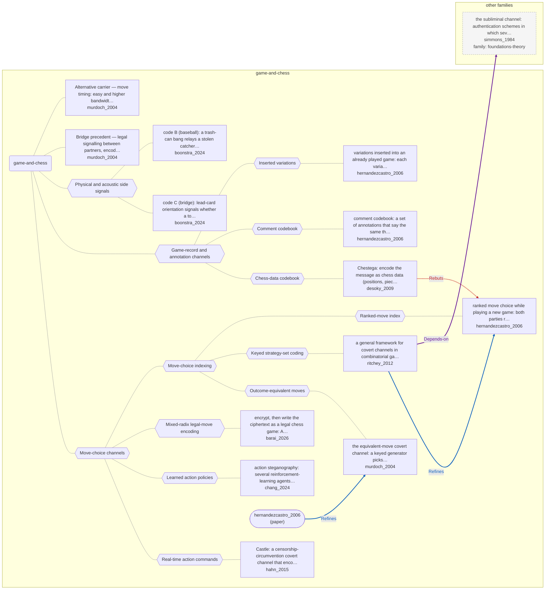

# Approach map — game-and-chess

Built by `tools/build_approach_map.py` from `C:\Users\user\Documents\GitHub\hypersteg_chess\hypersteg_novelty_kit_20261108\literature\verified_claims`, the features table `C:\Users\user\Documents\GitHub\hypersteg_chess\hypersteg_novelty_kit_20261108\maps\approach_features.tsv` and the technique taxonomy `C:\Users\user\Documents\GitHub\hypersteg_chess\hypersteg_novelty_kit_20261108\maps\technique_taxonomy.tsv`. View: `both`. Overview: [approach_map.md](approach_map.md).

- approaches: 13
- techniques: 13

## Legend

| link | arrow | colour | source |
| --- | --- | --- | --- |
| taxonomy (family → technique → approach) | `---` | #9e9e9e, thin | technique taxonomy and features table |
| Supports | `-->` | #2e7d32, thick | stated by a paper (ledger edge) |
| Rebuts | `-.->` | #c62828, thick | stated by a paper (ledger edge) |
| Depends-on | `==>` | #6a1b9a, thick | stated by a paper (ledger edge) |
| Refines | `-->` | #1565c0, thick | stated by a paper (ledger edge) |
| Qualifies | `-.->` | #ef6c00, thick | stated by a paper (ledger edge) |
| Restates | `<-->` | #00838f, thick | stated by a paper (ledger edge) |
| Duplicate-of | `o--o` | #757575, thick | stated by a paper (ledger edge) |
| Supersedes | `--x` | #4e342e, thick | stated by a paper (ledger edge) |

## Techniques

| technique | parent | name | definition | grounded by | approaches |
| --- | --- | --- | --- | --- | --- |
| `gc-action-commands` | gc-move-choice | Real-time action commands | Bits are carried by player commands in a real-time game, such as which units are selected, through a combinatorial selection scheme. | `hahn_2015:combinatorial-selection-encoding` | 1 |
| `gc-chess-data-codebook` | gc-record-annotation | Chess-data codebook | Message symbols are mapped to chess content (squares, pieces, players) written in chess-related text. | `desoky_2009:approach-chestega` | 1 |
| `gc-comment-codebook` | gc-record-annotation | Comment codebook | Synonymous annotation comments each stand for a bit pattern. | `hernandezcastro_2006:approach-comment-codebook` | 1 |
| `gc-equivalent-moves` | gc-move-index | Outcome-equivalent moves | A keyed generator chooses among moves that lead to the same outcome. | `murdoch_2004:approach-equivalent-move-channel` | 1 |
| `gc-keyed-strategy-set` | gc-move-index | Keyed strategy-set coding | The set of best moves is permuted by a shared random number generator and seed, and message bits index into the permuted set. | `ritchey_2012:permuted-best-move-index` | 1 |
| `gc-learned-action-policies` | gc-move-choice | Learned action policies | Each message symbol has its own trained policy and the receiver decodes by recognising which policy produced the actions. | `chang_2024:approach-action-steganography` | 1 |
| `gc-mixed-radix` | gc-move-choice | Mixed-radix legal-move encoding | Ciphertext read as an integer is written digit by digit as choices among all legal moves, each position supplying its own radix. | `barai_2026:mixed-radix-legal-move-index` | 1 |
| `gc-move-choice` | — | Move-choice channels | The message decides which legal move or action is played. | `hernandezcastro_2006:move-choice-threshold` | 6 |
| `gc-move-index` | gc-move-choice | Move-choice indexing | A prearranged criterion orders a set of acceptable moves, and the index of the move played sends that value. | `hernandezcastro_2006:both-embed-and-prior-art` | 3 |
| `gc-ranked-moves` | gc-move-index | Ranked-move index | A shared engine lists acceptable moves in order and the index of the move played carries bits. | `hernandezcastro_2006:approach-ranked-move-choice` | 1 |
| `gc-record-annotation` | — | Game-record and annotation channels | The message sits in material around the moves: comments, inserted variations or chess data in text. | `hernandezcastro_2006:comment-codebook` | 3 |
| `gc-side-signals` | — | Physical and acoustic side signals | Players signal hidden information through an agreed physical act outside the game moves, such as card orientation or a sound. | `boonstra_2024:surveyed-card-orientation-code-c` | 2 |
| `gc-variation-insertion` | gc-record-annotation | Inserted variations | Bits are carried by where a variation starts in an already played game, its length and its moves. | `hernandezcastro_2006:approach-variation-carrier` | 1 |

## Lineage edges (4)

| source | kind | target | lifted_from | ledger line |
| --- | --- | --- | --- | --- |
| `desoky_2009:approach-chestega` | Rebuts | `hernandezcastro_2006:approach-ranked-move-choice` | `desoky_2009:rebuts-hernandezcastro` | desoky_2009.md:167 |
| `paper:hernandezcastro_2006` | Refines | `murdoch_2004:approach-equivalent-move-channel` | `hernandezcastro_2006:prior-art-murdoch` | hernandezcastro_2006.md:173 |
| `ritchey_2012:approach-combinatorial-game-framework` | Depends-on | `simmons_1984:approach-subliminal-channel` | `ritchey_2012:builds-on-prisoners-problem` | ritchey_2012.md:161 |
| `ritchey_2012:approach-combinatorial-game-framework` | Refines | `hernandezcastro_2006:approach-ranked-move-choice` | `ritchey_2012:builds-on-hernandezcastro` | ritchey_2012.md:149 |

## Approaches

| address | name | family | technique | channel | key | access | capacity | mechanism | landable | mechanism_evidence | carrier | acquisition |
| --- | --- | --- | --- | --- | --- | --- | --- | --- | --- | --- | --- | --- |
| `barai_2026:approach-pgn-mixed-radix` | encrypt, then write the ciphertext as a legal chess game: AES-256-GCM output, read as a large integer, is mapped deterministically to a sequence of legal moves in PGN, with variation trees for longer messages | game-and-chess | gc-mixed-radix | move choice | shared-key | — | about 4.3 bits per ply; about 430 bits per 100-move game | m-mixed-radix-index | yes | sibling:mixed-radix-legal-move-index | choice among all legal moves (PGN) | specified |
| `boonstra_2024:surveyed-card-orientation-code-c` | code C (bridge): lead-card orientation signals whether a top honour is held, and the opposing declarer is unaware of the signal | game-and-chess | gc-side-signals | other (physical card orientation) | codebook | — | one bit per lead | m-orientation-signal | yes | own | orientation of the lead card | negotiated |
| `boonstra_2024:surveyed-trash-can-code-b` | code B (baseball): a trash-can bang relays a stolen catcher's sign for any non-fastball, silence for a fastball | game-and-chess | gc-side-signals | other (acoustic signal) | codebook | — | one bit per pitch | m-acoustic-signal | yes | own | trash-can bangs | negotiated |
| `chang_2024:approach-action-steganography` | action steganography: several reinforcement-learning agents each stand for one message symbol, and the receiver decodes by identifying which agent produced the observed episode | game-and-chess | gc-learned-action-policies | move choice | shared-key | training | one bit per trajectory (two agents) | m-policy-identity | yes | own | agent episodes (trajectories in a labyrinth) | rl-trained |
| `desoky_2009:approach-chestega` | Chestega: encode the message as chess data (positions, pieces, moves, tournaments, players) inside a chess-related document, preferably authentic games or tool-generated analysis, with a public method and an agreed configuration instead of a key | game-and-chess | gc-chess-data-codebook | other (chess-data content: target squares, pieces, players' initials, via an agreed codebook) | codebook | — | example: 7 bits per move as a target-square index; 4-bit slices as letters via player initials | m-reference-code; m-authentic-record-selection; m-letter-position | yes | partial;sibling:target-square-index;sibling:player-initial-codebook | chess data (squares, pieces, players) in chess-related text | specified |
| `hahn_2015:approach-castle` | Castle: a censorship-circumvention covert channel that encodes data as real-time-strategy player actions, executed by desktop automation and carried by the game's own network protocol, adaptable across games of one genre | game-and-chess | gc-action-commands | other (player action commands: k-of-n unit selection and target map location) | — | — | 50 to 200 B/s generally; about 190 B/s on 0 A.D.; over 400 B/s with tuning | m-combinatorial-subset-index | yes | partial | unit selections and commands in a real-time strategy game | specified |
| `hernandezcastro_2006:approach-comment-codebook` | comment codebook: a set of annotations that say the same thing (eight here, so three bits), open to any text-steganography technique, easy to strip | game-and-chess | gc-comment-codebook | lexical | codebook | — | three bits per comment from a set of eight | m-phrase-codebook | yes | own | annotation comments in a game record | specified |
| `hernandezcastro_2006:approach-ranked-move-choice` | ranked move choice while playing a new game: both parties run the same engine with a shared key, list the moves scoring above a threshold T, sort them by evaluation and play the i-th to send i | game-and-chess | gc-ranked-moves | move choice | shared-key | — | about log2 of the number of good moves per position; three bits per move in StegoGo | m-engine-ranked-index | yes | own | choice among engine-ranked moves | specified |
| `hernandezcastro_2006:approach-variation-carrier` | variations inserted into an already played game: each variant encodes bits by where it starts, how long it runs and, move by move, the ranked-choice rule | game-and-chess | gc-variation-insertion | structural-format | shared-key | — | — | m-insertion-parameters; m-engine-ranked-index | yes | own;own | variations inserted into a played game record | specified |
| `murdoch_2004:approach-equivalent-move-channel` | the equivalent-move covert channel: a keyed generator picks which of the outcome-equivalent moves to play, borrowing frequency hopping from low-probability-of-intercept radio, so colluders authenticate one another through the moves alone | game-and-chess | gc-equivalent-moves | move choice | shared-key | — | one bit (authentication) before the result is fixed; low capacity, high reliability | m-equivalent-choice | yes | sibling:equivalent-move-channel | choice among outcome-equivalent moves (Connect-4) | specified |
| `murdoch_2004:bridge-shared-secret-key` | Bridge precedent — legal signalling between partners, encoded in the cards played, with a shared secret acting as a key | game-and-chess | — | move choice | shared-key | — | — | m-keyed-play-convention | yes | own | cards played | unknown |
| `murdoch_2004:move-timing-channel` | Alternative carrier — move timing: easy and higher bandwidth, but unreliable under jitter and removable by fixing move times | game-and-chess | — | — | — | — | relatively high bandwidth | m-move-timing | yes | own | delay before each move | unknown |
| `ritchey_2012:approach-combinatorial-game-framework` | a general framework for covert channels in combinatorial games: the sender generates the cover by playing, assigns bit strings to the moves her strategies allow, and plays the move whose string matches the next data; shown on Tic-Tac-Toe, said to carry to Chess and Go | game-and-chess | gc-keyed-strategy-set | move choice | shared-key | — | up to floor(log2 N) bits per move; reduced but non-zero under perfect play | m-keyed-strategy-set-index | yes | sibling:permuted-best-move-index | choice among moves the sender's strategies allow | specified |
