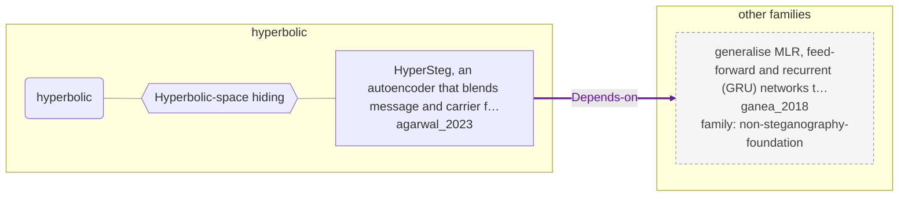

# Approach map — hyperbolic

Built by `tools/build_approach_map.py` from `C:\Users\user\Documents\GitHub\hypersteg_chess\hypersteg_novelty_kit_20261108\literature\verified_claims`, the features table `C:\Users\user\Documents\GitHub\hypersteg_chess\hypersteg_novelty_kit_20261108\maps\approach_features.tsv` and the technique taxonomy `C:\Users\user\Documents\GitHub\hypersteg_chess\hypersteg_novelty_kit_20261108\maps\technique_taxonomy.tsv`. View: `both`. Overview: [approach_map.md](approach_map.md).

- approaches: 1
- techniques: 1

## Legend

| link | arrow | colour | source |
| --- | --- | --- | --- |
| taxonomy (family → technique → approach) | `---` | #9e9e9e, thin | technique taxonomy and features table |
| Supports | `-->` | #2e7d32, thick | stated by a paper (ledger edge) |
| Rebuts | `-.->` | #c62828, thick | stated by a paper (ledger edge) |
| Depends-on | `==>` | #6a1b9a, thick | stated by a paper (ledger edge) |
| Refines | `-->` | #1565c0, thick | stated by a paper (ledger edge) |
| Qualifies | `-.->` | #ef6c00, thick | stated by a paper (ledger edge) |
| Restates | `<-->` | #00838f, thick | stated by a paper (ledger edge) |
| Duplicate-of | `o--o` | #757575, thick | stated by a paper (ledger edge) |
| Supersedes | `--x` | #4e342e, thick | stated by a paper (ledger edge) |

## Techniques

| technique | parent | name | definition | grounded by | approaches |
| --- | --- | --- | --- | --- | --- |
| `hy-hyperbolic-hiding` | — | Hyperbolic-space hiding | Message and carrier features are blended in a Poincare ball rather than in Euclidean space. | `agarwal_2023:approach-hypersteg` | 1 |

## Lineage edges (1)

| source | kind | target | lifted_from | ledger line |
| --- | --- | --- | --- | --- |
| `agarwal_2023:approach-hypersteg` | Depends-on | `ganea_2018:approach-hyperbolic-neural-networks` | — | agarwal_2023.md:195 |

## Approaches

| address | name | family | technique | channel | key | access | capacity | mechanism | landable | mechanism_evidence | carrier | acquisition |
| --- | --- | --- | --- | --- | --- | --- | --- | --- | --- | --- | --- | --- |
| `agarwal_2023:approach-hypersteg` | HyperSteg, an autoencoder that blends message and carrier features on the Poincaré ball, built on hyperbolic neural networks | hyperbolic | hy-hyperbolic-hiding | latent-generative | — | training | — | m-hyperbolic-blending | yes | sibling:hypersteg-poincare-beta-concatenation | image or audio carrier features | weight-trained |
