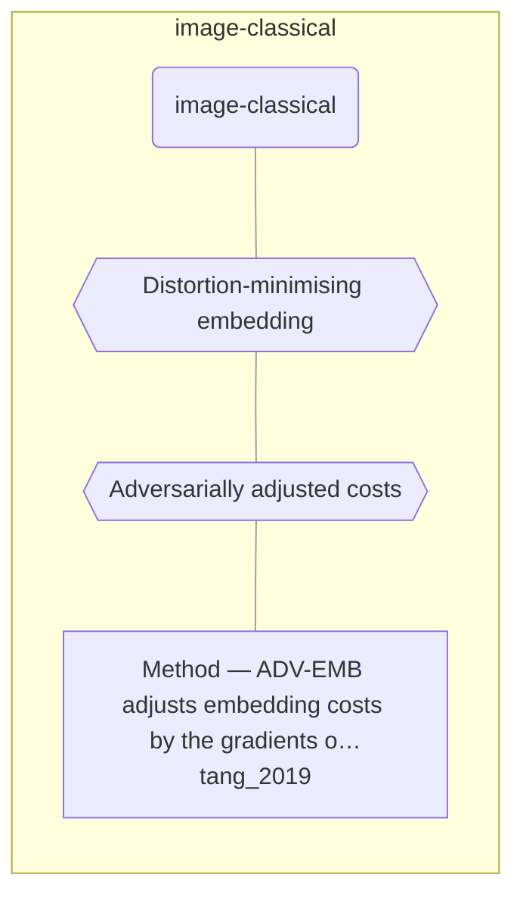

# Approach map — image-classical

Built by `tools/build_approach_map.py` from `C:\Users\user\Documents\GitHub\hypersteg_chess\hypersteg_novelty_kit_20261108\literature\verified_claims`, the features table `C:\Users\user\Documents\GitHub\hypersteg_chess\hypersteg_novelty_kit_20261108\maps\approach_features.tsv` and the technique taxonomy `C:\Users\user\Documents\GitHub\hypersteg_chess\hypersteg_novelty_kit_20261108\maps\technique_taxonomy.tsv`. View: `both`. Overview: [approach_map.md](approach_map.md).

- approaches: 1
- techniques: 2

## Legend

| link | arrow | colour | source |
| --- | --- | --- | --- |
| taxonomy (family → technique → approach) | `---` | #9e9e9e, thin | technique taxonomy and features table |
| Supports | `-->` | #2e7d32, thick | stated by a paper (ledger edge) |
| Rebuts | `-.->` | #c62828, thick | stated by a paper (ledger edge) |
| Depends-on | `==>` | #6a1b9a, thick | stated by a paper (ledger edge) |
| Refines | `-->` | #1565c0, thick | stated by a paper (ledger edge) |
| Qualifies | `-.->` | #ef6c00, thick | stated by a paper (ledger edge) |
| Restates | `<-->` | #00838f, thick | stated by a paper (ledger edge) |
| Duplicate-of | `o--o` | #757575, thick | stated by a paper (ledger edge) |
| Supersedes | `--x` | #4e342e, thick | stated by a paper (ledger edge) |

## Techniques

| technique | parent | name | definition | grounded by | approaches |
| --- | --- | --- | --- | --- | --- |
| `ic-adversarial-costs` | ic-distortion-minimisation | Adversarially adjusted costs | Embedding costs are made asymmetric by the gradient of a target steganalyser so the stego image also fools it. | `tang_2019:approach-adv-emb` | 1 |
| `ic-distortion-minimisation` | — | Distortion-minimising embedding | Embedding assigns costs to modifications of image elements and works under the framework of minimising total distortion. | `tang_2019:approach-adv-emb` | 1 |

## Lineage edges (0)

| source | kind | target | lifted_from | ledger line |
| --- | --- | --- | --- | --- |

## Approaches

| address | name | family | technique | channel | key | access | capacity | mechanism | landable | mechanism_evidence | carrier | acquisition |
| --- | --- | --- | --- | --- | --- | --- | --- | --- | --- | --- | --- | --- |
| `tang_2019:approach-adv-emb` | Method — ADV-EMB adjusts embedding costs by the gradients of a target CNN steganalyser | image-classical | ic-adversarial-costs | transform-domain | — | weights | 0.1 to 0.5 bpnzAC (JPEG); 0.4 bpp in the spatial extension | m-adversarial-costs | yes | own | JPEG coefficient modifications | specified |
