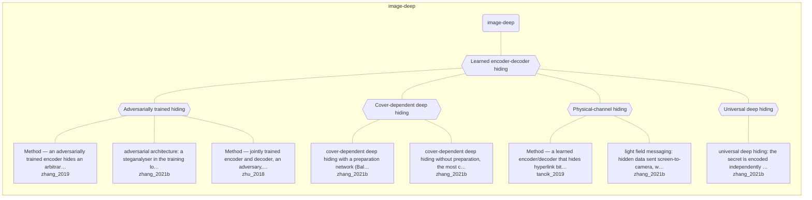

# Approach map — image-deep

Built by `tools/build_approach_map.py` from `C:\Users\user\Documents\GitHub\hypersteg_chess\hypersteg_novelty_kit_20261108\literature\verified_claims`, the features table `C:\Users\user\Documents\GitHub\hypersteg_chess\hypersteg_novelty_kit_20261108\maps\approach_features.tsv` and the technique taxonomy `C:\Users\user\Documents\GitHub\hypersteg_chess\hypersteg_novelty_kit_20261108\maps\technique_taxonomy.tsv`. View: `both`. Overview: [approach_map.md](approach_map.md).

- approaches: 8
- techniques: 5

## Legend

| link | arrow | colour | source |
| --- | --- | --- | --- |
| taxonomy (family → technique → approach) | `---` | #9e9e9e, thin | technique taxonomy and features table |
| Supports | `-->` | #2e7d32, thick | stated by a paper (ledger edge) |
| Rebuts | `-.->` | #c62828, thick | stated by a paper (ledger edge) |
| Depends-on | `==>` | #6a1b9a, thick | stated by a paper (ledger edge) |
| Refines | `-->` | #1565c0, thick | stated by a paper (ledger edge) |
| Qualifies | `-.->` | #ef6c00, thick | stated by a paper (ledger edge) |
| Restates | `<-->` | #00838f, thick | stated by a paper (ledger edge) |
| Duplicate-of | `o--o` | #757575, thick | stated by a paper (ledger edge) |
| Supersedes | `--x` | #4e342e, thick | stated by a paper (ledger edge) |

## Techniques

| technique | parent | name | definition | grounded by | approaches |
| --- | --- | --- | --- | --- | --- |
| `id-adversarial-training` | id-deep-hiding | Adversarially trained hiding | A steganalyser or discriminator is trained in the loop against the encoder. | `zhang_2021b:surveyed-adversarial-architecture` | 3 |
| `id-cover-dependent` | id-deep-hiding | Cover-dependent deep hiding | The hiding network sees both cover and secret, with or without a preparation network. | `zhang_2021b:surveyed-ddh-with-preparation` | 2 |
| `id-deep-hiding` | — | Learned encoder-decoder hiding | An encoder network takes the cover image and the message and outputs a residual that is added back to the image; a decoder network recovers the message. | `tancik_2019:residual-encoder` | 8 |
| `id-physical-channel` | id-deep-hiding | Physical-channel hiding | Training simulates printing, display and camera capture so the message survives a physical channel. | `tancik_2019:approach-stegastamp` | 2 |
| `id-universal` | id-deep-hiding | Universal deep hiding | The secret is encoded independently of the cover and the same perturbation can be added to any cover. | `zhang_2021b:surveyed-universal-deep-hiding` | 1 |

## Lineage edges (0)

| source | kind | target | lifted_from | ledger line |
| --- | --- | --- | --- | --- |

## Approaches

| address | name | family | technique | channel | key | access | capacity | mechanism | landable | mechanism_evidence | carrier | acquisition |
| --- | --- | --- | --- | --- | --- | --- | --- | --- | --- | --- | --- | --- |
| `tancik_2019:approach-stegastamp` | Method — a learned encoder/decoder that hides hyperlink bitstrings in photos, robust to printing and photography | image-deep | id-physical-channel | pixel-spatial | shared-model | training | 100 encoded bits per image; at least 56 bits after BCH error correction | m-physical-channel-training; m-residual-encoder | yes | own;sibling:residual-encoder | printed or displayed photographs, re-captured | weight-trained |
| `zhang_2019:approach-steganogan` | Method — an adversarially trained encoder hides an arbitrary bit tensor in a cover image; a decoder recovers it | image-deep | id-adversarial-training | pixel-spatial | shared-model | training | up to 4.4 RS-bpp (Reed–Solomon-corrected); 2 bpp while Ye-net auROC stays at or below 0.8 | m-adversarial-training; m-cover-conditioned-encoder | yes | own;own | cover image pixels | weight-trained |
| `zhang_2021b:surveyed-adversarial-architecture` | adversarial architecture: a steganalyser in the training loop, a three-player game; it does not guarantee resistance to an independently trained steganalyser | image-deep | id-adversarial-training | pixel-spatial | — | training | — | m-adversarial-training | yes | own | image pixels | weight-trained |
| `zhang_2021b:surveyed-ddh-with-preparation` | cover-dependent deep hiding with a preparation network (Baluja): a full image hidden in another, at 24 bpp, and easily detected | image-deep | id-cover-dependent | pixel-spatial | — | — | 24 bpp (a full-size colour image in another of the same size) | m-media-embedding | yes | own | image pixels | weight-trained |
| `zhang_2021b:surveyed-ddh-without-preparation` | cover-dependent deep hiding without preparation, the most common architecture | image-deep | id-cover-dependent | pixel-spatial | — | — | — | m-media-embedding | yes | own | image pixels | weight-trained |
| `zhang_2021b:surveyed-light-field-messaging` | light field messaging: hidden data sent screen-to-camera, with robustness rather than undetectability as the goal | image-deep | id-physical-channel | pixel-spatial | — | — | — | m-physical-channel-training | yes | own | images shown on a screen and photographed | weight-trained |
| `zhang_2021b:surveyed-universal-deep-hiding` | universal deep hiding: the secret is encoded independently of the cover and can be added to any cover | image-deep | id-universal | pixel-spatial | — | — | — | m-universal-perturbation | yes | own | image pixels | weight-trained |
| `zhu_2018:approach-hidden` | Method — jointly trained encoder and decoder, an adversary, and optional noise layers between them | image-deep | id-adversarial-training | pixel-spatial | shared-model | training | 0.203 bpp (52 bits per 16×16 patch), bit error below 1e-5 | m-cover-conditioned-encoder; m-attack-simulated-training; m-adversarial-training | yes | own;own;partial | image pixels | weight-trained |
