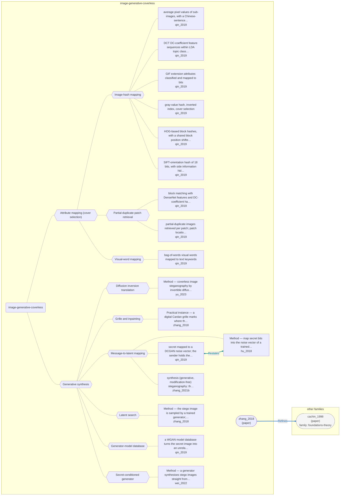

# Approach map — image-generative-coverless

Built by `tools/build_approach_map.py` from `C:\Users\user\Documents\GitHub\hypersteg_chess\hypersteg_novelty_kit_20261108\literature\verified_claims`, the features table `C:\Users\user\Documents\GitHub\hypersteg_chess\hypersteg_novelty_kit_20261108\maps\approach_features.tsv` and the technique taxonomy `C:\Users\user\Documents\GitHub\hypersteg_chess\hypersteg_novelty_kit_20261108\maps\technique_taxonomy.tsv`. View: `both`. Overview: [approach_map.md](approach_map.md).

- approaches: 17
- techniques: 11

## Legend

| link | arrow | colour | source |
| --- | --- | --- | --- |
| taxonomy (family → technique → approach) | `---` | #9e9e9e, thin | technique taxonomy and features table |
| Supports | `-->` | #2e7d32, thick | stated by a paper (ledger edge) |
| Rebuts | `-.->` | #c62828, thick | stated by a paper (ledger edge) |
| Depends-on | `==>` | #6a1b9a, thick | stated by a paper (ledger edge) |
| Refines | `-->` | #1565c0, thick | stated by a paper (ledger edge) |
| Qualifies | `-.->` | #ef6c00, thick | stated by a paper (ledger edge) |
| Restates | `<-->` | #00838f, thick | stated by a paper (ledger edge) |
| Duplicate-of | `o--o` | #757575, thick | stated by a paper (ledger edge) |
| Supersedes | `--x` | #4e342e, thick | stated by a paper (ledger edge) |

## Techniques

| technique | parent | name | definition | grounded by | approaches |
| --- | --- | --- | --- | --- | --- |
| `igc-attribute-mapping` | — | Attribute mapping (cover selection) | Unmodified natural images are chosen because their own attributes map to the message under an agreed rule. | `qin_2019:coverless-definition` | 9 |
| `igc-diffusion-inversion` | igc-generative-synthesis | Diffusion inversion translation | A diffusion model inverts a secret image and regenerates it under another condition as the container, and the receiver inverts back. | `yu_2023:approach-cross` | 1 |
| `igc-generative-synthesis` | — | Generative synthesis | A shared generator produces the container image directly from the message, so no cover is modified. | `zhang_2021b:surveyed-synthesis-generative` | 8 |
| `igc-grille-inpainting` | igc-generative-synthesis | Grille and inpainting | The message is written at positions marked by a shared mask and a generator inpaints the rest of the image. | `zhang_2018:approach-cardan-grille-inpainting` | 1 |
| `igc-hash-mapping` | igc-attribute-mapping | Image-hash mapping | A hash of low-level features (grey values, HOG, SIFT, DCT, deep features, file attributes) is matched to message segments through an index. | `qin_2019:surveyed-gray-hash-selection` | 6 |
| `igc-latent-mapping` | igc-generative-synthesis | Message-to-latent mapping | Message bits are mapped to the generator's input noise and a trained extractor recovers them from the image. | `hu_2018:approach-dcgan-swe` | 3 |
| `igc-latent-search` | igc-generative-synthesis | Latent search | The generator's latent space is searched for a code whose output carries the message. | `zhang_2018:approach-gss` | 1 |
| `igc-model-database` | igc-generative-synthesis | Generator-model database | A database of generator models turns a secret image into an unrelated-looking image and back. | `qin_2019:surveyed-wgan-model-database` | 1 |
| `igc-patch-retrieval` | igc-attribute-mapping | Partial-duplicate patch retrieval | Patches of a secret image are matched by retrieved natural images and stitched back at the receiver. | `qin_2019:surveyed-partial-duplicates` | 2 |
| `igc-secret-conditioned-generator` | igc-generative-synthesis | Secret-conditioned generator | A module inside the generator writes the secret into its feature maps during image generation. | `wei_2022:approach-gsn` | 1 |
| `igc-visual-word-mapping` | igc-attribute-mapping | Visual-word mapping | Visual words found in images are mapped to text keywords so selected images express a text message. | `qin_2019:surveyed-bow-visual-words` | 1 |

## Lineage edges (2)

| source | kind | target | lifted_from | ledger line |
| --- | --- | --- | --- | --- |
| `paper:zhang_2018` | Refines | `paper:cachin_1998` | `zhang_2018:js-epsilon-security`, `cachin_1998:relative-entropy-security` | zhang_2018.md:92 |
| `qin_2019:surveyed-dcgan-noise-vector` | Restates | `hu_2018:approach-dcgan-swe` | — | qin_2019.md:216 |

## Approaches

| address | name | family | technique | channel | key | access | capacity | mechanism | landable | mechanism_evidence | carrier | acquisition |
| --- | --- | --- | --- | --- | --- | --- | --- | --- | --- | --- | --- | --- |
| `hu_2018:approach-dcgan-swe` | Method — map secret bits into the noise vector of a trained DCGAN generator; no embedding | image-generative-coverless | igc-latent-mapping | latent-generative | shared-model | training | σ bits per noise value, 3×\|z\| bits per image; 9.16e-3 bytes/pixel; recovery accuracy about 0.89–0.96, not 100% | m-latent-mapping | yes | own | generated images (generator noise vector) | weight-trained |
| `qin_2019:surveyed-average-pixel-dictionary` | average pixel values of sub-images, with a Chinese-sentence dictionary | image-generative-coverless | igc-hash-mapping | other (cover selection by average-pixel hash with dictionary) | — | — | — | m-cover-selection | yes | own | selected natural images (sub-image average pixels) | specified |
| `qin_2019:surveyed-bow-visual-words` | bag-of-words visual words mapped to text keywords | image-generative-coverless | igc-visual-word-mapping | other (cover selection by visual words) | shared-key | — | — | m-visual-word-mapping | yes | own | selected natural images (visual words) | specified |
| `qin_2019:surveyed-dcgan-noise-vector` | secret mapped to a DCGAN noise vector; the sender holds the generator, the receiver the extractor | image-generative-coverless | igc-latent-mapping | latent-generative | shared-model | training | — | m-latent-mapping | yes | own | generated images (generator noise vector) | weight-trained |
| `qin_2019:surveyed-dct-lda` | DCT DC-coefficient feature sequences within LDA topic classes | image-generative-coverless | igc-hash-mapping | other (cover selection by DCT feature sequence) | — | — | — | m-feature-hash-selection | yes | own | selected natural images (DCT feature sequences) | specified |
| `qin_2019:surveyed-densenet-block-matching` | block matching with DenseNet features and DC-coefficient hashes | image-generative-coverless | igc-patch-retrieval | other (cover selection by block matching) | — | — | — | m-patch-retrieval | yes | own | selected natural images (matching blocks) | specified |
| `qin_2019:surveyed-gif-attributes` | GIF extension attributes classified and mapped to bits | image-generative-coverless | igc-hash-mapping | other (cover selection by GIF extension attributes) | — | — | — | m-file-attribute-mapping | yes | own | selected GIF files (extension attributes) | specified |
| `qin_2019:surveyed-gray-hash-selection` | gray-value hash, inverted index, cover selection | image-generative-coverless | igc-hash-mapping | other (cover selection by image hash) | — | — | 8 bits per image | m-feature-hash-selection | yes | own | selected natural images (grey-value hashes) | specified |
| `qin_2019:surveyed-hog-hash` | HOG-based block hashes, with a shared block position shifted one-time-pad style | image-generative-coverless | igc-hash-mapping | other (cover selection by HOG hash) | shared-key | — | — | m-feature-hash-selection | yes | own | selected natural images (HOG hashes) | specified |
| `qin_2019:surveyed-partial-duplicates` | partial-duplicate images retrieved per patch; patch locations are the shared key | image-generative-coverless | igc-patch-retrieval | other (cover selection by partial-duplicate patch retrieval) | shared-key | — | — | m-patch-retrieval | yes | own | selected natural images (partial duplicates) | specified |
| `qin_2019:surveyed-sift-robust-hash` | SIFT-orientation hash of 18 bits, with side information hidden by LSB | image-generative-coverless | igc-hash-mapping | other (cover selection by SIFT hash, plus LSB side channel) | — | — | 18 bits per image | m-feature-hash-selection | yes | own | selected natural images (SIFT hashes) | specified |
| `qin_2019:surveyed-wgan-model-database` | a WGAN model database turns the secret image into an unrelated-looking image and back | image-generative-coverless | igc-model-database | latent-generative | shared-model | training | — | m-generator-model-database | yes | own | generated images | weight-trained |
| `wei_2022:approach-gsn` | Method — a generator synthesises stego images straight from secret data, with no cover | image-generative-coverless | igc-secret-conditioned-generator | latent-generative | shared-model | training | 1–8 bpp; extraction accuracy 97.5% at 1 bpp, about 59–61% at 8 bpp | m-secret-conditioned-generator | yes | own | generated images (generator feature maps) | weight-trained |
| `yu_2023:approach-cross` | Method — coverless image steganography by invertible diffusion translation, with no training | image-generative-coverless | igc-diffusion-inversion | latent-generative | shared-key | weights | one secret image per container image | m-diffusion-translation | yes | own | generated container images | specified |
| `zhang_2018:approach-cardan-grille-inpainting` | Practical instance — a digital Cardan grille marks where the message is written; semantic inpainting fills the rest | image-generative-coverless | igc-grille-inpainting | pixel-spatial | shared-key | training | recovery above 70% at bit plane 7; higher bit planes more stable | m-grille-inpainting | yes | own | pixels at grille positions of an inpainted image | weight-trained |
| `zhang_2018:approach-gss` | Method — the stego image is sampled by a trained generator; no explicit cover | image-generative-coverless | igc-latent-search | latent-generative | shared-key | training | 1.49e-3 to 1.10e-2 bytes per pixel, to be multiplied by the extraction rate | m-latent-search | yes | own | generated images (searched latent code) | weight-trained |
| `zhang_2021b:surveyed-synthesis-generative` | synthesis (generative, modification-free) steganography: the container is generated from the message by a shared generator and extractor | image-generative-coverless | igc-latent-mapping | latent-generative | shared-model | training | — | m-latent-mapping | yes | own | generated images | weight-trained |
