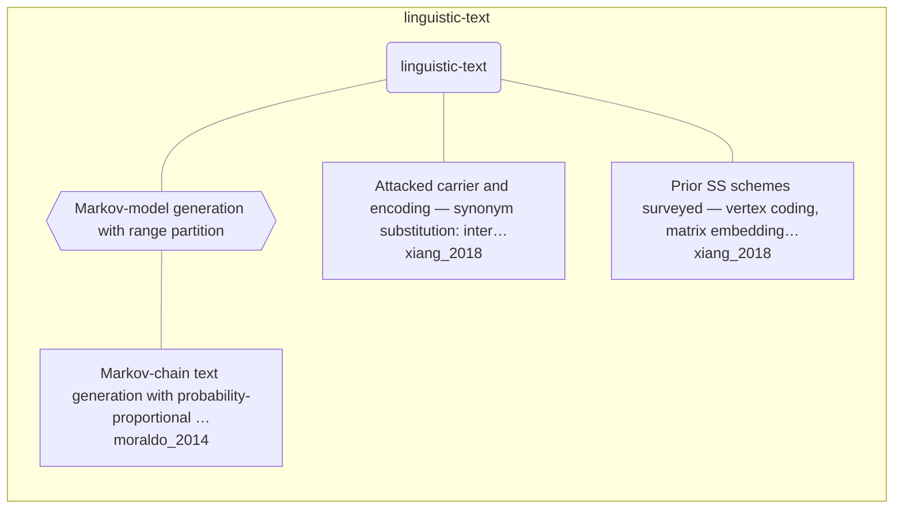

# Approach map — linguistic-text

Built by `tools/build_approach_map.py` from `C:\Users\user\Documents\GitHub\hypersteg_chess\hypersteg_novelty_kit_20261108\literature\verified_claims`, the features table `C:\Users\user\Documents\GitHub\hypersteg_chess\hypersteg_novelty_kit_20261108\maps\approach_features.tsv` and the technique taxonomy `C:\Users\user\Documents\GitHub\hypersteg_chess\hypersteg_novelty_kit_20261108\maps\technique_taxonomy.tsv`. View: `both`. Overview: [approach_map.md](approach_map.md).

- approaches: 3
- techniques: 1

## Legend

| link | arrow | colour | source |
| --- | --- | --- | --- |
| taxonomy (family → technique → approach) | `---` | #9e9e9e, thin | technique taxonomy and features table |
| Supports | `-->` | #2e7d32, thick | stated by a paper (ledger edge) |
| Rebuts | `-.->` | #c62828, thick | stated by a paper (ledger edge) |
| Depends-on | `==>` | #6a1b9a, thick | stated by a paper (ledger edge) |
| Refines | `-->` | #1565c0, thick | stated by a paper (ledger edge) |
| Qualifies | `-.->` | #ef6c00, thick | stated by a paper (ledger edge) |
| Restates | `<-->` | #00838f, thick | stated by a paper (ledger edge) |
| Duplicate-of | `o--o` | #757575, thick | stated by a paper (ledger edge) |
| Supersedes | `--x` | #4e342e, thick | stated by a paper (ledger edge) |

## Techniques

| technique | parent | name | definition | grounded by | approaches |
| --- | --- | --- | --- | --- | --- |
| `lt-markov-generation` | — | Markov-model generation with range partition | A message read as a number selects successive words from a Markov text model by probability-proportional ranges. | `moraldo_2014:approach-markov-range-partition` | 1 |

## Lineage edges (0)

| source | kind | target | lifted_from | ledger line |
| --- | --- | --- | --- | --- |

## Approaches

| address | name | family | technique | channel | key | access | capacity | mechanism | landable | mechanism_evidence | carrier | acquisition |
| --- | --- | --- | --- | --- | --- | --- | --- | --- | --- | --- | --- | --- |
| `moraldo_2014:approach-markov-range-partition` | Markov-chain text generation with probability-proportional range partitioning: the message, read as a number, picks at each word the outbound state whose subrange contains it, so the generated text keeps close to the chain's own transition probabilities | linguistic-text | lt-markov-generation | distributional-sampling | shared-model | — | encoded text about 6-7 times the data size (about 2 after compression) | m-interval-plain | yes | own | word choice in Markov-generated text | specified |
| `xiang_2018:ss-carrier-substitution-sets` | Attacked carrier and encoding — synonym substitution: interchangeable synonyms form a substitution set, and the choice among them carries the bits | linguistic-text | — | lexical | — | — | — | m-synonym-substitution; m-synonym-multibase | yes | own;own | choice among synonyms in a cover text | specified |
| `xiang_2018:ss-scheme-family` | Prior SS schemes surveyed — vertex coding, matrix embedding and syndrome-trellis codes to reduce embedding distortion | linguistic-text | — | lexical | — | — | matrix coding: k bits per 2^k - 1 cover synonyms | m-synonym-vertex-coding; m-synonym-matrix-embedding; m-synonym-stc | yes | own;own;own | choice among synonyms in a cover text | specified |
