# Approach map — llm-capability-eval

Built by `tools/build_approach_map.py` from `C:\Users\user\Documents\GitHub\hypersteg_chess\hypersteg_novelty_kit_20261108\literature\verified_claims`, the features table `C:\Users\user\Documents\GitHub\hypersteg_chess\hypersteg_novelty_kit_20261108\maps\approach_features.tsv` and the technique taxonomy `C:\Users\user\Documents\GitHub\hypersteg_chess\hypersteg_novelty_kit_20261108\maps\technique_taxonomy.tsv`. View: `both`. Overview: [approach_map.md](approach_map.md).

- approaches: 17
- techniques: 15

```mermaid
flowchart LR
  subgraph fam_llm_capability_eval_g["llm-capability-eval"]
    fam_llm_capability_eval("llm-capability-eval")
    tech_lce_agentic_construction{{"Agentic stegosystem construction"}}
    tech_lce_codeword_substitution{{"Codeword substitution"}}
    tech_lce_control_evaluations{{"Control evaluations"}}
    tech_lce_coordination_evals{{"Coordination-without-communication evaluations"}}
    tech_lce_encoded_reasoning{{"Prompted encoded reasoning"}}
    tech_lce_eval_frameworks{{"Evaluation frameworks and decompositions"}}
    tech_lce_message_passing{{"Encoded message passing"}}
    tech_lce_overt_encodings{{"Overt encodings as capabilities"}}
    tech_lce_partial_encoding{{"Graded partial encoding"}}
    tech_lce_prompted_elicitation{{"Prompted elicitation"}}
    tech_lce_rl_learned_codes{{"Codes learned under RL pressure"}}
    tech_lce_scheme_discovery{{"Scheme-discovery condition"}}
    tech_lce_stateless_subversion{{"Stateless protocol subversion"}}
    tech_lce_taught_schemes{{"Taught schemes"}}
    tech_lce_trained_elicitation{{"Training-induced steganography"}}
    n_anwar_2026_surveyed_codeword_codebook["codeword schemes for coin-flip reasoning (Sun/Moon, and a l…<br/>anwar_2026"]
    n_anwar_2026_surveyed_rot13_partial_encoding["word-level Rot13 encoding applied with probability p, as a …<br/>anwar_2026"]
    n_greenblatt_2023_approach_control_evaluation["control evaluations, in which a red team's attack policy st…<br/>greenblatt_2023"]
    n_karpov_2025_approach_colours_rl["the colours experiment, an RL-learnt unkeyed mapping withou…<br/>karpov_2025"]
    n_karpov_2025_approach_indirect_guess_game["the indirect guess game, in which an assistant may hide let…<br/>karpov_2025"]
    n_karpov_2025_approach_prompted_stego_eval["prompted evaluation of frontier models in direct, instructe…<br/>karpov_2025"]
    n_karpov_2025_synonym_scheme_given["Prompted schemes — synonym-substitution algorithm given to …<br/>karpov_2025"]
    n_mallen_2024_approach_subversion_strategy_eval["Subversion Strategy Eval, eight environments and six afford…<br/>mallen_2024"]
    n_mallen_2024_subversion_untrusted_monitoring_output_collusion["Untrusted-monitoring environment — one model plays generato…<br/>mallen_2024"]
    n_motwani_2024_approach_case_framework["CASE, a framework for evaluating secret collusion in indivi…<br/>motwani_2024"]
    n_rippin_2026_approach_agentic_covert_channel_construction["an agentic covert-channel construction benchmark, seeded wi…<br/>rippin_2026"]
    n_roger_2023_approach_finetuned_introduction_codebook["fine-tuning GPT-3.5-Turbo to learn a simple encoding scheme…<br/>roger_2023"]
    n_schulz_2026_approach_three_method_stego_elicitation["eliciting messaging, encoded reasoning and steganographic r…<br/>schulz_2026"]
    n_skaf_2025_approach_cot_penalty_rl["RL fine-tuning with an outcome reward minus a rule-based Co…<br/>skaf_2025"]
    n_tailor_2026_approach_rolewise_decomposition["rolewise decomposition: score what the encoder put in the t…<br/>tailor_2026"]
    n_zolkowski_2025_approach_encoded_message_passing_eval["an evaluation suite for encoded message passing under grade…<br/>zolkowski_2025"]
    n_zolkowski_2025_approach_encoded_reasoning_eval["the first evaluations of encoded reasoning, on hidden tasks…<br/>zolkowski_2025"]
    paper_karpov_2025(["karpov_2025<br/>(paper)"])
    paper_motwani_2024(["motwani_2024<br/>(paper)"])
    paper_rippin_2026(["rippin_2026<br/>(paper)"])
    paper_schulz_2026(["schulz_2026<br/>(paper)"])
    paper_zolkowski_2025(["zolkowski_2025<br/>(paper)"])
  end
  subgraph other_families["other families"]
    n_aharon_2026_approach_focal_point_evaluation["a large-scale study of focal points in LLMs, comparing taci…<br/>aharon_2026<br/>family: multi-agent-collusion"]
    n_buscemi_2026_approach_numeric_covert_games["numeric covert communication in canonical games, where agen…<br/>buscemi_2026<br/>family: multi-agent-collusion"]
    n_jarviniemi_2025_approach_meta_model_focal_collusion["meta-models that independently design policy and monitor pr…<br/>jarviniemi_2025<br/>family: multi-agent-collusion"]
    n_mathew_2024_approach_gbrl["gradient-based reinforcement learning (GBRL) of a sender an…<br/>mathew_2024<br/>family: multi-agent-collusion"]
    n_mathew_2024_approach_icrl["in-context reinforcement learning (ICRL), with centralised …<br/>mathew_2024<br/>family: multi-agent-collusion"]
    paper_mathew_2024(["mathew_2024<br/>(paper)<br/>family: multi-agent-collusion"])
    n_rose_2026_approach_helios["HELIOS, group-level collusion detection from per-agent acti…<br/>rose_2026<br/>family: steganalysis"]
    n_schroederdewitt_2022_approach_imec["minimum entropy coupling steganography (iMEC): encode by co…<br/>schroederdewitt_2022<br/>family: llm-generative-text"]
    n_zamir_2024_approach_undetectable_llm_stego["undetectable LLM steganography: the CGZ undetectable waterm…<br/>zamir_2024<br/>family: llm-generative-text"]
  end
  tech_lce_prompted_elicitation --- tech_lce_agentic_construction
  fam_llm_capability_eval --- tech_lce_codeword_substitution
  fam_llm_capability_eval --- tech_lce_control_evaluations
  fam_llm_capability_eval --- tech_lce_coordination_evals
  tech_lce_prompted_elicitation --- tech_lce_encoded_reasoning
  fam_llm_capability_eval --- tech_lce_eval_frameworks
  tech_lce_prompted_elicitation --- tech_lce_message_passing
  tech_lce_prompted_elicitation --- tech_lce_overt_encodings
  tech_lce_overt_encodings --- tech_lce_partial_encoding
  fam_llm_capability_eval --- tech_lce_prompted_elicitation
  tech_lce_trained_elicitation --- tech_lce_rl_learned_codes
  tech_lce_prompted_elicitation --- tech_lce_scheme_discovery
  tech_lce_coordination_evals --- tech_lce_stateless_subversion
  tech_lce_trained_elicitation --- tech_lce_taught_schemes
  fam_llm_capability_eval --- tech_lce_trained_elicitation
  tech_lce_codeword_substitution --- n_anwar_2026_surveyed_codeword_codebook
  tech_lce_partial_encoding --- n_anwar_2026_surveyed_rot13_partial_encoding
  tech_lce_control_evaluations --- n_greenblatt_2023_approach_control_evaluation
  tech_lce_rl_learned_codes --- n_karpov_2025_approach_colours_rl
  tech_lce_message_passing --- n_karpov_2025_approach_indirect_guess_game
  tech_lce_message_passing --- n_karpov_2025_approach_prompted_stego_eval
  fam_llm_capability_eval --- n_karpov_2025_synonym_scheme_given
  tech_lce_stateless_subversion --- n_mallen_2024_approach_subversion_strategy_eval
  fam_llm_capability_eval --- n_mallen_2024_subversion_untrusted_monitoring_output_collusion
  tech_lce_eval_frameworks --- n_motwani_2024_approach_case_framework
  tech_lce_agentic_construction --- n_rippin_2026_approach_agentic_covert_channel_construction
  tech_lce_taught_schemes --- n_roger_2023_approach_finetuned_introduction_codebook
  tech_lce_taught_schemes --- n_schulz_2026_approach_three_method_stego_elicitation
  tech_lce_rl_learned_codes --- n_skaf_2025_approach_cot_penalty_rl
  tech_lce_eval_frameworks --- n_tailor_2026_approach_rolewise_decomposition
  tech_lce_message_passing --- n_zolkowski_2025_approach_encoded_message_passing_eval
  tech_lce_encoded_reasoning --- n_zolkowski_2025_approach_encoded_reasoning_eval
  n_buscemi_2026_approach_numeric_covert_games -->|Refines| n_motwani_2024_approach_case_framework
  n_jarviniemi_2025_approach_meta_model_focal_collusion -->|Supports| n_mallen_2024_approach_subversion_strategy_eval
  paper_karpov_2025 -->|Refines| n_mathew_2024_approach_gbrl
  n_mallen_2024_approach_subversion_strategy_eval -->|Refines| n_greenblatt_2023_approach_control_evaluation
  paper_mathew_2024 -->|Refines| n_motwani_2024_approach_case_framework
  paper_motwani_2024 ==>|Depends-on| n_schroederdewitt_2022_approach_imec
  n_rippin_2026_approach_agentic_covert_channel_construction ==>|Depends-on| n_zamir_2024_approach_undetectable_llm_stego
  paper_rippin_2026 -->|Refines| n_aharon_2026_approach_focal_point_evaluation
  n_rose_2026_approach_helios -->|Refines| n_greenblatt_2023_approach_control_evaluation
  paper_schulz_2026 -->|Supports| n_zolkowski_2025_approach_encoded_reasoning_eval
  paper_schulz_2026 -.->|Qualifies| n_zolkowski_2025_approach_encoded_reasoning_eval
  paper_schulz_2026 -.->|Qualifies| n_skaf_2025_approach_cot_penalty_rl
  n_tailor_2026_approach_rolewise_decomposition -.->|Qualifies| n_zolkowski_2025_approach_encoded_message_passing_eval
  n_tailor_2026_approach_rolewise_decomposition -.->|Qualifies| n_motwani_2024_approach_case_framework
  n_tailor_2026_approach_rolewise_decomposition -.->|Qualifies| n_mathew_2024_approach_gbrl
  n_tailor_2026_approach_rolewise_decomposition -.->|Qualifies| n_mathew_2024_approach_icrl
  n_tailor_2026_approach_rolewise_decomposition -.->|Qualifies| n_karpov_2025_approach_prompted_stego_eval
  paper_zolkowski_2025 -->|Refines| n_motwani_2024_approach_case_framework
  linkStyle 0,1,2,3,4,5,6,7,8,9,10,11,12,13,14,15,16,17,18,19,20,21,22,23,24,25,26,27,28,29,30,31 stroke:#9e9e9e,stroke-width:1px
  linkStyle 32,34,35,36,39,40,49 stroke:#1565c0,stroke-width:2.5px,color:#1565c0
  linkStyle 33,41 stroke:#2e7d32,stroke-width:2.5px,color:#2e7d32
  linkStyle 37,38 stroke:#6a1b9a,stroke-width:2.5px,color:#6a1b9a
  linkStyle 42,43,44,45,46,47,48 stroke:#ef6c00,stroke-width:2.5px,color:#ef6c00
  classDef stub fill:#f5f5f5,stroke:#9e9e9e,stroke-dasharray:4 3,color:#424242
  class n_aharon_2026_approach_focal_point_evaluation,n_buscemi_2026_approach_numeric_covert_games,n_jarviniemi_2025_approach_meta_model_focal_collusion,n_mathew_2024_approach_gbrl,n_mathew_2024_approach_icrl,paper_mathew_2024,n_rose_2026_approach_helios,n_schroederdewitt_2022_approach_imec,n_zamir_2024_approach_undetectable_llm_stego stub
  classDef nonlanding fill:#eeeeee,stroke:#bdbdbd,stroke-dasharray:2 2,color:#9e9e9e
  class tech_lce_agentic_construction,tech_lce_control_evaluations,tech_lce_coordination_evals,tech_lce_encoded_reasoning,tech_lce_eval_frameworks,tech_lce_message_passing,tech_lce_prompted_elicitation,tech_lce_rl_learned_codes,tech_lce_scheme_discovery,tech_lce_stateless_subversion,tech_lce_taught_schemes,tech_lce_trained_elicitation nonlanding
```

## Legend

| link | arrow | colour | source |
| --- | --- | --- | --- |
| taxonomy (family → technique → approach) | `---` | #9e9e9e, thin | technique taxonomy and features table |
| Supports | `-->` | #2e7d32, thick | stated by a paper (ledger edge) |
| Rebuts | `-.->` | #c62828, thick | stated by a paper (ledger edge) |
| Depends-on | `==>` | #6a1b9a, thick | stated by a paper (ledger edge) |
| Refines | `-->` | #1565c0, thick | stated by a paper (ledger edge) |
| Qualifies | `-.->` | #ef6c00, thick | stated by a paper (ledger edge) |
| Restates | `<-->` | #00838f, thick | stated by a paper (ledger edge) |
| Duplicate-of | `o--o` | #757575, thick | stated by a paper (ledger edge) |
| Supersedes | `--x` | #4e342e, thick | stated by a paper (ledger edge) |

Muted, dashed nodes are marked not a landing node: they group the tree, and a novelty audit does not place a scheme at one. A child of such a node is one too unless its row says `landing: yes`.

## Techniques

| technique | parent | name | definition | grounded by | approaches |
| --- | --- | --- | --- | --- | --- |
| `lce-agentic-construction` | lce-prompted-elicitation | Agentic stegosystem construction (not a landing node) | A tool-using agent must build a working stegosystem from a provided paper, not merely describe one. | `rippin_2026:approach-agentic-covert-channel-construction` | 1 |
| `lce-codeword-substitution` | — | Codeword substitution | Agreed codewords stand in for the hidden states. | `anwar_2026:surveyed-codeword-codebook` | 1 |
| `lce-control-evaluations` | — | Control evaluations (not a landing node) | A blue team's protocol of trusted and untrusted models is scored by a red team's best attack, including collusion. | `greenblatt_2023:approach-control-evaluation` | 1 |
| `lce-coordination-evals` | — | Coordination-without-communication evaluations (not a landing node) | Models must coordinate with copies of themselves with no shared channel or memory. | `aharon_2026:approach-focal-point-evaluation` | 1 |
| `lce-encoded-reasoning` | lce-prompted-elicitation | Prompted encoded reasoning (not a landing node) | Models carry out hidden reasoning in an encoded form inside visible text. | `zolkowski_2025:approach-encoded-reasoning-eval` | 1 |
| `lce-eval-frameworks` | — | Evaluation frameworks and decompositions (not a landing node) | Frameworks that organise or split capability measurement (by capability or by role) rather than test one scheme. | `motwani_2024:approach-case-framework` | 2 |
| `lce-message-passing` | lce-prompted-elicitation | Encoded message passing (not a landing node) | An encoder hides a secret in its answer to a cover task for a decoder copy, and a monitor without the secret judges suspicion. | `zolkowski_2025:approach-encoded-message-passing-eval` | 3 |
| `lce-overt-encodings` | lce-prompted-elicitation | Overt encodings as capabilities | Standard encodings and ciphers are tested as a measure of whether models can encode and decode at all. | `zolkowski_2025:surveyed-byte-encodings` | 1 |
| `lce-partial-encoding` | lce-overt-encodings | Graded partial encoding | A cipher is applied to each word with a set probability, interpolating between legible and fully enciphered text. | `anwar_2026:surveyed-rot13-partial-encoding` | 1 |
| `lce-prompted-elicitation` | — | Prompted elicitation (not a landing node) | Models are prompted to act as encoder and decoder against a monitor, without any training on the task. | `zolkowski_2025:setting-encoder-decoder-monitor` | 6 |
| `lce-rl-learned-codes` | lce-trained-elicitation | Codes learned under RL pressure (not a landing node) | Reinforcement learning against penalised strings leads models to learn substitute encodings, which tend to rest on semantic links to the penalised strings. | `skaf_2025:arithmetic-semantic-substitutes` | 2 |
| `lce-scheme-discovery` | lce-prompted-elicitation | Scheme-discovery condition (not a landing node) | The model is asked to think of a scheme for the task, use it, and later re-derive it to decode; what it devises is not fixed. | `roger_2023:surveyed-scratchpad-scheme` | 0 |
| `lce-stateless-subversion` | lce-coordination-evals | Stateless protocol subversion (not a landing node) | A model must devise and act on a plan to subvert a control protocol across contexts with no shared memory. | `mallen_2024:approach-subversion-strategy-eval` | 1 |
| `lce-taught-schemes` | lce-trained-elicitation | Taught schemes (not a landing node) | A given scheme is instilled by fine-tuning, RL or in-context examples, and the study measures whether the model can use it. | `roger_2023:approach-finetuned-introduction-codebook` | 2 |
| `lce-trained-elicitation` | — | Training-induced steganography (not a landing node) | Fine-tuning or reinforcement learning is used to induce or teach hidden encoding. | `skaf_2025:approach-cot-penalty-rl` | 4 |

## Lineage edges (18)

| source | kind | target | lifted_from | ledger line |
| --- | --- | --- | --- | --- |
| `buscemi_2026:approach-numeric-covert-games` | Refines | `motwani_2024:approach-case-framework` | — | buscemi_2026.md:192 |
| `jarviniemi_2025:approach-meta-model-focal-collusion` | Supports | `mallen_2024:approach-subversion-strategy-eval` | `jarviniemi_2025:compatible-with-mallen` | jarviniemi_2025.md:170 |
| `mallen_2024:approach-subversion-strategy-eval` | Refines | `greenblatt_2023:approach-control-evaluation` | `mallen_2024:builds-on-ai-control` | mallen_2024.md:219 |
| `paper:karpov_2025` | Refines | `mathew_2024:approach-gbrl` | `karpov_2025:extends-mathew-multibit` | karpov_2025.md:219 |
| `paper:mathew_2024` | Refines | `motwani_2024:approach-case-framework` | `mathew_2024:builds-on` | mathew_2024.md:156 |
| `paper:motwani_2024` | Depends-on | `schroederdewitt_2022:approach-imec` | `motwani_2024:builds-on-ai-stego` | motwani_2024.md:184 |
| `paper:rippin_2026` | Refines | `aharon_2026:approach-focal-point-evaluation` | `rippin_2026:builds-on` | rippin_2026.md:189 |
| `paper:schulz_2026` | Qualifies | `skaf_2025:approach-cot-penalty-rl` | `schulz_2026:relation-zolkowski-skaf` | schulz_2026.md:232 |
| `paper:schulz_2026` | Qualifies | `zolkowski_2025:approach-encoded-reasoning-eval` | `schulz_2026:relation-zolkowski-skaf` | schulz_2026.md:231 |
| `paper:schulz_2026` | Supports | `zolkowski_2025:approach-encoded-reasoning-eval` | `schulz_2026:relation-zolkowski-skaf` | schulz_2026.md:230 |
| `paper:zolkowski_2025` | Refines | `motwani_2024:approach-case-framework` | `zolkowski_2025:contrast-prior-evals` | zolkowski_2025.md:202 |
| `rippin_2026:approach-agentic-covert-channel-construction` | Depends-on | `zamir_2024:approach-undetectable-llm-stego` | — | rippin_2026.md:171 |
| `rose_2026:approach-helios` | Refines | `greenblatt_2023:approach-control-evaluation` | — | rose_2026.md:217 |
| `tailor_2026:approach-rolewise-decomposition` | Qualifies | `karpov_2025:approach-prompted-stego-eval` | `tailor_2026:prior-e2e-recovery-named` | tailor_2026.md:206 |
| `tailor_2026:approach-rolewise-decomposition` | Qualifies | `mathew_2024:approach-gbrl` | `tailor_2026:prior-e2e-recovery-named` | tailor_2026.md:204 |
| `tailor_2026:approach-rolewise-decomposition` | Qualifies | `mathew_2024:approach-icrl` | `tailor_2026:prior-e2e-recovery-named` | tailor_2026.md:205 |
| `tailor_2026:approach-rolewise-decomposition` | Qualifies | `motwani_2024:approach-case-framework` | `tailor_2026:prior-e2e-recovery-named` | tailor_2026.md:203 |
| `tailor_2026:approach-rolewise-decomposition` | Qualifies | `zolkowski_2025:approach-encoded-message-passing-eval` | `tailor_2026:prior-e2e-recovery-named` | tailor_2026.md:202 |

## Approaches

| address | name | family | technique | channel | key | access | capacity | mechanism | landable | mechanism_evidence | carrier | acquisition |
| --- | --- | --- | --- | --- | --- | --- | --- | --- | --- | --- | --- | --- |
| `anwar_2026:surveyed-codeword-codebook` | codeword schemes for coin-flip reasoning (Sun/Moon, and a larger codebook) | llm-capability-eval | lce-codeword-substitution | lexical | codebook | prompt | one binary state per codeword | m-codeword-substitution | yes | own | words in a reasoning trace | prompted |
| `anwar_2026:surveyed-rot13-partial-encoding` | word-level Rot13 encoding applied with probability p, as a graded steganography simulation | llm-capability-eval | lce-partial-encoding | lexical | codebook | prompt | — | m-partial-word-cipher | yes | own | words in a reasoning trace | specified |
| `greenblatt_2023:approach-control-evaluation` | control evaluations, in which a red team's attack policy stands in for the untrusted model | llm-capability-eval | lce-control-evaluations | — | — | prompt | — | m-control-evaluation | no | own | — | — |
| `karpov_2025:approach-colours-rl` | the colours experiment, an RL-learnt unkeyed mapping without step-by-step reasoning | llm-capability-eval | lce-rl-learned-codes | lexical | none | training | — | m-codeword-substitution | yes | partial | proper names in short generated text | rl-trained |
| `karpov_2025:approach-indirect-guess-game` | the indirect guess game, in which an assistant may hide letters to help one team past an overseer | llm-capability-eval | lce-message-passing | other (model-chosen) | none | prompt | — | m-message-passing-task | no | own | — | — |
| `karpov_2025:approach-prompted-stego-eval` | prompted evaluation of frontier models in direct, instructed, coordinated and game scenarios | llm-capability-eval | lce-message-passing | lexical | — | prompt | — | m-message-passing-task | no | own | — | — |
| `karpov_2025:synonym-scheme-given` | Prompted schemes — synonym-substitution algorithm given to encoder and decoder, not the overseer | llm-capability-eval | — | — | — | — | — | m-synonym-substitution | yes | partial | synonym choice in covertext | prompted |
| `mallen_2024:approach-subversion-strategy-eval` | Subversion Strategy Eval, eight environments and six affordance sets for stateless protocol subversion | llm-capability-eval | lce-stateless-subversion | other (acausal coordination on a shared trigger or signal phrase) | none | prompt | — | m-stateless-subversion-eval | no | own | — | — |
| `mallen_2024:subversion-untrusted-monitoring-output-collusion` | Untrusted-monitoring environment — one model plays generator and monitor; an output-collusion signal phrase is an optimal strategy | llm-capability-eval | — | — | — | — | — | m-output-signal | yes | own | a fixed comment string in submitted code | specified |
| `motwani_2024:approach-case-framework` | CASE, a framework for evaluating secret collusion in individual and group LLM settings | llm-capability-eval | lce-eval-frameworks | — | — | prompt | — | m-eval-framework | no | own | — | — |
| `rippin_2026:approach-agentic-covert-channel-construction` | an agentic covert-channel construction benchmark, seeded with Zamir (2024) | llm-capability-eval | lce-agentic-construction | distributional-sampling | shared-key | logits | — | m-agentic-construction-eval | no | own | — | — |
| `roger_2023:approach-finetuned-introduction-codebook` | fine-tuning GPT-3.5-Turbo to learn a simple encoding scheme for encoded reasoning | llm-capability-eval | lce-taught-schemes | structural-format | codebook | training | 18 values (one choice among 18 introductions) | m-training-elicitation; m-phrase-codebook | yes | own;sibling:demo-introduction-codebook | introduction sentence of an answer | weight-trained |
| `schulz_2026:approach-three-method-stego-elicitation` | eliciting messaging, encoded reasoning and steganographic reasoning by in-context learning, RL and SFT | llm-capability-eval | lce-taught-schemes | structural-format | codebook | training | — | m-training-elicitation | no | own | — | — |
| `skaf_2025:approach-cot-penalty-rl` | RL fine-tuning with an outcome reward minus a rule-based CoT penalty on task-critical strings | llm-capability-eval | lce-rl-learned-codes | lexical | none | training | — | m-training-elicitation; m-codeword-substitution; m-character-variant | yes | own;sibling:coinflip-arbitrary-codebook;sibling:arithmetic-semantic-substitutes | tokens in a chain-of-thought trace | rl-trained |
| `tailor_2026:approach-rolewise-decomposition` | rolewise decomposition: score what the encoder put in the text, what the decoder recovered and what a deterministic verifier can reconstruct, in place of end-to-end recovery alone | llm-capability-eval | lce-eval-frameworks | — | — | prompt | — | m-eval-framework | no | own | — | — |
| `zolkowski_2025:approach-encoded-message-passing-eval` | an evaluation suite for encoded message passing under graded affordances | llm-capability-eval | lce-message-passing | lexical | — | prompt | short phrase of 8-20 characters | m-message-passing-task | no | own | — | — |
| `zolkowski_2025:approach-encoded-reasoning-eval` | the first evaluations of encoded reasoning, on hidden tasks inside a cover task | llm-capability-eval | lce-encoded-reasoning | structural-format | — | prompt | — | m-encoded-reasoning-task | no | own | — | — |
