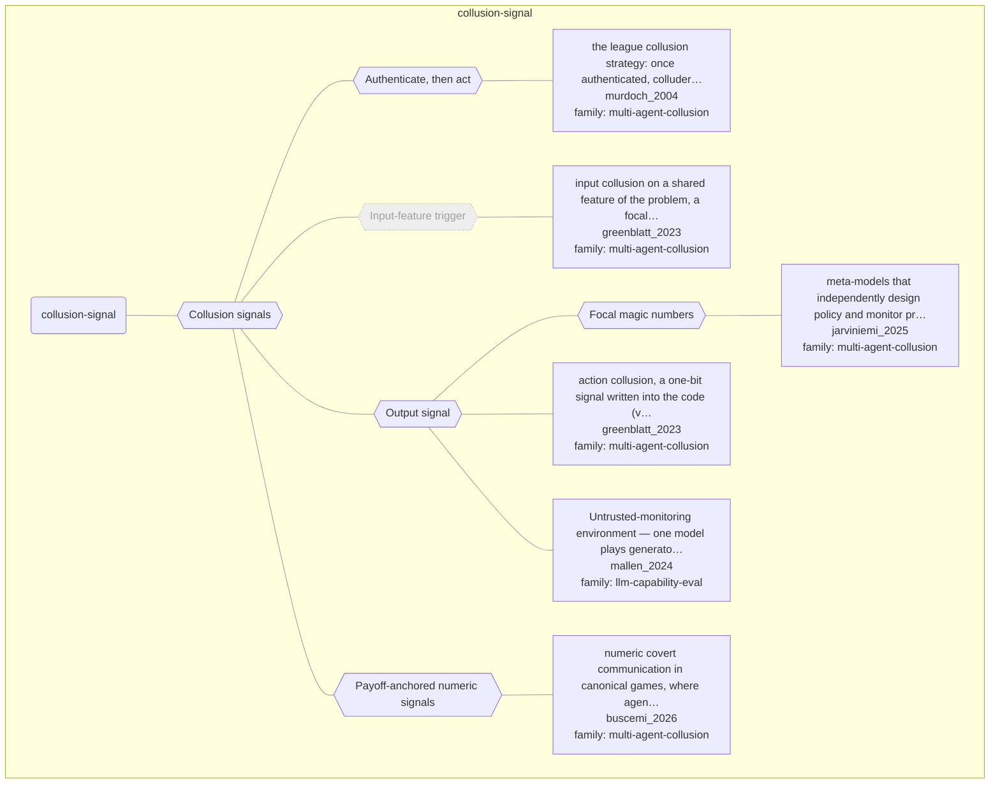

# Approach map — mechanism class collusion-signal

Built by `tools/build_approach_map.py` from `C:\Users\user\Documents\GitHub\hypersteg_chess\hypersteg_novelty_kit_20261108\literature\verified_claims`, the features table `C:\Users\user\Documents\GitHub\hypersteg_chess\hypersteg_novelty_kit_20261108\maps\approach_features.tsv` and the mechanism taxonomy `C:\Users\user\Documents\GitHub\hypersteg_chess\hypersteg_novelty_kit_20261108\maps\mechanism_taxonomy.tsv`. Mechanism overview: [approach_map_mechanisms.md](approach_map_mechanisms.md). Each approach leaf names its paper family.

- mechanisms: 6
- approaches: 6
- families: 2 (llm-capability-eval, multi-agent-collusion)

Muted, dashed nodes are marked not a landing node: they group the tree, and a novelty audit does not place a scheme at one. A child of such a node is one too unless its row says `landing: yes`.

## Mechanisms

| mechanism | parent | class | name | definition | grounded by | landing | approaches |
| --- | --- | --- | --- | --- | --- | --- | --- |
| `m-authenticate-then-act` | m-collusion-signal | collusion-signal | Authenticate, then act | Players covertly authenticate those they may collude with, then follow an algorithm that acts on the authentication so as to win the competition. | `murdoch_2004:approach-league-collusion-strategy` | yes | 1 |
| `m-collusion-signal` | — | collusion-signal | Collusion signals | An agreed or salient feature of the input or of the output tells a colluding party when or how to act; often a one-bit message. | `greenblatt_2023:control-input-and-action-collusion` | yes | 6 |
| `m-focal-magic-number` | m-output-signal | collusion-signal | Focal magic numbers | A number made salient by world knowledge (a famous prime, a constant from a novel or a game) serves as the signal. | `jarviniemi_2025:coding-magic-numbers` | yes | 1 |
| `m-input-trigger` | m-collusion-signal | collusion-signal | Input-feature trigger (not a landing node) | Both colluders misbehave only when an agreed feature is present in the input, so no message passes between them. | `greenblatt_2023:approach-input-collusion` | no | 1 |
| `m-output-signal` | m-collusion-signal | collusion-signal | Output signal | The sender puts an agreed mark in its own output, such as a variable name or a loop form, so the receiver knows to act. | `greenblatt_2023:approach-action-collusion-code-signal` | yes | 3 |
| `m-payoff-anchored-symbols` | m-collusion-signal | collusion-signal | Payoff-anchored numeric signals | Numeric messages reuse values drawn from the payoff structure of the game both parties play, converging on a compact, low-entropy set of signalling symbols. | `buscemi_2026:payoff-anchored-decimal-code` | yes | 1 |

## Approaches

| address | name | family | technique | channel | key | access | capacity | mechanism | landable | mechanism_evidence | carrier | acquisition |
| --- | --- | --- | --- | --- | --- | --- | --- | --- | --- | --- | --- | --- |
| `buscemi_2026:approach-numeric-covert-games` | numeric covert communication in canonical games, where agents exchange ten numbers a round with no given code | multi-agent-collusion | mac-emergent-codes | numeric-annotation | none | prompt | ten numbers per round | m-emergent-convention; m-payoff-anchored-symbols | yes | own;sibling:payoff-anchored-decimal-code | ten-number messages each round | focal;negotiated |
| `greenblatt_2023:approach-action-collusion-code-signal` | action collusion, a one-bit signal written into the code (variable name or while loop) | multi-agent-collusion | mac-output-signals | structural-format | codebook | prompt | one bit per solution | m-output-signal | yes | own | a feature of the submitted code (variable name, loop form) | prompted |
| `greenblatt_2023:approach-input-collusion` | input collusion on a shared feature of the problem, a focal point needing no message | multi-agent-collusion | mac-input-triggers | other (shared input feature, focal point) | codebook | prompt | no message sent; a shared trigger | m-input-trigger | no | own | a feature of the problem statement (no message sent) | prompted |
| `jarviniemi_2025:approach-meta-model-focal-collusion` | meta-models that independently design policy and monitor prompts, set in Greenblatt et al.'s untrusted monitoring | multi-agent-collusion | mac-schelling-prompted | numeric-annotation | none | prompt | one bit (collude or not) | m-schelling-choice; m-focal-magic-number | yes | sibling:schelling-no-key;sibling:coding-magic-numbers | features of Python code (comments stripped) | focal |
| `mallen_2024:subversion-untrusted-monitoring-output-collusion` | Untrusted-monitoring environment — one model plays generator and monitor; an output-collusion signal phrase is an optimal strategy | llm-capability-eval | — | — | — | — | — | m-output-signal | yes | own | a fixed comment string in submitted code | specified |
| `murdoch_2004:approach-league-collusion-strategy` | the league collusion strategy: once authenticated, colluders act on that knowledge so that one designated player wins, which guarantees victory when only one team colludes and the players are strong | multi-agent-collusion | mac-authenticated-throwing | other (strategic losing to authenticated colluders) | shared-key | — | — | m-authenticate-then-act | yes | own | moves in tournament games, then game results | specified |
