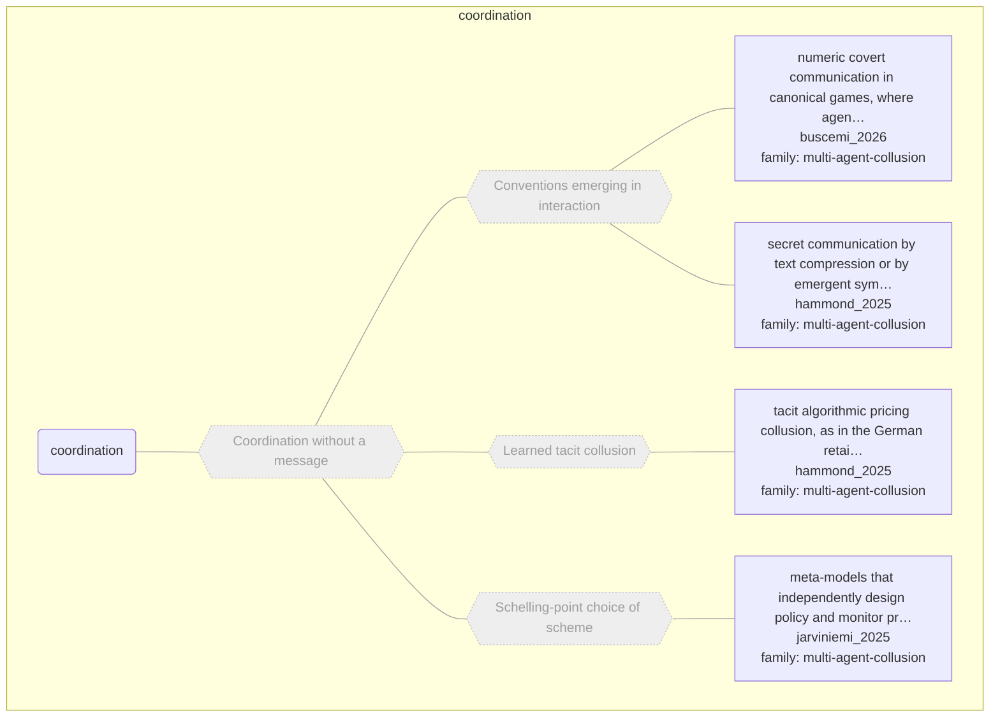

# Approach map — mechanism class coordination

Built by `tools/build_approach_map.py` from `C:\Users\user\Documents\GitHub\hypersteg_chess\hypersteg_novelty_kit_20261108\literature\verified_claims`, the features table `C:\Users\user\Documents\GitHub\hypersteg_chess\hypersteg_novelty_kit_20261108\maps\approach_features.tsv` and the mechanism taxonomy `C:\Users\user\Documents\GitHub\hypersteg_chess\hypersteg_novelty_kit_20261108\maps\mechanism_taxonomy.tsv`. Mechanism overview: [approach_map_mechanisms.md](approach_map_mechanisms.md). Each approach leaf names its paper family.

- mechanisms: 4
- approaches: 4
- families: 1 (multi-agent-collusion)

Muted, dashed nodes are marked not a landing node: they group the tree, and a novelty audit does not place a scheme at one. A child of such a node is one too unless its row says `landing: yes`.

## Mechanisms

| mechanism | parent | class | name | definition | grounded by | landing | approaches |
| --- | --- | --- | --- | --- | --- | --- | --- |
| `m-coordination` | — | coordination | Coordination without a message (not a landing node) | Parties collude or coordinate their actions, whether or not they communicate with each other; the distinction between explicit and tacit collusion may break down for agents. | `hammond_2025:explicit-tacit-distinction-breaks-down` | no | 4 |
| `m-emergent-convention` | m-coordination | coordination | Conventions emerging in interaction (not a landing node) | Agents exchange symbols with no predefined interpretation, and any meaning emerges endogenously through interaction. | `buscemi_2026:ten-number-covert-carrier` | no | 2 |
| `m-learned-tacit-collusion` | m-coordination | coordination | Learned tacit collusion (not a landing node) | Algorithms adapt their strategies to collude through interaction, without the parties communicating. | `hammond_2025:surveyed-algorithmic-pricing-collusion` | no | 1 |
| `m-schelling-choice` | m-coordination | coordination | Schelling-point choice of scheme (not a landing node) | Of the many possible schemes, some are salient (named in the prompt, in a shared file system, common in training), and isolated parties converge on them. | `rippin_2026:focal-point-salience` | no | 1 |

## Approaches

| address | name | family | technique | channel | key | access | capacity | mechanism | landable | mechanism_evidence | carrier | acquisition |
| --- | --- | --- | --- | --- | --- | --- | --- | --- | --- | --- | --- | --- |
| `buscemi_2026:approach-numeric-covert-games` | numeric covert communication in canonical games, where agents exchange ten numbers a round with no given code | multi-agent-collusion | mac-emergent-codes | numeric-annotation | none | prompt | ten numbers per round | m-emergent-convention; m-payoff-anchored-symbols | yes | own;sibling:payoff-anchored-decimal-code | ten-number messages each round | focal;negotiated |
| `hammond_2025:surveyed-algorithmic-pricing-collusion` | tacit algorithmic pricing collusion, as in the German retail gasoline market | multi-agent-collusion | mac-learned-tacit | other (price signals, tacit) | none | — | — | m-learned-tacit-collusion | no | own | market prices | — |
| `hammond_2025:surveyed-compression-emergent-communication` | secret communication by text compression or by emergent symbols without predefined meaning | multi-agent-collusion | mac-emergent-codes | other (compression or emergent code) | — | — | — | m-emergent-convention | no | own | agent messages | negotiated |
| `jarviniemi_2025:approach-meta-model-focal-collusion` | meta-models that independently design policy and monitor prompts, set in Greenblatt et al.'s untrusted monitoring | multi-agent-collusion | mac-schelling-prompted | numeric-annotation | none | prompt | one bit (collude or not) | m-schelling-choice; m-focal-magic-number | yes | sibling:schelling-no-key;sibling:coding-magic-numbers | features of Python code (comments stripped) | focal |
