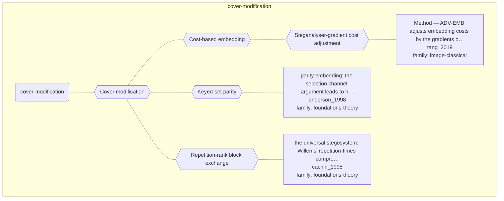

# Approach map — mechanism class cover-modification

Built by `tools/build_approach_map.py` from `C:\Users\user\Documents\GitHub\hypersteg_chess\hypersteg_novelty_kit_20261108\literature\verified_claims`, the features table `C:\Users\user\Documents\GitHub\hypersteg_chess\hypersteg_novelty_kit_20261108\maps\approach_features.tsv` and the mechanism taxonomy `C:\Users\user\Documents\GitHub\hypersteg_chess\hypersteg_novelty_kit_20261108\maps\mechanism_taxonomy.tsv`. Mechanism overview: [approach_map_mechanisms.md](approach_map_mechanisms.md). Each approach leaf names its paper family.

- mechanisms: 5
- approaches: 3
- families: 2 (foundations-theory, image-classical)

## Mechanisms

| mechanism | parent | class | name | definition | grounded by | landing | approaches |
| --- | --- | --- | --- | --- | --- | --- | --- |
| `m-adversarial-costs` | m-cost-based-embedding | cover-modification | Steganalyser-gradient cost adjustment | Embedding costs are adjusted by the gradients of a target CNN steganalyser so that the stego image also fools it. | `tang_2019:approach-adv-emb` | yes | 1 |
| `m-cost-based-embedding` | m-cover-modification | cover-modification | Cost-based embedding | Each modification of a cover element carries a cost, and the message is embedded under the conventional framework of distortion minimisation. | `tang_2019:approach-adv-emb` | yes | 1 |
| `m-cover-modification` | — | cover-modification | Cover modification | An existing cover is altered so that the alterations carry the message, exploiting limits of the warden such as human perception. | `motwani_2024:taxonomy-covertext-vs-it` | yes | 3 |
| `m-keyed-parity` | m-cover-modification | cover-modification | Keyed-set parity | A pad or keystream selects a set of cover elements and each ciphertext bit is embedded as their parity. | `anderson_1998:approach-parity-embedding` | yes | 1 |
| `m-repetition-rank-exchange` | m-cover-modification | cover-modification | Repetition-rank block exchange | In the ranking of a repetition-times compressor, a low-probability source block is kept or swapped for the block immediately following it, depending on the embedded bit. | `cachin_1998:approach-universal-repetition-times` | yes | 1 |

## Approaches

| address | name | family | technique | channel | key | access | capacity | mechanism | landable | mechanism_evidence | carrier | acquisition |
| --- | --- | --- | --- | --- | --- | --- | --- | --- | --- | --- | --- | --- |
| `anderson_1998:approach-parity-embedding` | parity embedding: the selection channel argument leads to hiding each bit in the parity of a key-selected set of cover bits rather than in the data directly | foundations-theory | ft-keyed-parity | pixel-spatial | shared-key | — | — | m-keyed-parity | yes | own | parity of key-selected cover elements (e.g. image pixels) | specified |
| `cachin_1998:approach-universal-repetition-times` | the universal stegosystem: Willems' repetition-times compressor, modified to swap a low-probability block for its neighbour in the repetition-time ranking, so no covertext statistics are needed | foundations-theory | ft-universal-compression | other (swap of low-probability block with its rank neighbour) | shared-key | — | — | m-repetition-rank-exchange | yes | own | source blocks of a repetition-times compressor | specified |
| `tang_2019:approach-adv-emb` | Method — ADV-EMB adjusts embedding costs by the gradients of a target CNN steganalyser | image-classical | ic-adversarial-costs | transform-domain | — | weights | 0.1 to 0.5 bpnzAC (JPEG); 0.4 bpp in the spatial extension | m-adversarial-costs | yes | own | JPEG coefficient modifications | specified |
