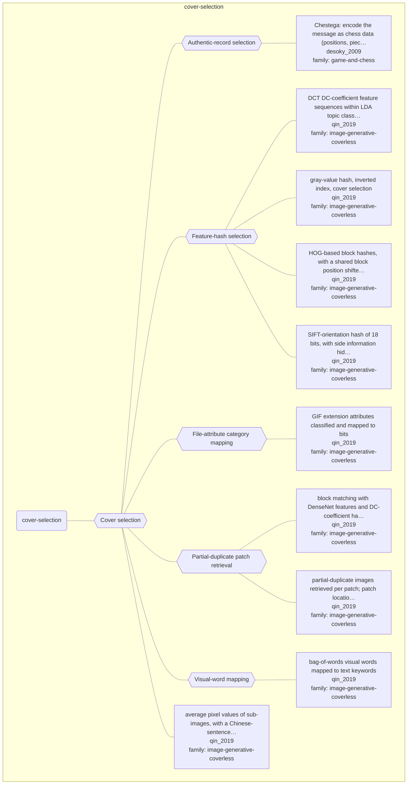

# Approach map — mechanism class cover-selection

Built by `tools/build_approach_map.py` from `C:\Users\user\Documents\GitHub\hypersteg_chess\hypersteg_novelty_kit_20261108\literature\verified_claims`, the features table `C:\Users\user\Documents\GitHub\hypersteg_chess\hypersteg_novelty_kit_20261108\maps\approach_features.tsv` and the mechanism taxonomy `C:\Users\user\Documents\GitHub\hypersteg_chess\hypersteg_novelty_kit_20261108\maps\mechanism_taxonomy.tsv`. Mechanism overview: [approach_map_mechanisms.md](approach_map_mechanisms.md). Each approach leaf names its paper family.

- mechanisms: 6
- approaches: 10
- families: 2 (game-and-chess, image-generative-coverless)

## Mechanisms

| mechanism | parent | class | name | definition | grounded by | landing | approaches |
| --- | --- | --- | --- | --- | --- | --- | --- |
| `m-authentic-record-selection` | m-cover-selection | cover-selection | Authentic-record selection | Moves from unaltered, authenticated real games are chosen so that their data carry the message. | `desoky_2009:target-square-index` | yes | 1 |
| `m-cover-selection` | — | cover-selection | Cover selection | An unmodified object is chosen because its own attributes map to the message under an agreed rule. | `qin_2019:coverless-definition` | yes | 10 |
| `m-feature-hash-selection` | m-cover-selection | cover-selection | Feature-hash selection | Images in a database are indexed by hash sequences of their features, and images whose hashes equal the message segments are sent. | `qin_2019:surveyed-gray-hash-selection` | yes | 4 |
| `m-file-attribute-mapping` | m-cover-selection | cover-selection | File-attribute category mapping | Values of a file attribute are divided into categories, each mapped to a secret message, and files are chosen by category. | `qin_2019:surveyed-gif-attributes` | yes | 1 |
| `m-patch-retrieval` | m-cover-selection | cover-selection | Partial-duplicate patch retrieval | Natural images sharing patches with a secret image are retrieved and sent, and the receiver stitches the patches back together. | `qin_2019:surveyed-partial-duplicates` | yes | 2 |
| `m-visual-word-mapping` | m-cover-selection | cover-selection | Visual-word mapping | Visual words extracted from images express the text to be hidden, and images containing them are selected. | `qin_2019:surveyed-bow-visual-words` | yes | 1 |

## Approaches

| address | name | family | technique | channel | key | access | capacity | mechanism | landable | mechanism_evidence | carrier | acquisition |
| --- | --- | --- | --- | --- | --- | --- | --- | --- | --- | --- | --- | --- |
| `desoky_2009:approach-chestega` | Chestega: encode the message as chess data (positions, pieces, moves, tournaments, players) inside a chess-related document, preferably authentic games or tool-generated analysis, with a public method and an agreed configuration instead of a key | game-and-chess | gc-chess-data-codebook | other (chess-data content: target squares, pieces, players' initials, via an agreed codebook) | codebook | — | example: 7 bits per move as a target-square index; 4-bit slices as letters via player initials | m-reference-code; m-authentic-record-selection; m-letter-position | yes | partial;sibling:target-square-index;sibling:player-initial-codebook | chess data (squares, pieces, players) in chess-related text | specified |
| `qin_2019:surveyed-average-pixel-dictionary` | average pixel values of sub-images, with a Chinese-sentence dictionary | image-generative-coverless | igc-hash-mapping | other (cover selection by average-pixel hash with dictionary) | — | — | — | m-cover-selection | yes | own | selected natural images (sub-image average pixels) | specified |
| `qin_2019:surveyed-bow-visual-words` | bag-of-words visual words mapped to text keywords | image-generative-coverless | igc-visual-word-mapping | other (cover selection by visual words) | shared-key | — | — | m-visual-word-mapping | yes | own | selected natural images (visual words) | specified |
| `qin_2019:surveyed-dct-lda` | DCT DC-coefficient feature sequences within LDA topic classes | image-generative-coverless | igc-hash-mapping | other (cover selection by DCT feature sequence) | — | — | — | m-feature-hash-selection | yes | own | selected natural images (DCT feature sequences) | specified |
| `qin_2019:surveyed-densenet-block-matching` | block matching with DenseNet features and DC-coefficient hashes | image-generative-coverless | igc-patch-retrieval | other (cover selection by block matching) | — | — | — | m-patch-retrieval | yes | own | selected natural images (matching blocks) | specified |
| `qin_2019:surveyed-gif-attributes` | GIF extension attributes classified and mapped to bits | image-generative-coverless | igc-hash-mapping | other (cover selection by GIF extension attributes) | — | — | — | m-file-attribute-mapping | yes | own | selected GIF files (extension attributes) | specified |
| `qin_2019:surveyed-gray-hash-selection` | gray-value hash, inverted index, cover selection | image-generative-coverless | igc-hash-mapping | other (cover selection by image hash) | — | — | 8 bits per image | m-feature-hash-selection | yes | own | selected natural images (grey-value hashes) | specified |
| `qin_2019:surveyed-hog-hash` | HOG-based block hashes, with a shared block position shifted one-time-pad style | image-generative-coverless | igc-hash-mapping | other (cover selection by HOG hash) | shared-key | — | — | m-feature-hash-selection | yes | own | selected natural images (HOG hashes) | specified |
| `qin_2019:surveyed-partial-duplicates` | partial-duplicate images retrieved per patch; patch locations are the shared key | image-generative-coverless | igc-patch-retrieval | other (cover selection by partial-duplicate patch retrieval) | shared-key | — | — | m-patch-retrieval | yes | own | selected natural images (partial duplicates) | specified |
| `qin_2019:surveyed-sift-robust-hash` | SIFT-orientation hash of 18 bits, with side information hidden by LSB | image-generative-coverless | igc-hash-mapping | other (cover selection by SIFT hash, plus LSB side channel) | — | — | 18 bits per image | m-feature-hash-selection | yes | own | selected natural images (SIFT hashes) | specified |
