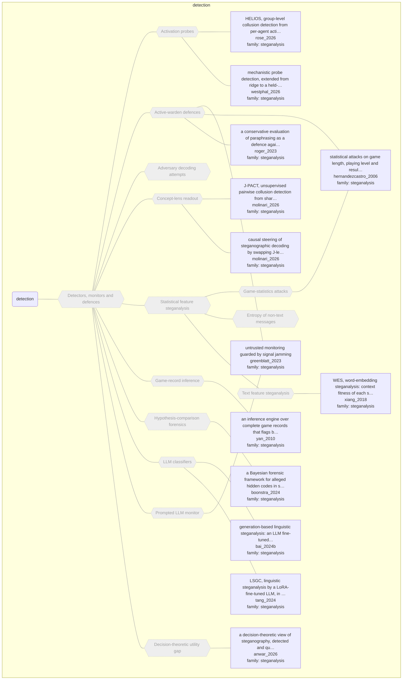

# Approach map — mechanism class detection

Built by `tools/build_approach_map.py` from `C:\Users\user\Documents\GitHub\hypersteg_chess\hypersteg_novelty_kit_20261108\literature\verified_claims`, the features table `C:\Users\user\Documents\GitHub\hypersteg_chess\hypersteg_novelty_kit_20261108\maps\approach_features.tsv` and the mechanism taxonomy `C:\Users\user\Documents\GitHub\hypersteg_chess\hypersteg_novelty_kit_20261108\maps\mechanism_taxonomy.tsv`. Mechanism overview: [approach_map_mechanisms.md](approach_map_mechanisms.md). Each approach leaf names its paper family.

- mechanisms: 14
- approaches: 13
- families: 1 (steganalysis)

Muted, dashed nodes are marked not a landing node: they group the tree, and a novelty audit does not place a scheme at one. A child of such a node is one too unless its row says `landing: yes`.

## Mechanisms

| mechanism | parent | class | name | definition | grounded by | landing | approaches |
| --- | --- | --- | --- | --- | --- | --- | --- |
| `m-activation-probe` | m-detection | detection | Activation probes (not a landing node) | Probes on hidden states reconstruct the secret or read deception, calibrated to a false-positive rate. | `westphal_2026:probe-detector-all-layer-rule` | no | 2 |
| `m-active-warden` | m-detection | detection | Active-warden defences (not a landing node) | The overseer rewrites the message, for example by paraphrasing it while keeping its meaning, to destroy any payload instead of only detecting it. | `roger_2023:approach-paraphrase-defence` | no | 3 |
| `m-adversary-decoding` | m-detection | detection | Adversary decoding attempts (not a landing node) | Near-copies of the decoder, trained with minor variations, try to recover the message rather than just flag it. | `agarwal_2023:hypersteg-near-copy-decoders-fail` | no | 0 |
| `m-concept-lens` | m-detection | detection | Concept-lens readout (not a landing node) | Concepts read through a Jacobian lens are compared across agents to find colluding pairs. | `molinari_2026:approach-j-pact` | no | 2 |
| `m-detection` | — | detection | Detectors, monitors and defences (not a landing node) | Methods that detect, measure, remove or read hidden communication. | `hernandezcastro_2006:approach-game-steganalysis` | no | 13 |
| `m-feature-steganalysis` | m-detection | detection | Statistical feature steganalysis (not a landing node) | Statistical attacks detect significant deviations from a model of the cover caused by inserting hidden data. | `hernandezcastro_2006:approach-game-steganalysis` | no | 2 |
| `m-game-record-inference` | m-detection | detection | Game-record inference (not a landing node) | An inference engine analyses the bidding and play in complete game records to detect collusive play. | `yan_2010:approach-inference-engine-collusion-detector` | no | 1 |
| `m-game-statistics` | m-feature-steganalysis | detection | Game-statistics attacks (not a landing node) | Game length, playing level and result are tested for deviations caused by embedding. | `hernandezcastro_2006:approach-game-steganalysis` | no | 1 |
| `m-likelihood-ratio-forensics` | m-detection | detection | Hypothesis-comparison forensics (not a landing node) | The hypothesis that a specified method was used to transmit information is weighed against the hypothesis that it was not. | `boonstra_2024:likelihood-ratio-detector` | no | 1 |
| `m-llm-classifier` | m-detection | detection | LLM classifiers (not a landing node) | A fine-tuned LLM judges whether a text carries hidden data. | `tang_2024:approach-lsgc` | no | 2 |
| `m-non-text-statistical-detection` | m-feature-steganalysis | detection | Entropy of non-text messages (not a landing node) | Covert messages are detected by their lower entropy than random baselines. | `buscemi_2026:entropy-ordering-detection` | no | 0 |
| `m-prompted-llm-monitor` | m-detection | detection | Prompted LLM monitor (not a landing node) | A model given the cover task and answer, but not the secret, is told to rate suspicion, and a threshold set at a fixed false-positive rate decides. | `zolkowski_2025:monitor-threshold-fpr` | no | 1 |
| `m-text-feature-steganalysis` | m-feature-steganalysis | detection | Text feature steganalysis (not a landing node) | Semantic features of word choice, such as synonym context fitness, feed a classifier. | `xiang_2018:approach-wes` | no | 1 |
| `m-utility-gap` | m-detection | detection | Decision-theoretic utility gap (not a landing node) | Steganography is measured by comparing the downstream utility of a message to parties who can and cannot decode it. | `anwar_2026:approach-steganographic-gap` | no | 1 |

## Approaches

| address | name | family | technique | channel | key | access | capacity | mechanism | landable | mechanism_evidence | carrier | acquisition |
| --- | --- | --- | --- | --- | --- | --- | --- | --- | --- | --- | --- | --- |
| `anwar_2026:approach-steganographic-gap` | a decision-theoretic view of steganography, detected and quantified by the steganographic gap over generalised V-information | steganalysis | sa-utility-gap | other (detection from downstream actions) | — | prompt | — | m-utility-gap | no | own | — | — |
| `bai_2024b:approach-generative-llm-steganalysis` | generation-based linguistic steganalysis: an LLM fine-tuned with LoRA writes its verdict on a text as readable output, with no added classifier module | steganalysis | sa-llm-classifiers | other (detector of distributional-sampling stegos) | — | training | — | m-llm-classifier | no | own | — | — |
| `boonstra_2024:approach-bayesian-hidden-code-forensics` | a Bayesian forensic framework for alleged hidden codes in sport: weigh the likelihood of the observed events under a named code against their likelihood under no code | steganalysis | sa-likelihood-ratio-forensics | other (detector of pre-agreed side-channel codes) | none | — | — | m-likelihood-ratio-forensics | no | sibling:likelihood-ratio-detector | — | — |
| `greenblatt_2023:approach-untrusted-monitoring-signal-jamming` | untrusted monitoring guarded by signal jamming | steganalysis | sa-active-warden; sa-prompted-llm-monitors | other (active-warden redaction and paraphrase) | — | prompt | — | m-prompted-llm-monitor; m-active-warden | no | own;own | — | — |
| `hernandezcastro_2006:approach-game-steganalysis` | statistical attacks on game length, playing level and result, and stripping variations and comments; countered by encryption, raised komi and both sides embedding | steganalysis | sa-game-statistics | move choice | none | — | — | m-game-statistics; m-active-warden | no | own;own | — | — |
| `molinari_2026:approach-j-pact` | J-PACT, unsupervised pairwise collusion detection from shared J-space concepts | steganalysis | sa-concept-lens | other (relational activation readout) | — | weights | — | m-concept-lens | no | own | — | — |
| `molinari_2026:approach-j-space-steering` | causal steering of steganographic decoding by swapping J-lens concept coordinates | steganalysis | sa-concept-lens | other (activation intervention) | — | weights | — | m-concept-lens | no | own | — | — |
| `roger_2023:approach-paraphrase-defence` | a conservative evaluation of paraphrasing as a defence against steganography | steganalysis | sa-active-warden | other (active-warden paraphrase defence) | — | prompt | below about 2 bits per answer (3 bits per KB) survive paraphrasing | m-active-warden | no | own | — | — |
| `rose_2026:approach-helios` | HELIOS, group-level collusion detection from per-agent activation probes | steganalysis | sa-activation-probes | other (activation probing) | — | weights | — | m-activation-probe | no | own | — | — |
| `tang_2024:approach-lsgc` | LSGC, linguistic steganalysis by a LoRA-fine-tuned LLM, in a generation mode that explains its verdict and a classification mode that reads features in one pass | steganalysis | sa-llm-classifiers | other (detector of generative text stego) | — | training | — | m-llm-classifier | no | own | — | — |
| `westphal_2026:approach-probe-detection-recontextualisation` | mechanistic probe detection, extended from ridge to a held-out two-layer MLP probe, and restored against evasive trojans by a recontextualisation dataset that removes the slack the secret is routed through | steganalysis | sa-activation-probes | other (detector) | — | weights | — | m-activation-probe | no | own | — | — |
| `xiang_2018:approach-wes` | WES, word-embedding steganalysis: context fitness of each synonym, three features from it, and an SVM | steganalysis | sa-text-features | lexical | — | training | — | m-text-feature-steganalysis | no | own | — | — |
| `yan_2010:approach-inference-engine-collusion-detector` | an inference engine over complete game records that flags bids and plays too good for the information a player legitimately held | steganalysis | sa-game-record-inference | move choice | — | — | — | m-game-record-inference | no | own | — | — |
