# Approach map — mechanism class evaluation

Built by `tools/build_approach_map.py` from `C:\Users\user\Documents\GitHub\hypersteg_chess\hypersteg_novelty_kit_20261108\literature\verified_claims`, the features table `C:\Users\user\Documents\GitHub\hypersteg_chess\hypersteg_novelty_kit_20261108\maps\approach_features.tsv` and the mechanism taxonomy `C:\Users\user\Documents\GitHub\hypersteg_chess\hypersteg_novelty_kit_20261108\maps\mechanism_taxonomy.tsv`. Mechanism overview: [approach_map_mechanisms.md](approach_map_mechanisms.md). Each approach leaf names its paper family.

- mechanisms: 13
- approaches: 22
- families: 3 (llm-capability-eval, llm-generative-text, multi-agent-collusion)

```mermaid
flowchart TD
  subgraph cls_evaluation_g["evaluation"]
    cls_evaluation("evaluation")
    mech_m_agentic_construction_eval{{"Agentic stegosystem construction"}}
    mech_m_collusion_benchmark{{"Collusion audits and benchmarks"}}
    mech_m_control_evaluation{{"Control evaluations"}}
    mech_m_coordination_eval{{"Focal-point evaluations"}}
    mech_m_encoded_reasoning_task{{"Encoded reasoning task"}}
    mech_m_eval_framework{{"Evaluation frameworks"}}
    mech_m_evaluation{{"Evaluations, benchmarks and elicitation conditions"}}
    mech_m_focality_prompt{{"Focality prompts"}}
    mech_m_message_passing_task{{"Encoded message-passing task"}}
    mech_m_risk_taxonomy{{"Risk taxonomies"}}
    mech_m_scheme_discovery_condition{{"Scheme-discovery condition"}}
    mech_m_stateless_subversion_eval{{"Stateless subversion evaluation"}}
    mech_m_training_elicitation{{"Training-based elicitation"}}
    n_aharon_2026_approach_focal_point_evaluation["a large-scale study of focal points in LLMs, comparing taci…<br/>aharon_2026<br/>family: multi-agent-collusion"]
    n_aharon_2026_surveyed_all_features_prompt["the #quot;all-features#quot; prompt: reason over Kraus et al.'s focal…<br/>aharon_2026<br/>family: multi-agent-collusion"]
    n_aharon_2026_surveyed_culture_prompt["the #quot;culture#quot; prompt: choose the option most culturally rel…<br/>aharon_2026<br/>family: multi-agent-collusion"]
    n_aharon_2026_surveyed_saliency_prompt["the #quot;saliency#quot; prompt: choose the option most salient to hu…<br/>aharon_2026<br/>family: multi-agent-collusion"]
    n_greenblatt_2023_approach_control_evaluation["control evaluations, in which a red team's attack policy st…<br/>greenblatt_2023<br/>family: llm-capability-eval"]
    n_hammond_2025_approach_multi_agent_risk_taxonomy["a taxonomy of multi-agent risks: three failure modes and se…<br/>hammond_2025<br/>family: multi-agent-collusion"]
    n_karpov_2025_approach_indirect_guess_game["the indirect guess game, in which an assistant may hide let…<br/>karpov_2025<br/>family: llm-capability-eval"]
    n_karpov_2025_approach_prompted_stego_eval["prompted evaluation of frontier models in direct, instructe…<br/>karpov_2025<br/>family: llm-capability-eval"]
    n_mallen_2024_approach_subversion_strategy_eval["Subversion Strategy Eval, eight environments and six afford…<br/>mallen_2024<br/>family: llm-capability-eval"]
    n_motwani_2024_approach_case_framework["CASE, a framework for evaluating secret collusion in indivi…<br/>motwani_2024<br/>family: llm-capability-eval"]
    n_nakamura_2026_approach_colosseum["Colosseum: cooperative tasks cast as DCOPs, collusion measu…<br/>nakamura_2026<br/>family: multi-agent-collusion"]
    n_rippin_2026_approach_agentic_covert_channel_construction["an agentic covert-channel construction benchmark, seeded wi…<br/>rippin_2026<br/>family: llm-capability-eval"]
    n_rippin_2026_approach_tacit_stego_agreement_cci["tacit steganographic agreement as Schelling coordination, m…<br/>rippin_2026<br/>family: multi-agent-collusion"]
    n_roger_2023_approach_finetuned_introduction_codebook["fine-tuning GPT-3.5-Turbo to learn a simple encoding scheme…<br/>roger_2023<br/>family: llm-capability-eval"]
    n_roger_2023_surveyed_scratchpad_scheme["scratchpad scheme in which the model devises its own encodi…<br/>roger_2023<br/>family: llm-generative-text"]
    n_rose_2026_approach_narcbench["NARCBench, a three-tier benchmark for collusion detection u…<br/>rose_2026<br/>family: multi-agent-collusion"]
    n_schulz_2026_approach_three_method_stego_elicitation["eliciting messaging, encoded reasoning and steganographic r…<br/>schulz_2026<br/>family: llm-capability-eval"]
    n_skaf_2025_approach_cot_penalty_rl["RL fine-tuning with an outcome reward minus a rule-based Co…<br/>skaf_2025<br/>family: llm-capability-eval"]
    n_tailor_2026_approach_rolewise_decomposition["rolewise decomposition: score what the encoder put in the t…<br/>tailor_2026<br/>family: llm-capability-eval"]
    n_zolkowski_2025_approach_encoded_message_passing_eval["an evaluation suite for encoded message passing under grade…<br/>zolkowski_2025<br/>family: llm-capability-eval"]
    n_zolkowski_2025_approach_encoded_reasoning_eval["the first evaluations of encoded reasoning, on hidden tasks…<br/>zolkowski_2025<br/>family: llm-capability-eval"]
    n_zolkowski_2025_surveyed_model_generated_subtlety["model-generated encoding schemes at three degrees of subtle…<br/>zolkowski_2025<br/>family: llm-generative-text"]
  end
  mech_m_evaluation --- mech_m_agentic_construction_eval
  mech_m_evaluation --- mech_m_collusion_benchmark
  mech_m_evaluation --- mech_m_control_evaluation
  mech_m_evaluation --- mech_m_coordination_eval
  mech_m_evaluation --- mech_m_encoded_reasoning_task
  mech_m_evaluation --- mech_m_eval_framework
  cls_evaluation --- mech_m_evaluation
  mech_m_evaluation --- mech_m_focality_prompt
  mech_m_evaluation --- mech_m_message_passing_task
  mech_m_evaluation --- mech_m_risk_taxonomy
  mech_m_evaluation --- mech_m_scheme_discovery_condition
  mech_m_evaluation --- mech_m_stateless_subversion_eval
  mech_m_evaluation --- mech_m_training_elicitation
  mech_m_coordination_eval --- n_aharon_2026_approach_focal_point_evaluation
  mech_m_focality_prompt --- n_aharon_2026_surveyed_all_features_prompt
  mech_m_focality_prompt --- n_aharon_2026_surveyed_culture_prompt
  mech_m_focality_prompt --- n_aharon_2026_surveyed_saliency_prompt
  mech_m_control_evaluation --- n_greenblatt_2023_approach_control_evaluation
  mech_m_risk_taxonomy --- n_hammond_2025_approach_multi_agent_risk_taxonomy
  mech_m_message_passing_task --- n_karpov_2025_approach_indirect_guess_game
  mech_m_message_passing_task --- n_karpov_2025_approach_prompted_stego_eval
  mech_m_stateless_subversion_eval --- n_mallen_2024_approach_subversion_strategy_eval
  mech_m_eval_framework --- n_motwani_2024_approach_case_framework
  mech_m_collusion_benchmark --- n_nakamura_2026_approach_colosseum
  mech_m_agentic_construction_eval --- n_rippin_2026_approach_agentic_covert_channel_construction
  mech_m_coordination_eval --- n_rippin_2026_approach_tacit_stego_agreement_cci
  mech_m_training_elicitation --- n_roger_2023_approach_finetuned_introduction_codebook
  mech_m_scheme_discovery_condition --- n_roger_2023_surveyed_scratchpad_scheme
  mech_m_collusion_benchmark --- n_rose_2026_approach_narcbench
  mech_m_training_elicitation --- n_schulz_2026_approach_three_method_stego_elicitation
  mech_m_training_elicitation --- n_skaf_2025_approach_cot_penalty_rl
  mech_m_eval_framework --- n_tailor_2026_approach_rolewise_decomposition
  mech_m_message_passing_task --- n_zolkowski_2025_approach_encoded_message_passing_eval
  mech_m_encoded_reasoning_task --- n_zolkowski_2025_approach_encoded_reasoning_eval
  mech_m_scheme_discovery_condition --- n_zolkowski_2025_surveyed_model_generated_subtlety
  linkStyle 0,1,2,3,4,5,6,7,8,9,10,11,12,13,14,15,16,17,18,19,20,21,22,23,24,25,26,27,28,29,30,31,32,33,34 stroke:#9e9e9e,stroke-width:1px
  classDef nonlanding fill:#eeeeee,stroke:#bdbdbd,stroke-dasharray:2 2,color:#9e9e9e
  class mech_m_agentic_construction_eval,mech_m_collusion_benchmark,mech_m_control_evaluation,mech_m_coordination_eval,mech_m_encoded_reasoning_task,mech_m_eval_framework,mech_m_evaluation,mech_m_focality_prompt,mech_m_message_passing_task,mech_m_risk_taxonomy,mech_m_scheme_discovery_condition,mech_m_stateless_subversion_eval,mech_m_training_elicitation nonlanding
```

Muted, dashed nodes are marked not a landing node: they group the tree, and a novelty audit does not place a scheme at one. A child of such a node is one too unless its row says `landing: yes`.

## Mechanisms

| mechanism | parent | class | name | definition | grounded by | landing | approaches |
| --- | --- | --- | --- | --- | --- | --- | --- |
| `m-agentic-construction-eval` | m-evaluation | evaluation | Agentic stegosystem construction (not a landing node) | A tool-using agent must build a working natural-language stegosystem. | `rippin_2026:approach-agentic-covert-channel-construction` | no | 1 |
| `m-collusion-benchmark` | m-evaluation | evaluation | Collusion audits and benchmarks (not a landing node) | Frameworks that audit collusion through outcome metrics and conversation logs. | `nakamura_2026:approach-colosseum` | no | 2 |
| `m-control-evaluation` | m-evaluation | evaluation | Control evaluations (not a landing node) | Protocols meant to stay safe despite intentional subversion are evaluated. | `greenblatt_2023:approach-control-evaluation` | no | 1 |
| `m-coordination-eval` | m-evaluation | evaluation | Focal-point evaluations (not a landing node) | Studies of how, when and why focal points emerge in models, compared with humans. | `aharon_2026:approach-focal-point-evaluation` | no | 2 |
| `m-encoded-reasoning-task` | m-evaluation | evaluation | Encoded reasoning task (not a landing node) | Models are evaluated on encoding their reasoning. | `zolkowski_2025:approach-encoded-reasoning-eval` | no | 1 |
| `m-eval-framework` | m-evaluation | evaluation | Evaluation frameworks (not a landing node) | Software frameworks and decompositions that organise capability measurement. | `motwani_2024:approach-case-framework` | no | 2 |
| `m-evaluation` | — | evaluation | Evaluations, benchmarks and elicitation conditions (not a landing node) | Frameworks and conditions that measure or elicit hiding, or classify risks, rather than hide anything. | `motwani_2024:approach-case-framework` | no | 22 |
| `m-focality-prompt` | m-evaluation | evaluation | Focality prompts (not a landing node) | A prompt tells the model which kind of salience to aim at. | `aharon_2026:surveyed-saliency-prompt` | no | 3 |
| `m-message-passing-task` | m-evaluation | evaluation | Encoded message-passing task (not a landing node) | An encoder hides a secret message in its answer to a cover task for a decoder copy of itself, while a monitor judges suspicion. | `zolkowski_2025:setting-encoder-decoder-monitor` | no | 3 |
| `m-risk-taxonomy` | m-evaluation | evaluation | Risk taxonomies (not a landing node) | Multi-agent risks are sorted into failure modes and risk factors. | `hammond_2025:approach-multi-agent-risk-taxonomy` | no | 1 |
| `m-scheme-discovery-condition` | m-evaluation | evaluation | Scheme-discovery condition (not a landing node) | The model is asked to think of a scheme for the task, use it, and later re-derive it to decode. | `roger_2023:surveyed-scratchpad-scheme` | no | 2 |
| `m-stateless-subversion-eval` | m-evaluation | evaluation | Stateless subversion evaluation (not a landing node) | Systems must generate and act on their own strategies for subverting control protocols without shared memory between contexts. | `mallen_2024:approach-subversion-strategy-eval` | no | 1 |
| `m-training-elicitation` | m-evaluation | evaluation | Training-based elicitation (not a landing node) | RL fine-tuning against a task reward and a monitor penalty is used to induce or study hidden encoding. | `skaf_2025:approach-cot-penalty-rl` | no | 3 |

## Approaches

| address | name | family | technique | channel | key | access | capacity | mechanism | landable | mechanism_evidence | carrier | acquisition |
| --- | --- | --- | --- | --- | --- | --- | --- | --- | --- | --- | --- | --- |
| `aharon_2026:approach-focal-point-evaluation` | a large-scale study of focal points in LLMs, comparing tacit coordination with humans across cooperative and competitive games, and testing learning-free prompts that improve it | multi-agent-collusion | — | other (none: coordination without communication) | none | prompt | — | m-coordination-eval | no | own | — | — |
| `aharon_2026:surveyed-all-features-prompt` | the "all-features" prompt: reason over Kraus et al.'s focality principles (little effect) | multi-agent-collusion | mac-focality-prompts | other (none: tacit coordination) | none | prompt | — | m-focality-prompt | no | own | — | — |
| `aharon_2026:surveyed-culture-prompt` | the "culture" prompt: choose the option most culturally relevant to humans (lifts heterogeneous models to human level where culture is part of focality) | multi-agent-collusion | mac-focality-prompts | other (none: tacit coordination) | none | prompt | — | m-focality-prompt | no | own | — | — |
| `aharon_2026:surveyed-saliency-prompt` | the "saliency" prompt: choose the option most salient to humans (little effect) | multi-agent-collusion | mac-focality-prompts | other (none: tacit coordination) | none | prompt | — | m-focality-prompt | no | own | — | — |
| `greenblatt_2023:approach-control-evaluation` | control evaluations, in which a red team's attack policy stands in for the untrusted model | llm-capability-eval | lce-control-evaluations | — | — | prompt | — | m-control-evaluation | no | own | — | — |
| `hammond_2025:approach-multi-agent-risk-taxonomy` | a taxonomy of multi-agent risks: three failure modes and seven risk factors | multi-agent-collusion | mac-risk-taxonomies | — | — | — | — | m-risk-taxonomy | no | own | — | — |
| `karpov_2025:approach-indirect-guess-game` | the indirect guess game, in which an assistant may hide letters to help one team past an overseer | llm-capability-eval | lce-message-passing | other (model-chosen) | none | prompt | — | m-message-passing-task | no | own | — | — |
| `karpov_2025:approach-prompted-stego-eval` | prompted evaluation of frontier models in direct, instructed, coordinated and game scenarios | llm-capability-eval | lce-message-passing | lexical | — | prompt | — | m-message-passing-task | no | own | — | — |
| `mallen_2024:approach-subversion-strategy-eval` | Subversion Strategy Eval, eight environments and six affordance sets for stateless protocol subversion | llm-capability-eval | lce-stateless-subversion | other (acausal coordination on a shared trigger or signal phrase) | none | prompt | — | m-stateless-subversion-eval | no | own | — | — |
| `motwani_2024:approach-case-framework` | CASE, a framework for evaluating secret collusion in individual and group LLM settings | llm-capability-eval | lce-eval-frameworks | — | — | prompt | — | m-eval-framework | no | own | — | — |
| `nakamura_2026:approach-colosseum` | Colosseum: cooperative tasks cast as DCOPs, collusion measured as coalition regret, with a secret channel opened between agents as a controlled probe | multi-agent-collusion | mac-collusion-benchmarks | other (explicit secret channel, as audit probe) | — | — | — | m-collusion-benchmark | no | own | — | — |
| `rippin_2026:approach-agentic-covert-channel-construction` | an agentic covert-channel construction benchmark, seeded with Zamir (2024) | llm-capability-eval | lce-agentic-construction | distributional-sampling | shared-key | logits | — | m-agentic-construction-eval | no | own | — | — |
| `rippin_2026:approach-tacit-stego-agreement-cci` | tacit steganographic agreement as Schelling coordination, measured by algorithm, hyperparameter and complete coordination indices | multi-agent-collusion | mac-schelling-prompted | other (choice of stegosystem and parameters) | — | prompt | — | m-coordination-eval | no | own | choice of stegosystem, key and parameters | focal |
| `roger_2023:approach-finetuned-introduction-codebook` | fine-tuning GPT-3.5-Turbo to learn a simple encoding scheme for encoded reasoning | llm-capability-eval | lce-taught-schemes | structural-format | codebook | training | 18 values (one choice among 18 introductions) | m-training-elicitation; m-phrase-codebook | yes | own;sibling:demo-introduction-codebook | introduction sentence of an answer | weight-trained |
| `roger_2023:surveyed-scratchpad-scheme` | scratchpad scheme in which the model devises its own encoding | llm-generative-text | — | other (model-chosen) | — | prompt | 30 bits per answer | m-scheme-discovery-condition | no | own | — | — |
| `rose_2026:approach-narcbench` | NARCBench, a three-tier benchmark for collusion detection under distribution shift | multi-agent-collusion | mac-collusion-benchmarks | — | — | prompt | — | m-collusion-benchmark | no | own | — | — |
| `schulz_2026:approach-three-method-stego-elicitation` | eliciting messaging, encoded reasoning and steganographic reasoning by in-context learning, RL and SFT | llm-capability-eval | lce-taught-schemes | structural-format | codebook | training | — | m-training-elicitation | no | own | — | — |
| `skaf_2025:approach-cot-penalty-rl` | RL fine-tuning with an outcome reward minus a rule-based CoT penalty on task-critical strings | llm-capability-eval | lce-rl-learned-codes | lexical | none | training | — | m-training-elicitation; m-codeword-substitution; m-character-variant | yes | own;sibling:coinflip-arbitrary-codebook;sibling:arithmetic-semantic-substitutes | tokens in a chain-of-thought trace | rl-trained |
| `tailor_2026:approach-rolewise-decomposition` | rolewise decomposition: score what the encoder put in the text, what the decoder recovered and what a deterministic verifier can reconstruct, in place of end-to-end recovery alone | llm-capability-eval | lce-eval-frameworks | — | — | prompt | — | m-eval-framework | no | own | — | — |
| `zolkowski_2025:approach-encoded-message-passing-eval` | an evaluation suite for encoded message passing under graded affordances | llm-capability-eval | lce-message-passing | lexical | — | prompt | short phrase of 8-20 characters | m-message-passing-task | no | own | — | — |
| `zolkowski_2025:approach-encoded-reasoning-eval` | the first evaluations of encoded reasoning, on hidden tasks inside a cover task | llm-capability-eval | lce-encoded-reasoning | structural-format | — | prompt | — | m-encoded-reasoning-task | no | own | — | — |
| `zolkowski_2025:surveyed-model-generated-subtlety` | model-generated encoding schemes at three degrees of subtlety | llm-generative-text | — | other (model-chosen) | none | prompt | — | m-scheme-discovery-condition | no | own | — | — |
