# Approach map — mechanism class foundation

Built by `tools/build_approach_map.py` from `C:\Users\user\Documents\GitHub\hypersteg_chess\hypersteg_novelty_kit_20261108\literature\verified_claims`, the features table `C:\Users\user\Documents\GitHub\hypersteg_chess\hypersteg_novelty_kit_20261108\maps\approach_features.tsv` and the mechanism taxonomy `C:\Users\user\Documents\GitHub\hypersteg_chess\hypersteg_novelty_kit_20261108\maps\mechanism_taxonomy.tsv`. Mechanism overview: [approach_map_mechanisms.md](approach_map_mechanisms.md). Each approach leaf names its paper family.

- mechanisms: 13
- approaches: 36
- families: 2 (multi-agent-collusion, non-steganography-foundation)

```mermaid
flowchart TD
  subgraph cls_foundation_g["foundation"]
    cls_foundation("foundation")
    mech_m_chess_language_models{{"Chess language models and datasets"}}
    mech_m_commentary_evaluation{{"Commentary evaluation"}}
    mech_m_commentary_generation{{"Commentary generation"}}
    mech_m_coordination_learning{{"Symmetry-robust coordination learning"}}
    mech_m_engine_benchmark_assessment{{"Engine-match assessment"}}
    mech_m_foundation{{"Non-steganographic foundations"}}
    mech_m_human_move_models{{"Models of human move choice"}}
    mech_m_hyperbolic_embeddings{{"Hyperbolic embeddings and measurement"}}
    mech_m_hyperbolic_networks{{"Hyperbolic network layers and agents"}}
    mech_m_intrinsic_rating{{"Intrinsic rating models"}}
    mech_m_llm_chess_play{{"LLM chess play"}}
    mech_m_neural_human_move{{"Neural human-move predictors"}}
    mech_m_opening_and_engine_analysis{{"Engine and opening analysis"}}
    n_biswas_2015_approach_3p_framework["a framework that separates Performance from Prediction and …<br/>biswas_2015<br/>family: non-steganography-foundation"]
    n_biswas_2015_surveyed_average_difference["average difference (AD) and its scaled form (ASD): centipaw…<br/>biswas_2015<br/>family: non-steganography-foundation"]
    n_biswas_2015_surveyed_move_matching["move matching (MM) and equal-value matching (EV): agreement…<br/>biswas_2015<br/>family: non-steganography-foundation"]
    n_biswas_2015_surveyed_skilloscopy["Skilloscopy (SK): Bayesian updating of belief over benchmar…<br/>biswas_2015<br/>family: non-steganography-foundation"]
    n_biswas_2015_surveyed_sr_all_depths["SR over all search depths (SRA): a move that ranks top earl…<br/>biswas_2015<br/>family: non-steganography-foundation"]
    n_biswas_2015_surveyed_statistical_regression["statistical regression (SR): fit the stochastic benchmark p…<br/>biswas_2015<br/>family: non-steganography-foundation"]
    n_blasius_2009_approach_opening_fragmentation_model["a measured opening-popularity law and its generating model:…<br/>blasius_2009<br/>family: non-steganography-foundation"]
    n_cetin_2022_approach_hyperbolic_rl_srym["deep RL agents whose latent state representations live in h…<br/>cetin_2022<br/>family: non-steganography-foundation"]
    n_chen_2021_approach_poincare_probe["a Poincaré probe that projects BERT embeddings into a Poinc…<br/>chen_2021<br/>family: non-steganography-foundation"]
    n_feng_2023_approach_chess_language_benchmark["a chess game-and-language dataset with an evaluation framew…<br/>feng_2023<br/>family: non-steganography-foundation"]
    n_feng_2023_approach_chessclip["ChessCLIP, contrastive training on board-history/move and a…<br/>feng_2023<br/>family: non-steganography-foundation"]
    n_feng_2023_approach_chessgpt["ChessGPT, a GPT-like model trained by causal language model…<br/>feng_2023<br/>family: non-steganography-foundation"]
    n_ganea_2018_approach_hyperbolic_neural_networks["generalise MLR, feed-forward and recurrent (GRU) networks t…<br/>ganea_2018<br/>family: non-steganography-foundation"]
    n_he_2024_approach_hierarchy_transformer["re-train transformer encoders as Hierarchy Transformer enco…<br/>he_2024<br/>family: non-steganography-foundation"]
    n_hu_2020_approach_other_play["other-play, self-play against symmetry-relabelled copies of…<br/>hu_2020<br/>family: multi-agent-collusion"]
    n_jhamtani_2018_approach_gac["GAC, an end-to-end neural generator that selects salient bo…<br/>jhamtani_2018<br/>family: non-steganography-foundation"]
    n_kim_2024_approach_ccc["CCC, concept vectors from a chess expert model, prioritised…<br/>kim_2024<br/>family: non-steganography-foundation"]
    n_kim_2024_approach_gcc_eval["GCC-Eval, G-Eval extended with expert-engine input to score…<br/>kim_2024<br/>family: non-steganography-foundation"]
    n_kolasani_2025_approach_llm_chess_benchmark["LLM Chess: an agentic benchmark in which models play whole …<br/>kolasani_2025<br/>family: non-steganography-foundation"]
    n_maia2_2024_approach_maia2["Maia-2, one model that fuses encoded skill levels and posit…<br/>maia2_2024<br/>family: non-steganography-foundation"]
    n_mcilroyyoung_2020_approach_blunder_predictor["blunder prediction, a residual CNN that labels a move a blu…<br/>mcilroyyoung_2020<br/>family: non-steganography-foundation"]
    n_mcilroyyoung_2020_approach_maia["Maia, AlphaZero's architecture retrained on human games to …<br/>mcilroyyoung_2020<br/>family: non-steganography-foundation"]
    n_nickel_2017_approach_poincare_embeddings["embed symbolic data in an n-dimensional Poincaré ball to ca…<br/>nickel_2017<br/>family: non-steganography-foundation"]
    n_regan_2011_approach_intrinsic_rating_model["an intrinsic-rating model of human move choice: engine eval…<br/>regan_2011<br/>family: non-steganography-foundation"]
    n_regan_2012_approach_intrinsic_performance_ratings["a refined Regan–Haworth model applied to whole populations:…<br/>regan_2012<br/>family: non-steganography-foundation"]
    n_sala_2018_approach_combinatorial_construction["a combinatorial construction that embeds a tree in hyperbol…<br/>sala_2018<br/>family: non-steganography-foundation"]
    n_sala_2018_approach_h_mds["hyperbolic multidimensional scaling (h-MDS): exact recovery…<br/>sala_2018<br/>family: non-steganography-foundation"]
    n_sala_2018_approach_pytorch_sgd_pga["an SGD algorithm in PyTorch, initialised by h-MDS, recovers…<br/>sala_2018<br/>family: non-steganography-foundation"]
    n_sarkar_2011_approach_delaunay_tree_embedding["Method — embed any tree in the hyperbolic plane as the Dela…<br/>sarkar_2011<br/>family: non-steganography-foundation"]
    n_shimizu_2020_approach_hnn_plus_plus["a parameter-reduced MLR, FC, convolutional and attention la…<br/>shimizu_2020<br/>family: non-steganography-foundation"]
    n_shimizu_2020_approach_poincare_beta_concatenation["Poincaré β-concatenation: map inputs to the tangent space, …<br/>shimizu_2020<br/>family: non-steganography-foundation"]
    n_tomasev_2020_approach_insilico_variant_assessment["in-silico assessment of chess variants, by training AlphaZe…<br/>tomasev_2020<br/>family: non-steganography-foundation"]
    n_tomasev_2020_approach_prior_entropy_diversity["opening diversity measured as the entropy of the first 20 p…<br/>tomasev_2020<br/>family: non-steganography-foundation"]
    n_xia_2026_approach_lapha["LaPha, AlphaZero-like LLM agents trained in a root-centred …<br/>xia_2026<br/>family: non-steganography-foundation"]
    n_yang_2024_approach_hyplora["HypLoRA, low-rank adaptation performed directly on the hype…<br/>yang_2024<br/>family: non-steganography-foundation"]
    n_yang_2026_approach_hyperbolicity_atlas["a Gromov-hyperbolicity atlas of prompt-token hidden states …<br/>yang_2026<br/>family: non-steganography-foundation"]
  end
  mech_m_foundation --- mech_m_chess_language_models
  mech_m_foundation --- mech_m_commentary_evaluation
  mech_m_foundation --- mech_m_commentary_generation
  mech_m_foundation --- mech_m_coordination_learning
  mech_m_human_move_models --- mech_m_engine_benchmark_assessment
  cls_foundation --- mech_m_foundation
  mech_m_foundation --- mech_m_human_move_models
  mech_m_foundation --- mech_m_hyperbolic_embeddings
  mech_m_foundation --- mech_m_hyperbolic_networks
  mech_m_human_move_models --- mech_m_intrinsic_rating
  mech_m_foundation --- mech_m_llm_chess_play
  mech_m_human_move_models --- mech_m_neural_human_move
  mech_m_foundation --- mech_m_opening_and_engine_analysis
  mech_m_human_move_models --- n_biswas_2015_approach_3p_framework
  mech_m_engine_benchmark_assessment --- n_biswas_2015_surveyed_average_difference
  mech_m_engine_benchmark_assessment --- n_biswas_2015_surveyed_move_matching
  mech_m_engine_benchmark_assessment --- n_biswas_2015_surveyed_skilloscopy
  mech_m_engine_benchmark_assessment --- n_biswas_2015_surveyed_sr_all_depths
  mech_m_intrinsic_rating --- n_biswas_2015_surveyed_sr_all_depths
  mech_m_intrinsic_rating --- n_biswas_2015_surveyed_statistical_regression
  mech_m_opening_and_engine_analysis --- n_blasius_2009_approach_opening_fragmentation_model
  mech_m_hyperbolic_networks --- n_cetin_2022_approach_hyperbolic_rl_srym
  mech_m_hyperbolic_embeddings --- n_chen_2021_approach_poincare_probe
  mech_m_chess_language_models --- n_feng_2023_approach_chess_language_benchmark
  mech_m_chess_language_models --- n_feng_2023_approach_chessclip
  mech_m_chess_language_models --- n_feng_2023_approach_chessgpt
  mech_m_hyperbolic_networks --- n_ganea_2018_approach_hyperbolic_neural_networks
  mech_m_hyperbolic_embeddings --- n_he_2024_approach_hierarchy_transformer
  mech_m_coordination_learning --- n_hu_2020_approach_other_play
  mech_m_commentary_generation --- n_jhamtani_2018_approach_gac
  mech_m_commentary_generation --- n_kim_2024_approach_ccc
  mech_m_commentary_evaluation --- n_kim_2024_approach_gcc_eval
  mech_m_llm_chess_play --- n_kolasani_2025_approach_llm_chess_benchmark
  mech_m_neural_human_move --- n_maia2_2024_approach_maia2
  mech_m_neural_human_move --- n_mcilroyyoung_2020_approach_blunder_predictor
  mech_m_neural_human_move --- n_mcilroyyoung_2020_approach_maia
  mech_m_hyperbolic_embeddings --- n_nickel_2017_approach_poincare_embeddings
  mech_m_intrinsic_rating --- n_regan_2011_approach_intrinsic_rating_model
  mech_m_intrinsic_rating --- n_regan_2012_approach_intrinsic_performance_ratings
  mech_m_hyperbolic_embeddings --- n_sala_2018_approach_combinatorial_construction
  mech_m_hyperbolic_embeddings --- n_sala_2018_approach_h_mds
  mech_m_hyperbolic_embeddings --- n_sala_2018_approach_pytorch_sgd_pga
  mech_m_hyperbolic_embeddings --- n_sarkar_2011_approach_delaunay_tree_embedding
  mech_m_hyperbolic_networks --- n_shimizu_2020_approach_hnn_plus_plus
  mech_m_hyperbolic_networks --- n_shimizu_2020_approach_poincare_beta_concatenation
  mech_m_opening_and_engine_analysis --- n_tomasev_2020_approach_insilico_variant_assessment
  mech_m_opening_and_engine_analysis --- n_tomasev_2020_approach_prior_entropy_diversity
  mech_m_hyperbolic_networks --- n_xia_2026_approach_lapha
  mech_m_hyperbolic_networks --- n_yang_2024_approach_hyplora
  mech_m_hyperbolic_embeddings --- n_yang_2026_approach_hyperbolicity_atlas
  linkStyle 0,1,2,3,4,5,6,7,8,9,10,11,12,13,14,15,16,17,18,19,20,21,22,23,24,25,26,27,28,29,30,31,32,33,34,35,36,37,38,39,40,41,42,43,44,45,46,47,48,49 stroke:#9e9e9e,stroke-width:1px
  classDef nonlanding fill:#eeeeee,stroke:#bdbdbd,stroke-dasharray:2 2,color:#9e9e9e
  class mech_m_chess_language_models,mech_m_commentary_evaluation,mech_m_commentary_generation,mech_m_coordination_learning,mech_m_engine_benchmark_assessment,mech_m_foundation,mech_m_human_move_models,mech_m_hyperbolic_embeddings,mech_m_hyperbolic_networks,mech_m_intrinsic_rating,mech_m_llm_chess_play,mech_m_neural_human_move,mech_m_opening_and_engine_analysis nonlanding
```

Muted, dashed nodes are marked not a landing node: they group the tree, and a novelty audit does not place a scheme at one. A child of such a node is one too unless its row says `landing: yes`.

## Mechanisms

| mechanism | parent | class | name | definition | grounded by | landing | approaches |
| --- | --- | --- | --- | --- | --- | --- | --- |
| `m-chess-language-models` | m-foundation | foundation | Chess language models and datasets (not a landing node) | Models trained on chess games paired with chess text. | `feng_2023:approach-chessgpt` | no | 3 |
| `m-commentary-evaluation` | m-foundation | foundation | Commentary evaluation (not a landing node) | An LLM evaluates chess commentary. | `kim_2024:approach-gcc-eval` | no | 1 |
| `m-commentary-generation` | m-foundation | foundation | Commentary generation (not a landing node) | Neural systems that generate commentary text for chess moves. | `jhamtani_2018:approach-gac` | no | 2 |
| `m-coordination-learning` | m-foundation | foundation | Symmetry-robust coordination learning (not a landing node) | Self-play against randomly relabelled, symmetry-equivalent copies of the partner, so agents coordinate with partners they have not met. | `hu_2020:other-play-objective` | no | 1 |
| `m-engine-benchmark-assessment` | m-human-move-models | foundation | Engine-match assessment (not a landing node) | Whether a player's move matches an engine's choice is counted, and this can detect or be gamed by cheaters. | `biswas_2015:surveyed-move-matching` | no | 4 |
| `m-foundation` | — | foundation | Non-steganographic foundations (not a landing node) | Work on chess language, chess play, human move choice, hyperbolic geometry and coordination learning that hides nothing. | `feng_2023:approach-chess-language-benchmark` | no | 36 |
| `m-human-move-models` | m-foundation | foundation | Models of human move choice (not a landing node) | Models of chess skill measured by the quality of the moves played. | `regan_2011:approach-intrinsic-rating-model` | no | 11 |
| `m-hyperbolic-embeddings` | m-foundation | foundation | Hyperbolic embeddings and measurement (not a landing node) | Data are embedded in hyperbolic space to represent hierarchy. | `nickel_2017:approach-poincare-embeddings` | no | 8 |
| `m-hyperbolic-networks` | m-foundation | foundation | Hyperbolic network layers and agents (not a landing node) | Neural network operations defined in hyperbolic geometry. | `ganea_2018:approach-hyperbolic-neural-networks` | no | 6 |
| `m-intrinsic-rating` | m-human-move-models | foundation | Intrinsic rating models (not a landing node) | Formulas represent playing strength by the quality of moves played, fitted by regression. | `regan_2011:approach-intrinsic-rating-model` | no | 4 |
| `m-llm-chess-play` | m-foundation | foundation | LLM chess play (not a landing node) | Benchmarks of how well language models play chess. | `kolasani_2025:approach-llm-chess-benchmark` | no | 1 |
| `m-neural-human-move` | m-human-move-models | foundation | Neural human-move predictors (not a landing node) | Networks trained on human games predict the move a human played. | `mcilroyyoung_2020:approach-maia` | no | 3 |
| `m-opening-and-engine-analysis` | m-foundation | foundation | Engine and opening analysis (not a landing node) | Engines and game databases measure opening diversity or variant balance. | `tomasev_2020:approach-prior-entropy-diversity` | no | 3 |

## Approaches

| address | name | family | technique | channel | key | access | capacity | mechanism | landable | mechanism_evidence | carrier | acquisition |
| --- | --- | --- | --- | --- | --- | --- | --- | --- | --- | --- | --- | --- |
| `biswas_2015:approach-3p-framework` | a framework that separates Performance from Prediction and quantifies Profiling, for methods that judge the intrinsic merit of moves | non-steganography-foundation | nsf-engine-benchmark-assessment | move choice | — | — | — | m-human-move-models | no | own | — | — |
| `biswas_2015:surveyed-average-difference` | average difference (AD) and its scaled form (ASD): centipawns lost against the engine, scaled by the size of the advantage after Regan's finding | non-steganography-foundation | nsf-engine-benchmark-assessment | move choice | — | — | — | m-engine-benchmark-assessment | no | own | — | — |
| `biswas_2015:surveyed-move-matching` | move matching (MM) and equal-value matching (EV): agreement with the engine's choice; a cheater can lower the match rate cheaply | non-steganography-foundation | nsf-engine-benchmark-assessment | move choice | — | — | — | m-engine-benchmark-assessment | no | own | — | — |
| `biswas_2015:surveyed-skilloscopy` | Skilloscopy (SK): Bayesian updating of belief over benchmark players of defined competence, move by move | non-steganography-foundation | nsf-engine-benchmark-assessment | move choice | — | — | — | m-engine-benchmark-assessment | no | own | — | — |
| `biswas_2015:surveyed-sr-all-depths` | SR over all search depths (SRA): a move that ranks top early in the search is likelier to be played | non-steganography-foundation | nsf-engine-benchmark-assessment | move choice | — | — | — | m-engine-benchmark-assessment; m-intrinsic-rating | no | own;own | — | — |
| `biswas_2015:surveyed-statistical-regression` | statistical regression (SR): fit the stochastic benchmark player whose competence best explains the moves; frequentist, with z-scores | non-steganography-foundation | nsf-engine-benchmark-assessment | move choice | — | — | — | m-intrinsic-rating | no | own | — | — |
| `blasius_2009:approach-opening-fragmentation-model` | a measured opening-popularity law and its generating model: opening frequencies are power-law with depth-dependent exponent, pooled weights obey Zipf's law, and a random multiplicative fragmentation of the game tree with arcsine branching ratios reproduces both | non-steganography-foundation | nsf-engine-and-opening-analysis | other (not a hiding channel; opening-popularity statistics) | — | — | — | m-opening-and-engine-analysis | no | own | — | — |
| `cetin_2022:approach-hyperbolic-rl-srym` | deep RL agents whose latent state representations live in hyperbolic space, stabilised by S-RYM | non-steganography-foundation | nsf-hyperbolic-networks | — | — | training | — | m-hyperbolic-networks | no | own | — | — |
| `chen_2021:approach-poincare-probe` | a Poincaré probe that projects BERT embeddings into a Poincaré subspace with explicit hierarchies | non-steganography-foundation | nsf-hyperbolic-embeddings | — | — | weights, training | — | m-hyperbolic-embeddings | no | own | — | — |
| `feng_2023:approach-chess-language-benchmark` | a chess game-and-language dataset with an evaluation framework, as a benchmark for policy and language together | non-steganography-foundation | nsf-chess-language-models | other (not a hiding channel; dataset and benchmark) | — | — | — | m-chess-language-models | no | own | — | — |
| `feng_2023:approach-chessclip` | ChessCLIP, contrastive training on board-history/move and annotation pairs to align policy and language | non-steganography-foundation | nsf-chess-language-models | other (not a hiding channel; policy-language alignment) | — | training | — | m-chess-language-models | no | own | — | — |
| `feng_2023:approach-chessgpt` | ChessGPT, a GPT-like model trained by causal language modelling on all the chess game and language data | non-steganography-foundation | nsf-chess-language-models | other (not a hiding channel; chess language model) | — | training | — | m-chess-language-models | no | own | — | — |
| `ganea_2018:approach-hyperbolic-neural-networks` | generalise MLR, feed-forward and recurrent (GRU) networks to the Poincaré ball via gyrovector spaces | non-steganography-foundation | nsf-hyperbolic-networks | — | — | training | — | m-hyperbolic-networks | no | own | — | — |
| `he_2024:approach-hierarchy-transformer` | re-train transformer encoders as Hierarchy Transformer encoders (HiTs) in a Poincaré ball with curvature set by dimension | non-steganography-foundation | nsf-hyperbolic-embeddings | — | — | weights, training | — | m-hyperbolic-embeddings | no | own | — | — |
| `hu_2020:approach-other-play` | other-play, self-play against symmetry-relabelled copies of the partner, so that no agent can rely on an arbitrary way of breaking symmetry | multi-agent-collusion | mac-zero-shot-conventions | other (convention formation in cooperative play: hints and actions) | none | training | — | m-coordination-learning | no | own | — | — |
| `jhamtani_2018:approach-gac` | GAC, an end-to-end neural generator that selects salient board features and decodes commentary with an LSTM | non-steganography-foundation | nsf-commentary-generation | other (not a hiding channel; commentary generator and corpus) | — | training | — | m-commentary-generation | no | own | — | — |
| `kim_2024:approach-ccc` | CCC, concept vectors from a chess expert model, prioritised by the move, handed to an LLM that writes the comment | non-steganography-foundation | nsf-commentary-generation | other (not a hiding channel; LLM commentary generator) | — | prompt | — | m-commentary-generation | no | own | — | — |
| `kim_2024:approach-gcc-eval` | GCC-Eval, G-Eval extended with expert-engine input to score chess commentary on four dimensions | non-steganography-foundation | nsf-commentary-evaluation | other (not a hiding channel; LLM-based commentary evaluator) | — | prompt | — | m-commentary-evaluation | no | own | — | — |
| `kolasani_2025:approach-llm-chess-benchmark` | LLM Chess: an agentic benchmark in which models play whole games through tool calls, ranked against a random opponent and, for the strongest, given an Elo against a configurable engine | non-steganography-foundation | nsf-llm-chess-play | — | — | — | — | m-llm-chess-play | no | own | — | — |
| `maia2_2024:approach-maia2` | Maia-2, one model that fuses encoded skill levels and positions by skill-aware attention, built on Maia | non-steganography-foundation | nsf-neural-human-move | other (not a hiding channel; skill-conditioned model of human move choice) | — | training | — | m-neural-human-move | no | own | — | — |
| `mcilroyyoung_2020:approach-blunder-predictor` | blunder prediction, a residual CNN that labels a move a blunder when it costs 10 points of win probability | non-steganography-foundation | nsf-neural-human-move | other (not a hiding channel; mistake predictor) | — | training | — | m-neural-human-move | no | own | — | — |
| `mcilroyyoung_2020:approach-maia` | Maia, AlphaZero's architecture retrained on human games to predict the next human move, with no tree search | non-steganography-foundation | nsf-neural-human-move | other (not a hiding channel; model of human move choice, a cover distribution or warden model for move-choice channels) | — | training | — | m-neural-human-move | no | own | — | — |
| `nickel_2017:approach-poincare-embeddings` | embed symbolic data in an n-dimensional Poincaré ball to capture hierarchy and similarity at once | non-steganography-foundation | nsf-hyperbolic-embeddings | — | — | training | — | m-hyperbolic-embeddings | no | own | — | — |
| `regan_2011:approach-intrinsic-rating-model` | an intrinsic-rating model of human move choice: engine evaluations of all reasonable moves give each move a probability set by sensitivity s and competence c, fitted to Elo by regression and usable to detect engine assistance | non-steganography-foundation | nsf-intrinsic-rating | other (not a hiding channel; model of human move choice) | — | — | — | m-intrinsic-rating | no | own | — | — |
| `regan_2012:approach-intrinsic-performance-ratings` | a refined Regan–Haworth model applied to whole populations: Intrinsic Performance Ratings from Multi-PV analysis, with their distribution used to test rating stability and drift between rating systems | non-steganography-foundation | nsf-intrinsic-rating | other (not a hiding channel; population-level move-quality distributions) | — | — | — | m-intrinsic-rating | no | own | — | — |
| `sala_2018:approach-combinatorial-construction` | a combinatorial construction that embeds a tree in hyperbolic space with arbitrarily low distortion, without optimisation | non-steganography-foundation | nsf-hyperbolic-embeddings | — | — | — | — | m-hyperbolic-embeddings | no | own | — | — |
| `sala_2018:approach-h-mds` | hyperbolic multidimensional scaling (h-MDS): exact recovery of points from distances via a non-standard mean | non-steganography-foundation | nsf-hyperbolic-embeddings | — | — | — | — | m-hyperbolic-embeddings | no | own | — | — |
| `sala_2018:approach-pytorch-sgd-pga` | an SGD algorithm in PyTorch, initialised by h-MDS, recovers the data's submanifold under noise and handles incomplete distances | non-steganography-foundation | nsf-hyperbolic-embeddings | — | — | training | — | m-hyperbolic-embeddings | no | own | — | — |
| `sarkar_2011:approach-delaunay-tree-embedding` | Method — embed any tree in the hyperbolic plane as the Delaunay graph of its vertices | non-steganography-foundation | nsf-hyperbolic-embeddings | other (not a channel: geometric embedding) | — | — | — | m-hyperbolic-embeddings | no | own | — | — |
| `shimizu_2020:approach-hnn-plus-plus` | a parameter-reduced MLR, FC, convolutional and attention layers, all in the Poincaré ball under one interpretation | non-steganography-foundation | nsf-hyperbolic-networks | — | — | training | — | m-hyperbolic-networks | no | own | — | — |
| `shimizu_2020:approach-poincare-beta-concatenation` | Poincaré β-concatenation: map inputs to the tangent space, rescale by beta-function ratios, concatenate, map back | non-steganography-foundation | nsf-hyperbolic-networks | — | — | — | — | m-hyperbolic-networks | no | own | — | — |
| `tomasev_2020:approach-insilico-variant-assessment` | in-silico assessment of chess variants, by training AlphaZero to near-optimal play under each rule set | non-steganography-foundation | nsf-engine-and-opening-analysis | other (not a hiding channel; game-balance assessment) | — | training | — | m-opening-and-engine-analysis | no | own | — | — |
| `tomasev_2020:approach-prior-entropy-diversity` | opening diversity measured as the entropy of the first 20 plies of the AlphaZero prior | non-steganography-foundation | nsf-engine-and-opening-analysis | other (not a hiding channel; carrier-capacity measure for move choice) | — | weights | classical chess 28.58 nats over the first 20 plies of the prior against 64.96 nats for uniform legal-move choice | m-opening-and-engine-analysis | no | own | — | — |
| `xia_2026:approach-lapha` | LaPha, AlphaZero-like LLM agents trained in a root-centred Poincaré latent space | non-steganography-foundation | nsf-hyperbolic-networks | — | — | weights, training | — | m-hyperbolic-networks | no | own | — | — |
| `yang_2024:approach-hyplora` | HypLoRA, low-rank adaptation performed directly on the hyperbolic manifold | non-steganography-foundation | nsf-hyperbolic-networks | — | — | weights, training | — | m-hyperbolic-networks | no | own | — | — |
| `yang_2026:approach-hyperbolicity-atlas` | a Gromov-hyperbolicity atlas of prompt-token hidden states across scale, depth, family and domain | non-steganography-foundation | nsf-hyperbolic-embeddings | — | — | weights | — | m-hyperbolic-embeddings | no | own | — | — |
