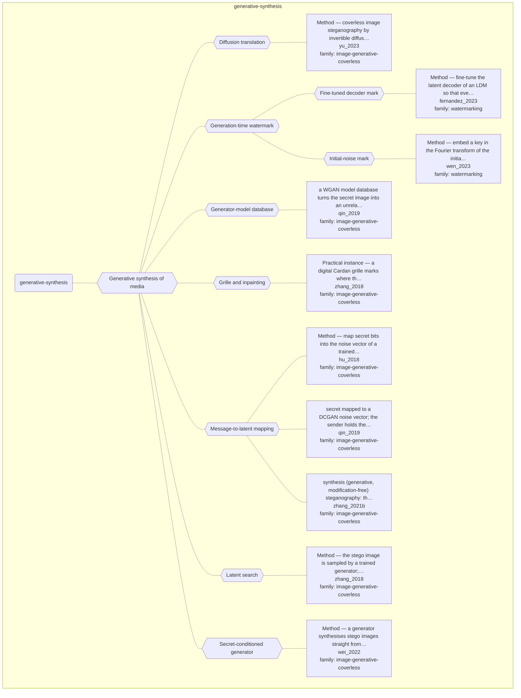

# Approach map — mechanism class generative-synthesis

Built by `tools/build_approach_map.py` from `C:\Users\user\Documents\GitHub\hypersteg_chess\hypersteg_novelty_kit_20261108\literature\verified_claims`, the features table `C:\Users\user\Documents\GitHub\hypersteg_chess\hypersteg_novelty_kit_20261108\maps\approach_features.tsv` and the mechanism taxonomy `C:\Users\user\Documents\GitHub\hypersteg_chess\hypersteg_novelty_kit_20261108\maps\mechanism_taxonomy.tsv`. Mechanism overview: [approach_map_mechanisms.md](approach_map_mechanisms.md). Each approach leaf names its paper family.

- mechanisms: 10
- approaches: 10
- families: 2 (image-generative-coverless, watermarking)

## Mechanisms

| mechanism | parent | class | name | definition | grounded by | landing | approaches |
| --- | --- | --- | --- | --- | --- | --- | --- |
| `m-decoder-finetune-mark` | m-generation-time-watermark | generative-synthesis | Fine-tuned decoder mark | The latent decoder of a diffusion model is fine-tuned so that every generated image carries a fixed binary signature. | `fernandez_2023:approach-stable-signature` | yes | 1 |
| `m-diffusion-translation` | m-generative-synthesis | generative-synthesis | Diffusion translation | A pre-trained conditional diffusion model, with different conditions in its forward and backward processes, translates a secret image into a container without additional training. | `yu_2023:approach-cross` | yes | 1 |
| `m-generation-time-watermark` | m-generative-synthesis | generative-synthesis | Generation-time watermark | The mark is introduced while a generative model produces the image, through the model's parameters or its sampling input. | `fernandez_2023:approach-stable-signature` | yes | 2 |
| `m-generative-synthesis` | — | generative-synthesis | Generative synthesis of media | A shared generator produces the container directly from the message, so no cover is modified, and an extractor recovers the message. | `zhang_2021b:surveyed-synthesis-generative` | yes | 10 |
| `m-generator-model-database` | m-generative-synthesis | generative-synthesis | Generator-model database | A database of generative models turns a secret image into an unrelated-looking image and back. | `qin_2019:surveyed-wgan-model-database` | yes | 1 |
| `m-grille-inpainting` | m-generative-synthesis | generative-synthesis | Grille and inpainting | A shared mask (a digital Cardan grille) marks where the message is written and a generator completes the rest of the image. | `zhang_2018:approach-cardan-grille-inpainting` | yes | 1 |
| `m-initial-noise-mark` | m-generation-time-watermark | generative-synthesis | Initial-noise mark | A pattern is written into the Fourier transform of the initial noise vector used for sampling, with no change to the model. | `wen_2023:approach-tree-ring` | yes | 1 |
| `m-latent-mapping` | m-generative-synthesis | generative-synthesis | Message-to-latent mapping | Secret bits are mapped to the generator's noise vector and a trained extractor recovers them from the generated image. | `hu_2018:approach-dcgan-swe` | yes | 3 |
| `m-latent-search` | m-generative-synthesis | generative-synthesis | Latent search | The generator's latent space is searched for the encoding whose output carries the message. | `zhang_2018:approach-gss` | yes | 1 |
| `m-secret-conditioned-generator` | m-generative-synthesis | generative-synthesis | Secret-conditioned generator | A secret block inside the generator writes the secret data into its feature maps during image generation. | `wei_2022:approach-gsn` | yes | 1 |

## Approaches

| address | name | family | technique | channel | key | access | capacity | mechanism | landable | mechanism_evidence | carrier | acquisition |
| --- | --- | --- | --- | --- | --- | --- | --- | --- | --- | --- | --- | --- |
| `fernandez_2023:approach-stable-signature` | Method — fine-tune the latent decoder of an LDM so that every generated image carries a binary signature | watermarking | wm-decoder-finetune | latent-generative | shared-key | training | 48-bit signature | m-decoder-finetune-mark | yes | own | images from a latent diffusion model | weight-trained |
| `hu_2018:approach-dcgan-swe` | Method — map secret bits into the noise vector of a trained DCGAN generator; no embedding | image-generative-coverless | igc-latent-mapping | latent-generative | shared-model | training | σ bits per noise value, 3×\|z\| bits per image; 9.16e-3 bytes/pixel; recovery accuracy about 0.89–0.96, not 100% | m-latent-mapping | yes | own | generated images (generator noise vector) | weight-trained |
| `qin_2019:surveyed-dcgan-noise-vector` | secret mapped to a DCGAN noise vector; the sender holds the generator, the receiver the extractor | image-generative-coverless | igc-latent-mapping | latent-generative | shared-model | training | — | m-latent-mapping | yes | own | generated images (generator noise vector) | weight-trained |
| `qin_2019:surveyed-wgan-model-database` | a WGAN model database turns the secret image into an unrelated-looking image and back | image-generative-coverless | igc-model-database | latent-generative | shared-model | training | — | m-generator-model-database | yes | own | generated images | weight-trained |
| `wei_2022:approach-gsn` | Method — a generator synthesises stego images straight from secret data, with no cover | image-generative-coverless | igc-secret-conditioned-generator | latent-generative | shared-model | training | 1–8 bpp; extraction accuracy 97.5% at 1 bpp, about 59–61% at 8 bpp | m-secret-conditioned-generator | yes | own | generated images (generator feature maps) | weight-trained |
| `wen_2023:approach-tree-ring` | Method — embed a key in the Fourier transform of the initial diffusion noise; detect by DDIM inversion | watermarking | wm-initial-noise | latent-generative | shared-key | weights | zero-bit (presence test); capacity for multiple keys stated as open | m-initial-noise-mark | yes | own | initial diffusion noise (Fourier space) | specified |
| `yu_2023:approach-cross` | Method — coverless image steganography by invertible diffusion translation, with no training | image-generative-coverless | igc-diffusion-inversion | latent-generative | shared-key | weights | one secret image per container image | m-diffusion-translation | yes | own | generated container images | specified |
| `zhang_2018:approach-cardan-grille-inpainting` | Practical instance — a digital Cardan grille marks where the message is written; semantic inpainting fills the rest | image-generative-coverless | igc-grille-inpainting | pixel-spatial | shared-key | training | recovery above 70% at bit plane 7; higher bit planes more stable | m-grille-inpainting | yes | own | pixels at grille positions of an inpainted image | weight-trained |
| `zhang_2018:approach-gss` | Method — the stego image is sampled by a trained generator; no explicit cover | image-generative-coverless | igc-latent-search | latent-generative | shared-key | training | 1.49e-3 to 1.10e-2 bytes per pixel, to be multiplied by the extraction rate | m-latent-search | yes | own | generated images (searched latent code) | weight-trained |
| `zhang_2021b:surveyed-synthesis-generative` | synthesis (generative, modification-free) steganography: the container is generated from the message by a shared generator and extractor | image-generative-coverless | igc-latent-mapping | latent-generative | shared-model | training | — | m-latent-mapping | yes | own | generated images | weight-trained |
