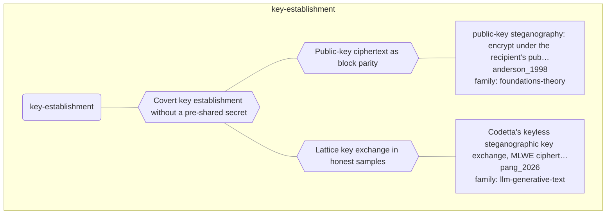

# Approach map — mechanism class key-establishment

Built by `tools/build_approach_map.py` from `C:\Users\user\Documents\GitHub\hypersteg_chess\hypersteg_novelty_kit_20261108\literature\verified_claims`, the features table `C:\Users\user\Documents\GitHub\hypersteg_chess\hypersteg_novelty_kit_20261108\maps\approach_features.tsv` and the mechanism taxonomy `C:\Users\user\Documents\GitHub\hypersteg_chess\hypersteg_novelty_kit_20261108\maps\mechanism_taxonomy.tsv`. Mechanism overview: [approach_map_mechanisms.md](approach_map_mechanisms.md). Each approach leaf names its paper family.

- mechanisms: 3
- approaches: 2
- families: 2 (foundations-theory, llm-generative-text)

## Mechanisms

| mechanism | parent | class | name | definition | grounded by | landing | approaches |
| --- | --- | --- | --- | --- | --- | --- | --- |
| `m-key-establishment` | — | key-establishment | Covert key establishment without a pre-shared secret | Ciphertext under the recipient's public key, such as a session key, is carried in the cover, so parties who share no secret can still communicate covertly. | `anderson_1998:approach-public-key-steganography` | yes | 2 |
| `m-public-key-block-parity` | m-key-establishment | key-establishment | Public-key ciphertext as block parity | The message is encrypted under the recipient's public key and embedded as the parities of successive cover blocks. | `anderson_1998:approach-public-key-steganography` | yes | 1 |
| `m-sampled-lattice-key-exchange` | m-key-establishment | key-establishment | Lattice key exchange in honest samples | MLWE ciphertext coefficients are carried as small displacements in blocks that are honest samples from the sender's model, so that independently deployed agents agree a key. | `pang_2026:mlwe-steganographic-key-exchange` | yes | 1 |

## Approaches

| address | name | family | technique | channel | key | access | capacity | mechanism | landable | mechanism_evidence | carrier | acquisition |
| --- | --- | --- | --- | --- | --- | --- | --- | --- | --- | --- | --- | --- |
| `anderson_1998:approach-public-key-steganography` | public-key steganography: encrypt under the recipient's public key and embed as block parities; every recipient tries to decrypt, and against an active warden a one-time key permutes the cover bits | foundations-theory | ft-public-key-steganography; ft-keyed-parity | other (parity of successive cover blocks) | none | — | — | m-public-key-block-parity | yes | own | parity of successive cover blocks | specified |
| `pang_2026:approach-codetta-key-exchange` | Codetta's keyless steganographic key exchange, MLWE ciphertexts carried over honest model samples | llm-generative-text | lgt-public-key-sampling | distributional-sampling | none | sender: logits; receiver: logits of the public draft model | about 80k visible tokens per 128-bit key (640 tokens per key bit) | m-sampled-lattice-key-exchange | yes | own | token sampling in agent messages | specified |
