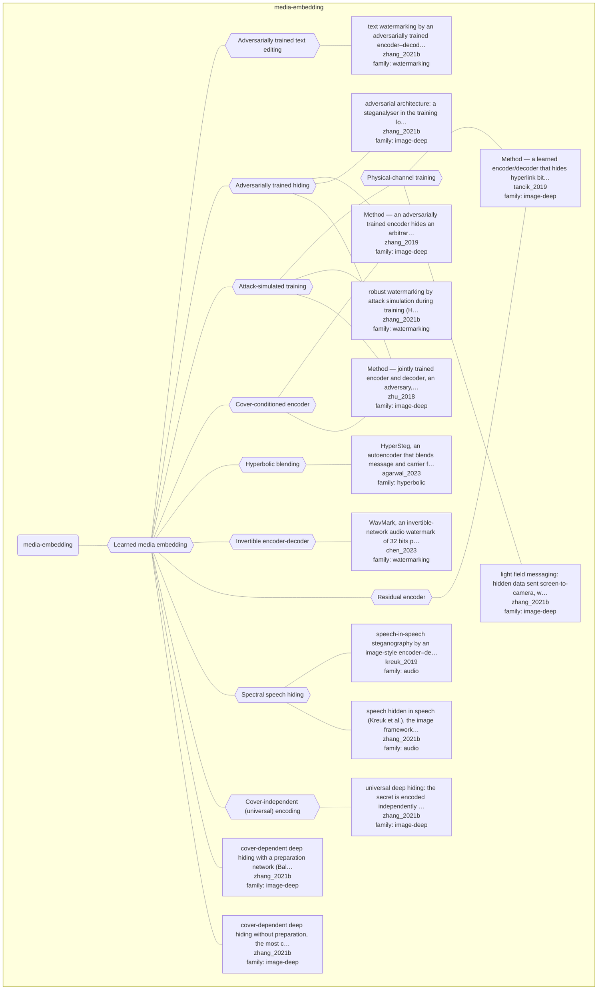

# Approach map — mechanism class media-embedding

Built by `tools/build_approach_map.py` from `C:\Users\user\Documents\GitHub\hypersteg_chess\hypersteg_novelty_kit_20261108\literature\verified_claims`, the features table `C:\Users\user\Documents\GitHub\hypersteg_chess\hypersteg_novelty_kit_20261108\maps\approach_features.tsv` and the mechanism taxonomy `C:\Users\user\Documents\GitHub\hypersteg_chess\hypersteg_novelty_kit_20261108\maps\mechanism_taxonomy.tsv`. Mechanism overview: [approach_map_mechanisms.md](approach_map_mechanisms.md). Each approach leaf names its paper family.

- mechanisms: 11
- approaches: 14
- families: 4 (audio, hyperbolic, image-deep, watermarking)

## Mechanisms

| mechanism | parent | class | name | definition | grounded by | landing | approaches |
| --- | --- | --- | --- | --- | --- | --- | --- |
| `m-adversarial-text-editing` | m-media-embedding | media-embedding | Adversarially trained text editing | A jointly and adversarially trained encoder-decoder transformer takes a text and a binary message and outputs the text unobtrusively modified. | `zhang_2021b:surveyed-adversarial-watermarking-transformer` | yes | 1 |
| `m-adversarial-training` | m-media-embedding | media-embedding | Adversarially trained hiding | Containers and covers are fed to an adversarial model, making training a three-player game. | `zhang_2021b:surveyed-adversarial-architecture` | yes | 3 |
| `m-attack-simulated-training` | m-media-embedding | media-embedding | Attack-simulated training | Containers are distorted by simulated attacks during training before they reach the reveal network, so the mark survives them. | `zhang_2021b:surveyed-noise-augmentation-watermarking` | yes | 4 |
| `m-cover-conditioned-encoder` | m-media-embedding | media-embedding | Cover-conditioned encoder | The encoder takes the cover as well as the message, so the embedding depends on the cover; HiDDeN, for instance, concatenates the spatially replicated message to its intermediate representation of the cover. | `zhu_2018:approach-hidden` | yes | 2 |
| `m-hyperbolic-blending` | m-media-embedding | media-embedding | Hyperbolic blending | Message and carrier features are mapped to the Poincare ball, concatenated in the tangent space and mapped back to the ball. | `agarwal_2023:hypersteg-poincare-beta-concatenation` | yes | 1 |
| `m-invertible-encoder` | m-media-embedding | media-embedding | Invertible encoder-decoder | An invertible network performs encoding and decoding as reciprocal processes with shared parameters. | `chen_2023:approach-wavmark` | yes | 1 |
| `m-media-embedding` | — | media-embedding | Learned media embedding | Trainable networks hide data in an existing image or audio signal and recover it. | `zhu_2018:approach-hidden` | yes | 14 |
| `m-physical-channel-training` | m-attack-simulated-training | media-embedding | Physical-channel training | The simulated distortions are those of real printing, display and photography. | `tancik_2019:approach-stegastamp` | yes | 2 |
| `m-residual-encoder` | m-media-embedding | media-embedding | Residual encoder | The encoder outputs a residual image that is added back to the cover; the message enters as an extra input channel. | `tancik_2019:residual-encoder` | yes | 1 |
| `m-spectral-audio-hiding` | m-media-embedding | media-embedding | Spectral speech hiding | STFT and inverse-STFT layers inside the network let speech be hidden in speech. | `kreuk_2019:approach-hide-and-speak` | yes | 2 |
| `m-universal-perturbation` | m-media-embedding | media-embedding | Cover-independent (universal) encoding | The secret is encoded independently of the cover image. | `zhang_2021b:surveyed-universal-deep-hiding` | yes | 1 |

## Approaches

| address | name | family | technique | channel | key | access | capacity | mechanism | landable | mechanism_evidence | carrier | acquisition |
| --- | --- | --- | --- | --- | --- | --- | --- | --- | --- | --- | --- | --- |
| `agarwal_2023:approach-hypersteg` | HyperSteg, an autoencoder that blends message and carrier features on the Poincaré ball, built on hyperbolic neural networks | hyperbolic | hy-hyperbolic-hiding | latent-generative | — | training | — | m-hyperbolic-blending | yes | sibling:hypersteg-poincare-beta-concatenation | image or audio carrier features | weight-trained |
| `chen_2023:approach-wavmark` | WavMark, an invertible-network audio watermark of 32 bits per 1-second segment, with encoder and decoder sharing parameters | watermarking | wm-learned-post-hoc | transform-domain | shared-model | training | 32 bits per 1-second segment (32 bps); 10 of 32 bits spent on pattern bits for locating | m-invertible-encoder | yes | own | audio waveform (1-second segments) | weight-trained |
| `kreuk_2019:approach-hide-and-speak` | speech-in-speech steganography by an image-style encoder–decoder network with differentiable STFT and inverse-STFT layers | audio | au-deep-speech-hiding | transform-domain | shared-model | training | one to five speech messages in one speech carrier of unchanged dimension; quality falls as the count rises | m-spectral-audio-hiding | yes | own | speech audio (STFT magnitudes) | weight-trained |
| `tancik_2019:approach-stegastamp` | Method — a learned encoder/decoder that hides hyperlink bitstrings in photos, robust to printing and photography | image-deep | id-physical-channel | pixel-spatial | shared-model | training | 100 encoded bits per image; at least 56 bits after BCH error correction | m-physical-channel-training; m-residual-encoder | yes | own;sibling:residual-encoder | printed or displayed photographs, re-captured | weight-trained |
| `zhang_2019:approach-steganogan` | Method — an adversarially trained encoder hides an arbitrary bit tensor in a cover image; a decoder recovers it | image-deep | id-adversarial-training | pixel-spatial | shared-model | training | up to 4.4 RS-bpp (Reed–Solomon-corrected); 2 bpp while Ye-net auROC stays at or below 0.8 | m-adversarial-training; m-cover-conditioned-encoder | yes | own;own | cover image pixels | weight-trained |
| `zhang_2021b:surveyed-adversarial-architecture` | adversarial architecture: a steganalyser in the training loop, a three-player game; it does not guarantee resistance to an independently trained steganalyser | image-deep | id-adversarial-training | pixel-spatial | — | training | — | m-adversarial-training | yes | own | image pixels | weight-trained |
| `zhang_2021b:surveyed-adversarial-watermarking-transformer` | text watermarking by an adversarially trained encoder–decoder transformer (AWT), set apart from generative text methods | watermarking | wm-learned-post-hoc | other (unobtrusive modification of an input text; edit type not stated) | — | training | binary message | m-adversarial-text-editing | yes | own | edited text | weight-trained |
| `zhang_2021b:surveyed-ddh-with-preparation` | cover-dependent deep hiding with a preparation network (Baluja): a full image hidden in another, at 24 bpp, and easily detected | image-deep | id-cover-dependent | pixel-spatial | — | — | 24 bpp (a full-size colour image in another of the same size) | m-media-embedding | yes | own | image pixels | weight-trained |
| `zhang_2021b:surveyed-ddh-without-preparation` | cover-dependent deep hiding without preparation, the most common architecture | image-deep | id-cover-dependent | pixel-spatial | — | — | — | m-media-embedding | yes | own | image pixels | weight-trained |
| `zhang_2021b:surveyed-light-field-messaging` | light field messaging: hidden data sent screen-to-camera, with robustness rather than undetectability as the goal | image-deep | id-physical-channel | pixel-spatial | — | — | — | m-physical-channel-training | yes | own | images shown on a screen and photographed | weight-trained |
| `zhang_2021b:surveyed-noise-augmentation-watermarking` | robust watermarking by attack simulation during training (HiDDeN and successors); JPEG's non-differentiability is the chief obstacle | watermarking | wm-learned-post-hoc | pixel-spatial | — | training | — | m-attack-simulated-training | yes | own | image pixels | weight-trained |
| `zhang_2021b:surveyed-speech-in-speech` | speech hidden in speech (Kreuk et al.), the image framework carried over with differentiable STFT layers | audio | au-deep-speech-hiding | transform-domain | — | training | — | m-spectral-audio-hiding | yes | own | speech audio | weight-trained |
| `zhang_2021b:surveyed-universal-deep-hiding` | universal deep hiding: the secret is encoded independently of the cover and can be added to any cover | image-deep | id-universal | pixel-spatial | — | — | — | m-universal-perturbation | yes | own | image pixels | weight-trained |
| `zhu_2018:approach-hidden` | Method — jointly trained encoder and decoder, an adversary, and optional noise layers between them | image-deep | id-adversarial-training | pixel-spatial | shared-model | training | 0.203 bpp (52 bits per 16×16 patch), bit error below 1e-5 | m-cover-conditioned-encoder; m-attack-simulated-training; m-adversarial-training | yes | own;own;partial | image pixels | weight-trained |
