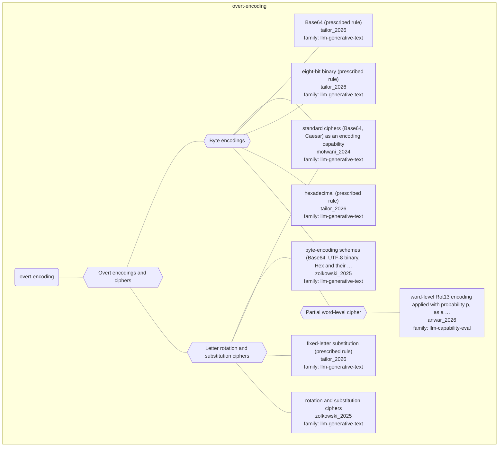

# Approach map — mechanism class overt-encoding

Built by `tools/build_approach_map.py` from `C:\Users\user\Documents\GitHub\hypersteg_chess\hypersteg_novelty_kit_20261108\literature\verified_claims`, the features table `C:\Users\user\Documents\GitHub\hypersteg_chess\hypersteg_novelty_kit_20261108\maps\approach_features.tsv` and the mechanism taxonomy `C:\Users\user\Documents\GitHub\hypersteg_chess\hypersteg_novelty_kit_20261108\maps\mechanism_taxonomy.tsv`. Mechanism overview: [approach_map_mechanisms.md](approach_map_mechanisms.md). Each approach leaf names its paper family.

- mechanisms: 4
- approaches: 8
- families: 2 (llm-capability-eval, llm-generative-text)

## Mechanisms

| mechanism | parent | class | name | definition | grounded by | landing | approaches |
| --- | --- | --- | --- | --- | --- | --- | --- |
| `m-byte-encoding` | m-overt-encoding | overt-encoding | Byte encodings | The message is written as Base64, UTF-8 binary or hexadecimal, possibly with bit swaps, rotations or repeated application. | `zolkowski_2025:surveyed-byte-encodings` | yes | 5 |
| `m-letter-substitution-cipher` | m-overt-encoding | overt-encoding | Letter rotation and substitution ciphers | Each letter is rotated by N places or replaced under a provided character mapping. | `zolkowski_2025:surveyed-rotation-substitution` | yes | 4 |
| `m-overt-encoding` | — | overt-encoding | Overt encodings and ciphers | The message is transformed by a standard encoding or cipher and written into the text, which hides its content but not that something is encoded. | `tailor_2026:surveyed-base64` | yes | 8 |
| `m-partial-word-cipher` | m-letter-substitution-cipher | overt-encoding | Partial word-level cipher | Rot13 is applied to each word independently with probability p, interpolating between legible and fully enciphered text. | `anwar_2026:surveyed-rot13-partial-encoding` | yes | 1 |

## Approaches

| address | name | family | technique | channel | key | access | capacity | mechanism | landable | mechanism_evidence | carrier | acquisition |
| --- | --- | --- | --- | --- | --- | --- | --- | --- | --- | --- | --- | --- |
| `anwar_2026:surveyed-rot13-partial-encoding` | word-level Rot13 encoding applied with probability p, as a graded steganography simulation | llm-capability-eval | lce-partial-encoding | lexical | codebook | prompt | — | m-partial-word-cipher | yes | own | words in a reasoning trace | specified |
| `motwani_2024:surveyed-standard-ciphers` | standard ciphers (Base64, Caesar) as an encoding capability | llm-generative-text | lgt-byte-encodings; lgt-substitution-ciphers | other (cipher encoding, not hidden) | codebook | prompt | — | m-byte-encoding; m-letter-substitution-cipher | yes | own;own | encoded string in text | prompted |
| `tailor_2026:surveyed-base64` | Base64 (prescribed rule) | llm-generative-text | lgt-byte-encodings | other (literal Base64 string) | codebook | prompt | — | m-byte-encoding | yes | own | encoded string in text | prompted |
| `tailor_2026:surveyed-eight-bit-binary` | eight-bit binary (prescribed rule) | llm-generative-text | lgt-byte-encodings | other (literal binary string) | codebook | prompt | eight binary digits per character | m-byte-encoding | yes | own | encoded string in text | prompted |
| `tailor_2026:surveyed-fixed-letter-substitution` | fixed-letter substitution (prescribed rule) | llm-generative-text | lgt-substitution-ciphers | other (substitution-cipher letters) | codebook | prompt | — | m-letter-substitution-cipher | yes | own | enciphered letters in text | prompted |
| `tailor_2026:surveyed-hexadecimal` | hexadecimal (prescribed rule) | llm-generative-text | lgt-byte-encodings | other (literal hex string) | codebook | prompt | — | m-byte-encoding | yes | own | encoded string in text | prompted |
| `zolkowski_2025:surveyed-byte-encodings` | byte-encoding schemes (Base64, UTF-8 binary, Hex and their variants) | llm-generative-text | lgt-byte-encodings | other (overt encoding) | codebook | prompt | — | m-byte-encoding | yes | own | encoded string in text | prompted |
| `zolkowski_2025:surveyed-rotation-substitution` | rotation and substitution ciphers | llm-generative-text | lgt-substitution-ciphers | other (overt cipher) | codebook | prompt | — | m-letter-substitution-cipher | yes | own | enciphered letters in text | prompted |
