# Approach map — mechanism class sampling

Built by `tools/build_approach_map.py` from `C:\Users\user\Documents\GitHub\hypersteg_chess\hypersteg_novelty_kit_20261108\literature\verified_claims`, the features table `C:\Users\user\Documents\GitHub\hypersteg_chess\hypersteg_novelty_kit_20261108\maps\approach_features.tsv` and the mechanism taxonomy `C:\Users\user\Documents\GitHub\hypersteg_chess\hypersteg_novelty_kit_20261108\maps\mechanism_taxonomy.tsv`. Mechanism overview: [approach_map_mechanisms.md](approach_map_mechanisms.md). Each approach leaf names its paper family.

- mechanisms: 26
- approaches: 23
- families: 3 (foundations-theory, linguistic-text, llm-generative-text)

```mermaid
flowchart TD
  subgraph cls_sampling_g["sampling"]
    cls_sampling("sampling")
    mech_m_balanced_partition{{"Near-equiprobable partition"}}
    mech_m_coupling{{"Coupling codes"}}
    mech_m_distribution_copies{{"Distribution copies"}}
    mech_m_feedback_coding{{"Feedback (posterior-matching) coding"}}
    mech_m_fixed_bins{{"Fixed shared bins"}}
    mech_m_huffman_every_step{{"Huffman at every step"}}
    mech_m_huffman_patient{{"Thresholded (patient) Huffman"}}
    mech_m_hyperplane_buckets{{"Hyperplane buckets"}}
    mech_m_interval_adaptive_truncation{{"Interval coding with per-step truncation"}}
    mech_m_interval_coding{{"Interval (range or arithmetic) coding"}}
    mech_m_interval_keyed_randomness{{"Keyed sampling-randomness embedding"}}
    mech_m_interval_plain{{"Plain range partition over a fixed model"}}
    mech_m_maximal_coupling_public_draft{{"Maximal coupling through a public draft model"}}
    mech_m_min_entropy_coupling{{"Minimum-entropy coupling"}}
    mech_m_partition_codes{{"Partition codes"}}
    mech_m_prefix_codes{{"Prefix-code (Huffman) sampling"}}
    mech_m_pseudorandom_watermark_code{{"Key-correlated sampling randomness"}}
    mech_m_recursive_balanced_grouping{{"Recursive near-equiprobable grouping"}}
    mech_m_rejection_keyed_stateful{{"Keyed, bounded rejection sampling"}}
    mech_m_rejection_public_unbiased{{"Rejection sampling with a public unbiased function"}}
    mech_m_rejection_sampling{{"Rejection sampling"}}
    mech_m_robust_feature_function{{"Keyed function of a robust document feature"}}
    mech_m_sampling{{"Distribution-steered sampling codes"}}
    mech_m_shared_sample_robust{{"Shared-sample robust coding"}}
    mech_m_token_partition_watermark{{"Token-partition (red-green) watermark codes"}}
    mech_m_universal_estimate_and_sample{{"Estimate-and-sample universal stegosystem"}}
    n_cachin_1998_approach_balanced_partition["the balanced-partition stegosystem: split the covertext alp…<br/>cachin_1998<br/>family: foundations-theory"]
    n_cachin_2004_approach_balanced_partition["the balanced-partition stegosystem for arbitrary known dist…<br/>cachin_2004<br/>family: foundations-theory"]
    n_cachin_2004_approach_universal_stegosystem["the universal stegosystem: approximate the covertext distri…<br/>cachin_2004<br/>family: foundations-theory"]
    n_dai_2019_approach_patient_huffman["patient-Huffman, per-step Huffman coding of the LM distribu…<br/>dai_2019<br/>family: llm-generative-text"]
    n_dai_2019_surveyed_bins["Bins (Fang et al. 2017), a shared random partition of the v…<br/>dai_2019<br/>family: llm-generative-text"]
    n_dai_2019_surveyed_vlc_huffman["VLC (Yang et al. 2018), a Huffman code over the vocabulary …<br/>dai_2019<br/>family: llm-generative-text"]
    n_ding_2023_approach_discop["Discop, sampling from one of several rotated #quot;distribution …<br/>ding_2023<br/>family: llm-generative-text"]
    n_guo_2026_approach_bam_feedback_coding["BAM (Burnashev Adaptive Posterior Matching): black-box LLM …<br/>guo_2026<br/>family: llm-generative-text"]
    n_hopper_2002_approach_robust_text_shingling["Construction 4, robust protocol for text-like channels: a k…<br/>hopper_2002<br/>family: foundations-theory"]
    n_hopper_2002_approach_stateful_rejection_sampling["Construction 1, stateful rejection sampling: for each encod…<br/>hopper_2002<br/>family: foundations-theory"]
    n_hopper_2002_approach_stateless_unbiased_function["Construction 2, stateless: encrypt with an IND$-CPA cipher,…<br/>hopper_2002<br/>family: foundations-theory"]
    n_hopper_2002_approach_universally_robust["Construction 3, universally robust: channel draws from shar…<br/>hopper_2002<br/>family: foundations-theory"]
    n_kaptchuk_2021_approach_meteor["Meteor: a symmetric-key, stateful, provably secure scheme t…<br/>kaptchuk_2021<br/>family: llm-generative-text"]
    n_moraldo_2014_approach_markov_range_partition["Markov-chain text generation with probability-proportional …<br/>moraldo_2014<br/>family: linguistic-text"]
    n_pang_2026_approach_codetta_keyed["Codetta's keyed protocol, high-capacity asymmetric steganog…<br/>pang_2026<br/>family: llm-generative-text"]
    n_roger_2023_surveyed_balanced_marking["balanced-marking watermark used for steganography<br/>roger_2023<br/>family: llm-generative-text"]
    n_roger_2023_surveyed_cycle_shifting_watermark["cycle-shifting watermark used for steganography<br/>roger_2023<br/>family: llm-generative-text"]
    n_schroederdewitt_2022_approach_imec["minimum entropy coupling steganography (iMEC): encode by co…<br/>schroederdewitt_2022<br/>family: llm-generative-text"]
    n_shen_2020_approach_saac["SAAC, arithmetic coding over a pretrained LM in which the t…<br/>shen_2020<br/>family: llm-generative-text"]
    n_westphal_2026_approach_evasive_steganographic_trojan["the evasive steganographic trojan: an LLM fine-tuned to enc…<br/>westphal_2026<br/>family: llm-generative-text"]
    n_zamir_2024_approach_undetectable_llm_stego["undetectable LLM steganography: the CGZ undetectable waterm…<br/>zamir_2024<br/>family: llm-generative-text"]
    n_zhang_2021_approach_adg["ADG, equal-probability grouping of the vocabulary at each s…<br/>zhang_2021<br/>family: llm-generative-text"]
    n_ziegler_2019_approach_arithmetic_coding["arithmetic-coding steganography over a large neural languag…<br/>ziegler_2019<br/>family: llm-generative-text"]
  end
  mech_m_partition_codes --- mech_m_balanced_partition
  mech_m_sampling --- mech_m_coupling
  mech_m_sampling --- mech_m_distribution_copies
  mech_m_sampling --- mech_m_feedback_coding
  mech_m_partition_codes --- mech_m_fixed_bins
  mech_m_prefix_codes --- mech_m_huffman_every_step
  mech_m_prefix_codes --- mech_m_huffman_patient
  mech_m_partition_codes --- mech_m_hyperplane_buckets
  mech_m_interval_coding --- mech_m_interval_adaptive_truncation
  mech_m_sampling --- mech_m_interval_coding
  mech_m_interval_coding --- mech_m_interval_keyed_randomness
  mech_m_interval_coding --- mech_m_interval_plain
  mech_m_coupling --- mech_m_maximal_coupling_public_draft
  mech_m_coupling --- mech_m_min_entropy_coupling
  mech_m_sampling --- mech_m_partition_codes
  mech_m_sampling --- mech_m_prefix_codes
  mech_m_sampling --- mech_m_pseudorandom_watermark_code
  mech_m_balanced_partition --- mech_m_recursive_balanced_grouping
  mech_m_rejection_sampling --- mech_m_rejection_keyed_stateful
  mech_m_rejection_sampling --- mech_m_rejection_public_unbiased
  mech_m_sampling --- mech_m_rejection_sampling
  mech_m_sampling --- mech_m_robust_feature_function
  cls_sampling --- mech_m_sampling
  mech_m_sampling --- mech_m_shared_sample_robust
  mech_m_sampling --- mech_m_token_partition_watermark
  mech_m_sampling --- mech_m_universal_estimate_and_sample
  mech_m_balanced_partition --- n_cachin_1998_approach_balanced_partition
  mech_m_balanced_partition --- n_cachin_2004_approach_balanced_partition
  mech_m_universal_estimate_and_sample --- n_cachin_2004_approach_universal_stegosystem
  mech_m_huffman_patient --- n_dai_2019_approach_patient_huffman
  mech_m_fixed_bins --- n_dai_2019_surveyed_bins
  mech_m_huffman_every_step --- n_dai_2019_surveyed_vlc_huffman
  mech_m_distribution_copies --- n_ding_2023_approach_discop
  mech_m_feedback_coding --- n_guo_2026_approach_bam_feedback_coding
  mech_m_coupling --- n_guo_2026_approach_bam_feedback_coding
  mech_m_robust_feature_function --- n_hopper_2002_approach_robust_text_shingling
  mech_m_rejection_keyed_stateful --- n_hopper_2002_approach_stateful_rejection_sampling
  mech_m_rejection_public_unbiased --- n_hopper_2002_approach_stateless_unbiased_function
  mech_m_shared_sample_robust --- n_hopper_2002_approach_universally_robust
  mech_m_interval_keyed_randomness --- n_kaptchuk_2021_approach_meteor
  mech_m_interval_plain --- n_moraldo_2014_approach_markov_range_partition
  mech_m_maximal_coupling_public_draft --- n_pang_2026_approach_codetta_keyed
  mech_m_token_partition_watermark --- n_roger_2023_surveyed_balanced_marking
  mech_m_token_partition_watermark --- n_roger_2023_surveyed_cycle_shifting_watermark
  mech_m_min_entropy_coupling --- n_schroederdewitt_2022_approach_imec
  mech_m_interval_adaptive_truncation --- n_shen_2020_approach_saac
  mech_m_hyperplane_buckets --- n_westphal_2026_approach_evasive_steganographic_trojan
  mech_m_pseudorandom_watermark_code --- n_zamir_2024_approach_undetectable_llm_stego
  mech_m_recursive_balanced_grouping --- n_zhang_2021_approach_adg
  mech_m_interval_plain --- n_ziegler_2019_approach_arithmetic_coding
  linkStyle 0,1,2,3,4,5,6,7,8,9,10,11,12,13,14,15,16,17,18,19,20,21,22,23,24,25,26,27,28,29,30,31,32,33,34,35,36,37,38,39,40,41,42,43,44,45,46,47,48,49 stroke:#9e9e9e,stroke-width:1px
```

## Mechanisms

| mechanism | parent | class | name | definition | grounded by | landing | approaches |
| --- | --- | --- | --- | --- | --- | --- | --- |
| `m-balanced-partition` | m-partition-codes | sampling | Near-equiprobable partition | The cover space is split into parts of approximately equal probability mass and the message bit picks the part to sample from. | `cachin_1998:approach-balanced-partition` | yes | 3 |
| `m-coupling` | m-sampling | sampling | Coupling codes | Ciphertext that looks uniformly random is joined to the cover distribution by a coupling, so the published symbol follows the cover distribution. | `schroederdewitt_2022:approach-imec` | yes | 3 |
| `m-distribution-copies` | m-sampling | sampling | Distribution copies | Copies of the token distribution are made by rotating its intervals, and the message decides which copy the token is sampled from. | `ding_2023:distribution-copies` | yes | 1 |
| `m-feedback-coding` | m-sampling | sampling | Feedback (posterior-matching) coding | Every generated token is observed by both parties, so generation is a channel with noiseless feedback and each token guides the next embedding step. | `guo_2026:generation-as-feedback-channel` | yes | 1 |
| `m-fixed-bins` | m-partition-codes | sampling | Fixed shared bins | A shared random partition of the vocabulary into equal-sized bins lets the bin of each token carry a fixed-length block of ciphertext. | `dai_2019:surveyed-bins` | yes | 1 |
| `m-huffman-every-step` | m-prefix-codes | sampling | Huffman at every step | A Huffman code over the vocabulary is rebuilt at every step and followed bit by bit from the root to a leaf token. | `dai_2019:surveyed-vlc-huffman` | yes | 1 |
| `m-huffman-patient` | m-prefix-codes | sampling | Thresholded (patient) Huffman | The Huffman code is used only at steps where its total variation distance from the model's distribution is small enough; otherwise the step samples from the model and waits. | `dai_2019:approach-patient-huffman` | yes | 1 |
| `m-hyperplane-buckets` | m-partition-codes | sampling | Hyperplane buckets | A random hyperplane in the embedding space splits the vocabulary into two buckets, and each output token carries one bit by the bucket it falls in. | `westphal_2026:hyperplane-bucket-encoding` | yes | 1 |
| `m-interval-adaptive-truncation` | m-interval-coding | sampling | Interval coding with per-step truncation | Arithmetic coding over a neural LM in which the number of candidate tokens kept, fixed in earlier work, is re-chosen at each step. | `shen_2020:approach-saac` | yes | 1 |
| `m-interval-coding` | m-sampling | sampling | Interval (range or arithmetic) coding | The message, read as a number, is decoded into symbols by partitioning a range in proportion to the model's probabilities: arithmetic coding run in reverse. | `ziegler_2019:reverse-arithmetic-coding` | yes | 4 |
| `m-interval-keyed-randomness` | m-interval-coding | sampling | Keyed sampling-randomness embedding | Message bits stand in for the random number used to sample each token, masked afresh at every sampling event by a generator keyed with state the two parties share. | `kaptchuk_2021:fresh-prg-mask` | yes | 1 |
| `m-interval-plain` | m-interval-coding | sampling | Plain range partition over a fixed model | At each step the range is partitioned to match the model's outbound probabilities and the symbol whose subrange contains the message number is emitted. | `moraldo_2014:approach-markov-range-partition` | yes | 2 |
| `m-maximal-coupling-public-draft` | m-coupling | sampling | Maximal coupling through a public draft model | A small public draft model that both parties run on the public transcript partitions the vocabulary into buckets, and a maximal coupling samples the published token exactly from the sender's private distribution. | `pang_2026:draft-buckets-maximal-coupling` | yes | 1 |
| `m-min-entropy-coupling` | m-coupling | sampling | Minimum-entropy coupling | An iterative minimum-entropy coupling joins uniform ciphertext to an autoregressively specified cover distribution. | `schroederdewitt_2022:imec-coding` | yes | 1 |
| `m-partition-codes` | m-sampling | sampling | Partition codes | The symbol space is split into groups and the message chooses the group from which the next symbol is drawn. | `cachin_2004:approach-balanced-partition` | yes | 5 |
| `m-prefix-codes` | m-sampling | sampling | Prefix-code (Huffman) sampling | A prefix code built from the model's distribution at each step is walked by the message bits to choose a token. | `dai_2019:surveyed-vlc-huffman` | yes | 2 |
| `m-pseudorandom-watermark-code` | m-sampling | sampling | Key-correlated sampling randomness | The model's sampling randomness is correlated with a secret key instead of its distribution being changed, and the watermark is extended to carry a payload. | `zamir_2024:builds-on-cgz` | yes | 1 |
| `m-recursive-balanced-grouping` | m-balanced-partition | sampling | Recursive near-equiprobable grouping | At each step the vocabulary is grouped adaptively into groups of approximately equal probability, the message chooses a group, and the operation repeats within it. | `zhang_2021:adg-adaptive-dynamic-grouping` | yes | 1 |
| `m-rejection-keyed-stateful` | m-rejection-sampling | sampling | Keyed, bounded rejection sampling | For each bit, at most two channel blocks are drawn, looking for one whose keyed pseudorandom function value F_K(N, c) equals the bit; the protocol is stateful. | `hopper_2002:approach-stateful-rejection-sampling` | yes | 1 |
| `m-rejection-public-unbiased` | m-rejection-sampling | sampling | Rejection sampling with a public unbiased function | A public function, assumed unbiased on the channel, decides whether a sampled block carries the next bit; the assumption does not hold for every channel. | `hopper_2002:approach-stateless-unbiased-function` | yes | 1 |
| `m-rejection-sampling` | m-sampling | sampling | Rejection sampling | Channel samples are drawn until a keyed or public function of one equals the next message bit; in the bounded form at most a fixed number of draws is made, trying to find a match. | `hopper_2002:rejection-sampling-prf` | yes | 2 |
| `m-robust-feature-function` | m-sampling | sampling | Keyed function of a robust document feature | A keyed function f picks the shingle of each document that maximises it, giving a protocol robust against a particular class of edits on text-like channels. | `hopper_2002:approach-robust-text-shingling` | yes | 1 |
| `m-sampling` | — | sampling | Distribution-steered sampling codes | The message is embedded in how each symbol is sampled from a model's distribution, for example in the random number used to sample, and the receiver recovers it from the distribution or the randomness. | `kaptchuk_2021:embed-in-sampling-randomness` | yes | 23 |
| `m-shared-sample-robust` | m-sampling | sampling | Shared-sample robust coding | Channel draws made with pseudorandom inputs that sender and receiver share stand in for shared blocks and lower the decoding error, so that robust hiding is possible against any admissible warden relation. | `hopper_2002:approach-universally-robust` | yes | 1 |
| `m-token-partition-watermark` | m-sampling | sampling | Token-partition (red-green) watermark codes | The message seeds or selects a split of tokens into favoured and disfavoured sets, biasing sampling, and the decoder picks the message whose split scores highest. | `roger_2023:surveyed-cycle-shifting-watermark` | yes | 2 |
| `m-universal-estimate-and-sample` | m-sampling | sampling | Estimate-and-sample universal stegosystem | The unknown cover distribution is estimated and stegotext is sampled from the estimate using the sender's private randomness. | `cachin_2004:approach-universal-stegosystem` | yes | 1 |

## Approaches

| address | name | family | technique | channel | key | access | capacity | mechanism | landable | mechanism_evidence | carrier | acquisition |
| --- | --- | --- | --- | --- | --- | --- | --- | --- | --- | --- | --- | --- |
| `cachin_1998:approach-balanced-partition` | the balanced-partition stegosystem: split the covertext alphabet into two parts of near-equal probability and let a one-bit shared key choose which part carries each message bit | foundations-theory | ft-balanced-partition | distributional-sampling | shared-key | — | one bit per covertext | m-balanced-partition | yes | own | choice of covertext from a near-equiprobable half | specified |
| `cachin_2004:approach-balanced-partition` | the balanced-partition stegosystem for arbitrary known distributions: a one-bit key chooses which of two near-equiprobable halves of the covertext space carries the bit | foundations-theory | ft-balanced-partition | distributional-sampling | shared-key | — | one bit per covertext | m-balanced-partition | yes | own | choice of covertext from a near-equiprobable half | specified |
| `cachin_2004:approach-universal-stegosystem` | the universal stegosystem: approximate the covertext distribution by universal compression, then generate stegotext from private randomness with the message one-time-padded into the encoder output | foundations-theory | ft-universal-compression | distributional-sampling | shared-key | — | message of up to n H(X) bits | m-universal-estimate-and-sample | yes | own | covertext sampled from an estimated distribution | specified |
| `dai_2019:approach-patient-huffman` | patient-Huffman, per-step Huffman coding of the LM distribution that encodes only at steps where the Huffman distribution is close enough to the LM's | llm-generative-text | lgt-huffman-patient | distributional-sampling | shared-key | logits | — | m-huffman-patient | yes | own | token sampling in generated text | specified |
| `dai_2019:surveyed-bins` | Bins (Fang et al. 2017), a shared random partition of the vocabulary into equal bins, the bin carrying a block of ciphertext | llm-generative-text | lgt-bins | lexical | shared-key | logits | — | m-fixed-bins | yes | own | token choice in generated text | specified |
| `dai_2019:surveyed-vlc-huffman` | VLC (Yang et al. 2018), a Huffman code over the vocabulary rebuilt at each step, walked by the ciphertext bits | llm-generative-text | lgt-huffman | distributional-sampling | shared-model | logits | — | m-huffman-every-step | yes | own | token sampling in generated text | specified |
| `ding_2023:approach-discop` | Discop, sampling from one of several rotated "distribution copies" chosen by the message, so the model's distribution is kept exactly; with KL measured against Meteor and ADG | llm-generative-text | lgt-distribution-copies | distributional-sampling | shared-key | logits | 3.48 to 5.76 bits per token, about 0.92 to 0.95 of the entropy limit | m-distribution-copies | yes | own | token sampling (also image and speech generation) | specified |
| `guo_2026:approach-bam-feedback-coding` | BAM (Burnashev Adaptive Posterior Matching): black-box LLM steganography recast as communication over a channel with causal, noiseless feedback, coded by posterior matching with a decode-and-confirm phase | llm-generative-text | lgt-feedback-coding | distributional-sampling | shared-key | sender: logits; receiver: no model access | 8-bit payload in under 50 tokens at most 0.1% message error; chess moves average 5.0 coded bits | m-feedback-coding; m-coupling | yes | own;sibling:ot-coupling-sampler | token sampling in agent conversation | specified |
| `hopper_2002:approach-robust-text-shingling` | Construction 4, robust protocol for text-like channels: a keyed PRF picks the maximising n-shingle of each document and an unbiased function of it carries the bit, surviving edits that preserve shingle overlap | foundations-theory | ft-keyed-feature-function | other (keyed function of the maximising n-shingle of a document) | shared-key | — | — | m-robust-feature-function | yes | partial | choice of document, read through its maximising shingle | specified |
| `hopper_2002:approach-stateful-rejection-sampling` | Construction 1, stateful rejection sampling: for each encoded bit, draw up to two channel blocks until a keyed PRF of block and counter equals the bit; taken from Anderson and Petitcolas | foundations-theory | ft-rejection-sampling | distributional-sampling | shared-key | — | one bit per block; some failure probability per bit, absorbed by an error-correcting code | m-rejection-keyed-stateful | yes | own | choice among channel samples | specified |
| `hopper_2002:approach-stateless-unbiased-function` | Construction 2, stateless: encrypt with an IND$-CPA cipher, then rejection-sample each block until a public function unbiased on the channel yields the next ciphertext bit; Cachin gave an information-theoretic version | foundations-theory | ft-rejection-sampling | distributional-sampling | shared-key | — | — | m-rejection-public-unbiased | yes | own | choice among channel samples | specified |
| `hopper_2002:approach-universally-robust` | Construction 3, universally robust: channel draws from shared pseudorandom inputs stand in for two shared secret blocks, each bit repeated n times, robust against any bounded warden but impractical | foundations-theory | ft-shared-sample-robust-code | distributional-sampling | shared-key | — | — | m-shared-sample-robust | yes | own | channel draws from shared pseudorandom inputs | specified |
| `kaptchuk_2021:approach-meteor` | Meteor: a symmetric-key, stateful, provably secure scheme that embeds message bits in the sampling randomness of a generative model, at a rate that follows the instantaneous entropy | llm-generative-text | lgt-interval-keyed-randomness | distributional-sampling | shared-key | logits | throughput proportional to channel entropy; bits per token depend strongly on the model | m-interval-keyed-randomness | yes | sibling:fresh-prg-mask | token sampling in generated text | specified |
| `moraldo_2014:approach-markov-range-partition` | Markov-chain text generation with probability-proportional range partitioning: the message, read as a number, picks at each word the outbound state whose subrange contains it, so the generated text keeps close to the chain's own transition probabilities | linguistic-text | lt-markov-generation | distributional-sampling | shared-model | — | encoded text about 6-7 times the data size (about 2 after compression) | m-interval-plain | yes | own | word choice in Markov-generated text | specified |
| `pang_2026:approach-codetta-keyed` | Codetta's keyed protocol, high-capacity asymmetric steganography through a public draft model and maximal coupling | llm-generative-text | lgt-coupling-public-draft | distributional-sampling | shared-key | sender: logits; receiver: logits of the public draft model | 0.45-0.57 bits per token (Ministral); 4.1-6.4x draft-free LDPC, 16-94x ARS; below 0.04 on low-entropy CTF text | m-maximal-coupling-public-draft | yes | own | token sampling in agent messages, files or wikis | specified |
| `roger_2023:surveyed-balanced-marking` | balanced-marking watermark used for steganography | llm-generative-text | lgt-watermark-token-partition | distributional-sampling | shared-key | logits | — | m-token-partition-watermark | yes | own | token sampling in generated text | specified |
| `roger_2023:surveyed-cycle-shifting-watermark` | cycle-shifting watermark used for steganography | llm-generative-text | lgt-watermark-token-partition | distributional-sampling | shared-key | logits | — | m-token-partition-watermark | yes | own | token sampling in generated text | specified |
| `schroederdewitt_2022:approach-imec` | minimum entropy coupling steganography (iMEC): encode by coupling uniform-looking ciphertext with the covertext distribution, which makes the procedure perfectly secure and maximally efficient under Cachin's model | llm-generative-text | lgt-coupling | distributional-sampling | shared-key | logits | maximal throughput iff minimum entropy coupling; encoding efficiency above baselines at 20-bit blocks | m-min-entropy-coupling | yes | own | token sampling (also audio and image generation) | specified |
| `shen_2020:approach-saac` | SAAC, arithmetic coding over a pretrained LM in which the top-K truncation is re-chosen at every step to meet a per-step bound | llm-generative-text | lgt-interval-adaptive-truncation | distributional-sampling | shared-model | logits | about 4.8 bits per word at delta 0.01 (4.862 on Drug); 15.3% more bits per word than the prior best | m-interval-adaptive-truncation | yes | own | token sampling in generated text | specified |
| `westphal_2026:approach-evasive-steganographic-trojan` | the evasive steganographic trojan: an LLM fine-tuned to encode prompt-borne secrets into ordinary completions, then adversarially fine-tuned against refitted ridge critics so that probes see little beyond base-model signal | llm-generative-text | lgt-finetuned-encoders | lexical | shared-model | training | 32 bits per 32-token completion (one bit per token) | m-hyperplane-buckets | yes | sibling:hyperplane-bucket-encoding | token choice in completions | weight-trained |
| `zamir_2024:approach-undetectable-llm-stego` | undetectable LLM steganography: the CGZ undetectable watermark extended to carry a multi-bit payload, recovered with a secret key through a dynamic error-correcting code with feedback | llm-generative-text | lgt-watermark-pseudorandom | distributional-sampling | shared-key | sender: logits; receiver: no model access | linear in response length (asymptotically optimal), only for high-entropy responses | m-pseudorandom-watermark-code | yes | own | token sampling in an LLM response | specified |
| `zhang_2021:approach-adg` | ADG, equal-probability grouping of the vocabulary at each step, repeated recursively on the selected group, then sampling inside it | llm-generative-text | lgt-grouping | distributional-sampling | shared-model | logits | about 5.1 to 5.7 bits per word on LSTM models (Movie 5.147, News 5.650, Tweet 5.411) | m-recursive-balanced-grouping | yes | own | token sampling in generated text | specified |
| `ziegler_2019:approach-arithmetic-coding` | arithmetic-coding steganography over a large neural language model: a uniform message is decoded into tokens so that the cover text follows the model's distribution | llm-generative-text | lgt-interval-coding | distributional-sampling | shared-model | logits | entropy of the induced distribution; humans fooled at 1 bit/word; minimum KL near 4 bits/word | m-interval-plain | yes | own | token sampling in generated text | specified |
