# Approach map — mechanism class selection

Built by `tools/build_approach_map.py` from `C:\Users\user\Documents\GitHub\hypersteg_chess\hypersteg_novelty_kit_20261108\literature\verified_claims`, the features table `C:\Users\user\Documents\GitHub\hypersteg_chess\hypersteg_novelty_kit_20261108\maps\approach_features.tsv` and the mechanism taxonomy `C:\Users\user\Documents\GitHub\hypersteg_chess\hypersteg_novelty_kit_20261108\maps\mechanism_taxonomy.tsv`. Mechanism overview: [approach_map_mechanisms.md](approach_map_mechanisms.md). Each approach leaf names its paper family.

- mechanisms: 23
- approaches: 24
- families: 5 (foundations-theory, game-and-chess, llm-capability-eval, llm-generative-text, multi-agent-collusion)

```mermaid
flowchart TD
  subgraph cls_selection_g["selection"]
    cls_selection("selection")
    mech_m_codebook{{"Codebook choice"}}
    mech_m_combinatorial_subset_index{{"Combinatorial subset index"}}
    mech_m_engine_ranked_index{{"Engine-ranked index"}}
    mech_m_entity_tree_class{{"Ontology-entity semantic space"}}
    mech_m_equivalent_choice{{"Equivalent-alternative choice"}}
    mech_m_free_task_choice{{"Free choices within a task"}}
    mech_m_insertion_parameters{{"Optional-insertion parameters"}}
    mech_m_item_inclusion_bits{{"Item in/out bits"}}
    mech_m_keyed_play_convention{{"Signalling keyed by private knowledge"}}
    mech_m_keyed_strategy_set_index{{"Keyed strategy-set coding"}}
    mech_m_keyword_set_index{{"Keyword-set index"}}
    mech_m_mixed_radix_index{{"Mixed-radix index over all legal options"}}
    mech_m_ordered_choice_index{{"Move-choice indexing (ordered alternatives)"}}
    mech_m_phrase_codebook{{"Phrase codebook"}}
    mech_m_pointer_code{{"Pointer (book-cipher) code"}}
    mech_m_policy_identity{{"Policy identity"}}
    mech_m_reasoning_behaviour_choice{{"Reasoning-behaviour choice"}}
    mech_m_reference_code{{"Reference code into shared data"}}
    mech_m_selection{{"Enumerated-choice codes"}}
    mech_m_semantic_content{{"Semantic-content choice"}}
    mech_m_stated_value_code{{"Stated-value code"}}
    mech_m_uniform_reference{{"Reference to equally likely items"}}
    mech_m_utterance_category_code{{"Utterance-category code"}}
    n_anderson_1998_selection_channel_book_cipher["Selection channel — the shared pad that chooses which cover…<br/>anderson_1998<br/>family: foundations-theory"]
    n_bai_2024_approach_semantic_steganography["semantic steganography: secret bits select a class in a sem…<br/>bai_2024<br/>family: llm-generative-text"]
    n_barai_2026_approach_pgn_mixed_radix["encrypt, then write the ciphertext as a legal chess game: A…<br/>barai_2026<br/>family: game-and-chess"]
    n_cachin_2004_approach_uniform_cover_schemes["perfectly secure stegosystems for uniform covertext: a key-…<br/>cachin_2004<br/>family: foundations-theory"]
    n_chang_2024_approach_action_steganography["action steganography: several reinforcement-learning agents…<br/>chang_2024<br/>family: game-and-chess"]
    n_desoky_2009_approach_chestega["Chestega: encode the message as chess data (positions, piec…<br/>desoky_2009<br/>family: game-and-chess"]
    n_hahn_2015_approach_castle["Castle: a censorship-circumvention covert channel that enco…<br/>hahn_2015<br/>family: game-and-chess"]
    n_hernandezcastro_2006_approach_comment_codebook["comment codebook: a set of annotations that say the same th…<br/>hernandezcastro_2006<br/>family: game-and-chess"]
    n_hernandezcastro_2006_approach_ranked_move_choice["ranked move choice while playing a new game: both parties r…<br/>hernandezcastro_2006<br/>family: game-and-chess"]
    n_hernandezcastro_2006_approach_variation_carrier["variations inserted into an already played game: each varia…<br/>hernandezcastro_2006<br/>family: game-and-chess"]
    n_mathew_2024_approach_gbrl["gradient-based reinforcement learning (GBRL) of a sender an…<br/>mathew_2024<br/>family: multi-agent-collusion"]
    n_mathew_2024_approach_icrl["in-context reinforcement learning (ICRL), with centralised …<br/>mathew_2024<br/>family: multi-agent-collusion"]
    n_motwani_2024_approach_common_knowledge_covertext["group covertext steganography, hiding a secret word in comm…<br/>motwani_2024<br/>family: multi-agent-collusion"]
    n_murdoch_2004_approach_equivalent_move_channel["the equivalent-move covert channel: a keyed generator picks…<br/>murdoch_2004<br/>family: game-and-chess"]
    n_murdoch_2004_bridge_shared_secret_key["Bridge precedent — legal signalling between partners, encod…<br/>murdoch_2004<br/>family: game-and-chess"]
    n_ritchey_2012_approach_combinatorial_game_framework["a general framework for covert channels in combinatorial ga…<br/>ritchey_2012<br/>family: game-and-chess"]
    n_roger_2023_approach_finetuned_introduction_codebook["fine-tuning GPT-3.5-Turbo to learn a simple encoding scheme…<br/>roger_2023<br/>family: llm-capability-eval"]
    n_roger_2023_surveyed_age_instructions["prompted age-instruction scheme<br/>roger_2023<br/>family: llm-generative-text"]
    n_roger_2023_surveyed_introduction_variations["prompted introduction-variation scheme<br/>roger_2023<br/>family: llm-generative-text"]
    n_rose_2026_approach_blackjack_table_talk["the Stego tier's blackjack table-talk channel, with a schem…<br/>rose_2026<br/>family: multi-agent-collusion"]
    n_schulz_2026_approach_formatting_and_knapsack_encodings["six surface-formatting encodings and the knapsack cover, ap…<br/>schulz_2026<br/>family: llm-generative-text"]
    n_simmons_1984_approach_subliminal_channel["the subliminal channel: authentication schemes in which sev…<br/>simmons_1984<br/>family: foundations-theory"]
    n_wu_2024_approach_llm_stega["LLM-Stega, black-box steganography through an LLM's user in…<br/>wu_2024<br/>family: llm-generative-text"]
    n_zhou_2026_approach_conceptual_steganography["conceptual steganography: each chain-of-thought step carrie…<br/>zhou_2026<br/>family: llm-generative-text"]
  end
  mech_m_selection --- mech_m_codebook
  mech_m_selection --- mech_m_combinatorial_subset_index
  mech_m_ordered_choice_index --- mech_m_engine_ranked_index
  mech_m_semantic_content --- mech_m_entity_tree_class
  mech_m_ordered_choice_index --- mech_m_equivalent_choice
  mech_m_selection --- mech_m_free_task_choice
  mech_m_selection --- mech_m_insertion_parameters
  mech_m_free_task_choice --- mech_m_item_inclusion_bits
  mech_m_selection --- mech_m_keyed_play_convention
  mech_m_ordered_choice_index --- mech_m_keyed_strategy_set_index
  mech_m_semantic_content --- mech_m_keyword_set_index
  mech_m_selection --- mech_m_mixed_radix_index
  mech_m_selection --- mech_m_ordered_choice_index
  mech_m_codebook --- mech_m_phrase_codebook
  mech_m_reference_code --- mech_m_pointer_code
  mech_m_selection --- mech_m_policy_identity
  mech_m_semantic_content --- mech_m_reasoning_behaviour_choice
  mech_m_codebook --- mech_m_reference_code
  cls_selection --- mech_m_selection
  mech_m_selection --- mech_m_semantic_content
  mech_m_codebook --- mech_m_stated_value_code
  mech_m_reference_code --- mech_m_uniform_reference
  mech_m_codebook --- mech_m_utterance_category_code
  mech_m_pointer_code --- n_anderson_1998_selection_channel_book_cipher
  mech_m_entity_tree_class --- n_bai_2024_approach_semantic_steganography
  mech_m_mixed_radix_index --- n_barai_2026_approach_pgn_mixed_radix
  mech_m_uniform_reference --- n_cachin_2004_approach_uniform_cover_schemes
  mech_m_policy_identity --- n_chang_2024_approach_action_steganography
  mech_m_reference_code --- n_desoky_2009_approach_chestega
  mech_m_combinatorial_subset_index --- n_hahn_2015_approach_castle
  mech_m_phrase_codebook --- n_hernandezcastro_2006_approach_comment_codebook
  mech_m_engine_ranked_index --- n_hernandezcastro_2006_approach_ranked_move_choice
  mech_m_insertion_parameters --- n_hernandezcastro_2006_approach_variation_carrier
  mech_m_engine_ranked_index --- n_hernandezcastro_2006_approach_variation_carrier
  mech_m_codebook --- n_mathew_2024_approach_gbrl
  mech_m_phrase_codebook --- n_mathew_2024_approach_icrl
  mech_m_codebook --- n_motwani_2024_approach_common_knowledge_covertext
  mech_m_equivalent_choice --- n_murdoch_2004_approach_equivalent_move_channel
  mech_m_keyed_play_convention --- n_murdoch_2004_bridge_shared_secret_key
  mech_m_keyed_strategy_set_index --- n_ritchey_2012_approach_combinatorial_game_framework
  mech_m_phrase_codebook --- n_roger_2023_approach_finetuned_introduction_codebook
  mech_m_stated_value_code --- n_roger_2023_surveyed_age_instructions
  mech_m_phrase_codebook --- n_roger_2023_surveyed_introduction_variations
  mech_m_utterance_category_code --- n_rose_2026_approach_blackjack_table_talk
  mech_m_item_inclusion_bits --- n_schulz_2026_approach_formatting_and_knapsack_encodings
  mech_m_equivalent_choice --- n_simmons_1984_approach_subliminal_channel
  mech_m_keyword_set_index --- n_wu_2024_approach_llm_stega
  mech_m_reasoning_behaviour_choice --- n_zhou_2026_approach_conceptual_steganography
  linkStyle 0,1,2,3,4,5,6,7,8,9,10,11,12,13,14,15,16,17,18,19,20,21,22,23,24,25,26,27,28,29,30,31,32,33,34,35,36,37,38,39,40,41,42,43,44,45,46,47 stroke:#9e9e9e,stroke-width:1px
```

## Mechanisms

| mechanism | parent | class | name | definition | grounded by | landing | approaches |
| --- | --- | --- | --- | --- | --- | --- | --- |
| `m-codebook` | m-selection | selection | Codebook choice | An agreed table maps message values to a finite set of expressions, so that the one used codifies the bits. | `hernandezcastro_2006:comment-codebook` | yes | 11 |
| `m-combinatorial-subset-index` | m-selection | selection | Combinatorial subset index | A combinatorial number system converts the data into a choice of a set of units, and a target location for them can carry more. | `hahn_2015:combinatorial-selection-encoding` | yes | 1 |
| `m-engine-ranked-index` | m-ordered-choice-index | selection | Engine-ranked index | A shared engine lists the moves scoring above a threshold T, sorts them by evaluation, and playing the i-th sends i. | `hernandezcastro_2006:approach-ranked-move-choice` | yes | 2 |
| `m-entity-tree-class` | m-semantic-content | selection | Ontology-entity semantic space | A semantic space is built from ontology-entity trees and secret messages are mapped onto it, without altering how the model samples. | `bai_2024:approach-semantic-steganography` | yes | 1 |
| `m-equivalent-choice` | m-ordered-choice-index | selection | Equivalent-alternative choice | Among alternatives that can be shown not to change the outcome, the one played transmits information, and the receiver identifies which it was. | `murdoch_2004:equivalent-move-channel` | yes | 2 |
| `m-free-task-choice` | m-selection | selection | Free choices within a task | Choices a task leaves open, repetitive and supposedly arbitrary or unimportant ones such as variable names, serve as the carrier, the option taken carrying the information. | `schulz_2026:arbitrary-choice-covers` | yes | 1 |
| `m-insertion-parameters` | m-selection | selection | Optional-insertion parameters | Optional material added to a record (a variation in a played game) carries bits by where it begins, how long it is, and the choices within it. | `hernandezcastro_2006:variation-carrier` | yes | 1 |
| `m-item-inclusion-bits` | m-free-task-choice | selection | Item in/out bits | The in/out choices of the first items of a task solution encode a number in binary, one bit per item (the knapsack cover). | `schulz_2026:formatting-and-knapsack-carriers` | yes | 1 |
| `m-keyed-play-convention` | m-selection | selection | Signalling keyed by private knowledge | Partners encode information in the plays they choose, and a secret they share but opponents lack (what each holds) acts as a key. | `murdoch_2004:bridge-shared-secret-key` | yes | 1 |
| `m-keyed-strategy-set-index` | m-ordered-choice-index | selection | Keyed strategy-set coding | The set of best moves is permuted by a shared random number generator and seed, and message bits are consumed as an index into the permuted set. | `ritchey_2012:permuted-best-move-index` | yes | 1 |
| `m-keyword-set-index` | m-semantic-content | selection | Keyword-set index | Keyword sets are expanded by repeated sampling in proportion to probability, and the location index of each keyword in the expanded set encodes message bits. | `wu_2024:augmented-keyword-index-mapping` | yes | 1 |
| `m-mixed-radix-index` | m-selection | selection | Mixed-radix index over all legal options | Options at each position are sorted deterministically and each position is treated as a base-n digit, n being the number of options, until the message integer is consumed. | `barai_2026:mixed-radix-legal-move-index` | yes | 1 |
| `m-ordered-choice-index` | m-selection | selection | Move-choice indexing (ordered alternatives) | A prearranged criterion orders a set of acceptable alternatives, and the index of the one played sends that value. | `hernandezcastro_2006:both-embed-and-prior-art` | yes | 5 |
| `m-phrase-codebook` | m-codebook | selection | Phrase codebook | Each possible message is associated with a fixed phrase, such as an answer introduction, and the receiver finds which phrase was used. | `roger_2023:surveyed-introduction-variations` | yes | 4 |
| `m-pointer-code` | m-reference-code | selection | Pointer (book-cipher) code | Sender and receiver share a book and encipher the message as a series of pointers to its words. | `anderson_1998:selection-channel-book-cipher` | yes | 1 |
| `m-policy-identity` | m-selection | selection | Policy identity | Each message symbol has its own agent, and the receiver decodes by identifying which agent produced the observed episode. | `chang_2024:approach-action-steganography` | yes | 1 |
| `m-reasoning-behaviour-choice` | m-semantic-content | selection | Reasoning-behaviour choice | Each reasoning step carries a bit in which high-level reasoning behaviour it shows rather than in its words. | `zhou_2026:approach-conceptual-steganography` | yes | 1 |
| `m-reference-code` | m-codebook | selection | Reference code into shared data | Message values are sent as references to items of shared data both parties hold, such as pointers to the words of a shared book. | `anderson_1998:selection-channel-book-cipher` | yes | 3 |
| `m-selection` | — | selection | Enumerated-choice codes | At each decision point the sender's rule yields a set of admissible alternatives, a bit string is assigned to each, and the one whose string matches the next data appears. | `ritchey_2012:approach-combinatorial-game-framework` | yes | 24 |
| `m-semantic-content` | m-selection | selection | Semantic-content choice | The message selects what the generated text is about or does (its keywords, its semantic class, or the reasoning behaviour of a step) rather than its wording, and a model writes text with that content. | `bai_2024:approach-semantic-steganography` | yes | 3 |
| `m-stated-value-code` | m-codebook | selection | Stated-value code | The text states a number determined by the message, such as an age, and the receiver reads the integer and looks up its message. | `roger_2023:surveyed-age-instructions` | yes | 1 |
| `m-uniform-reference` | m-reference-code | selection | Reference to equally likely items | A reference to one of many items both parties hold, each assumed equally likely (a verse of a shared book), leaves the covertext and stegotext distributions equal. | `cachin_2004:bible-verse-codebook` | yes | 1 |
| `m-utterance-category-code` | m-codebook | selection | Utterance-category code | The kind of remark made (a question, a complaint about the weather) stands for a message value, so the code is functional rather than lexical. | `rose_2026:bespoke-per-shoe-style-encoding` | yes | 1 |

## Approaches

| address | name | family | technique | channel | key | access | capacity | mechanism | landable | mechanism_evidence | carrier | acquisition |
| --- | --- | --- | --- | --- | --- | --- | --- | --- | --- | --- | --- | --- |
| `anderson_1998:selection-channel-book-cipher` | Selection channel — the shared pad that chooses which cover bits carry the message; the book cipher as a shared-codebook example | foundations-theory | — | — | codebook | — | lower for a repetitive book, since correlation attacks from the context limit the share of words usable | m-pointer-code | yes | own | pointers to words of a shared book | specified |
| `bai_2024:approach-semantic-steganography` | semantic steganography: secret bits select a class in a semantic space built from ontology-entity trees, and an LLM writes a sentence of that class | llm-generative-text | lgt-entity-keyword-mapping | topic-semantic | shared-key | prompt | follows entity-distribution entropy; about 28 bit/sentence versus about 2.5 for AC on ChatGLM2-6B | m-entity-tree-class | yes | own | topic of generated sentences (entity class) | specified |
| `barai_2026:approach-pgn-mixed-radix` | encrypt, then write the ciphertext as a legal chess game: AES-256-GCM output, read as a large integer, is mapped deterministically to a sequence of legal moves in PGN, with variation trees for longer messages | game-and-chess | gc-mixed-radix | move choice | shared-key | — | about 4.3 bits per ply; about 430 bits per 100-move game | m-mixed-radix-index | yes | sibling:mixed-radix-legal-move-index | choice among all legal moves (PGN) | specified |
| `cachin_2004:approach-uniform-cover-schemes` | perfectly secure stegosystems for uniform covertext: a key-shifted Bible-verse reference, and the one-time pad on uniformly random bits | foundations-theory | ft-uniform-cover | other (key-shifted choice of a reference into a shared book) | shared-key | — | — | m-uniform-reference | yes | own | reference to an equally likely item (a Bible verse) | specified |
| `chang_2024:approach-action-steganography` | action steganography: several reinforcement-learning agents each stand for one message symbol, and the receiver decodes by identifying which agent produced the observed episode | game-and-chess | gc-learned-action-policies | move choice | shared-key | training | one bit per trajectory (two agents) | m-policy-identity | yes | own | agent episodes (trajectories in a labyrinth) | rl-trained |
| `desoky_2009:approach-chestega` | Chestega: encode the message as chess data (positions, pieces, moves, tournaments, players) inside a chess-related document, preferably authentic games or tool-generated analysis, with a public method and an agreed configuration instead of a key | game-and-chess | gc-chess-data-codebook | other (chess-data content: target squares, pieces, players' initials, via an agreed codebook) | codebook | — | example: 7 bits per move as a target-square index; 4-bit slices as letters via player initials | m-reference-code; m-authentic-record-selection; m-letter-position | yes | partial;sibling:target-square-index;sibling:player-initial-codebook | chess data (squares, pieces, players) in chess-related text | specified |
| `hahn_2015:approach-castle` | Castle: a censorship-circumvention covert channel that encodes data as real-time-strategy player actions, executed by desktop automation and carried by the game's own network protocol, adaptable across games of one genre | game-and-chess | gc-action-commands | other (player action commands: k-of-n unit selection and target map location) | — | — | 50 to 200 B/s generally; about 190 B/s on 0 A.D.; over 400 B/s with tuning | m-combinatorial-subset-index | yes | partial | unit selections and commands in a real-time strategy game | specified |
| `hernandezcastro_2006:approach-comment-codebook` | comment codebook: a set of annotations that say the same thing (eight here, so three bits), open to any text-steganography technique, easy to strip | game-and-chess | gc-comment-codebook | lexical | codebook | — | three bits per comment from a set of eight | m-phrase-codebook | yes | own | annotation comments in a game record | specified |
| `hernandezcastro_2006:approach-ranked-move-choice` | ranked move choice while playing a new game: both parties run the same engine with a shared key, list the moves scoring above a threshold T, sort them by evaluation and play the i-th to send i | game-and-chess | gc-ranked-moves | move choice | shared-key | — | about log2 of the number of good moves per position; three bits per move in StegoGo | m-engine-ranked-index | yes | own | choice among engine-ranked moves | specified |
| `hernandezcastro_2006:approach-variation-carrier` | variations inserted into an already played game: each variant encodes bits by where it starts, how long it runs and, move by move, the ranked-choice rule | game-and-chess | gc-variation-insertion | structural-format | shared-key | — | — | m-insertion-parameters; m-engine-ranked-index | yes | own;own | variations inserted into a played game record | specified |
| `mathew_2024:approach-gbrl` | gradient-based reinforcement learning (GBRL) of a sender and receiver against an overseer | multi-agent-collusion | mac-gradient-rl | lexical | shared-model | training | — | m-codeword-substitution; m-codebook | yes | sibling:coding-lexical-stylistic;sibling:coding-lexical-stylistic | word and phrase choice in cover letters | rl-trained |
| `mathew_2024:approach-icrl` | in-context reinforcement learning (ICRL), with centralised and decentralised learners devising strategies in natural language | multi-agent-collusion | mac-in-context-rl | other (strategy chosen by learner; lexical and stylistic) | — | prompt | — | m-phrase-codebook | yes | sibling:coding-lexical-stylistic | phrase choice in cover letters | in-context-optimised |
| `motwani_2024:approach-common-knowledge-covertext` | group covertext steganography, hiding a secret word in common knowledge the overseer lacks | multi-agent-collusion | mac-covertext-codebooks | other (covertext modification against shared common knowledge) | codebook | prompt | one secret word per message | m-codebook | yes | partial | text over a public channel, keyed by shared common knowledge | prompted |
| `murdoch_2004:approach-equivalent-move-channel` | the equivalent-move covert channel: a keyed generator picks which of the outcome-equivalent moves to play, borrowing frequency hopping from low-probability-of-intercept radio, so colluders authenticate one another through the moves alone | game-and-chess | gc-equivalent-moves | move choice | shared-key | — | one bit (authentication) before the result is fixed; low capacity, high reliability | m-equivalent-choice | yes | sibling:equivalent-move-channel | choice among outcome-equivalent moves (Connect-4) | specified |
| `murdoch_2004:bridge-shared-secret-key` | Bridge precedent — legal signalling between partners, encoded in the cards played, with a shared secret acting as a key | game-and-chess | — | move choice | shared-key | — | — | m-keyed-play-convention | yes | own | cards played | unknown |
| `ritchey_2012:approach-combinatorial-game-framework` | a general framework for covert channels in combinatorial games: the sender generates the cover by playing, assigns bit strings to the moves her strategies allow, and plays the move whose string matches the next data; shown on Tic-Tac-Toe, said to carry to Chess and Go | game-and-chess | gc-keyed-strategy-set | move choice | shared-key | — | up to floor(log2 N) bits per move; reduced but non-zero under perfect play | m-keyed-strategy-set-index | yes | sibling:permuted-best-move-index | choice among moves the sender's strategies allow | specified |
| `roger_2023:approach-finetuned-introduction-codebook` | fine-tuning GPT-3.5-Turbo to learn a simple encoding scheme for encoded reasoning | llm-capability-eval | lce-taught-schemes | structural-format | codebook | training | 18 values (one choice among 18 introductions) | m-training-elicitation; m-phrase-codebook | yes | own;sibling:demo-introduction-codebook | introduction sentence of an answer | weight-trained |
| `roger_2023:surveyed-age-instructions` | prompted age-instruction scheme | llm-generative-text | lgt-enumerated-openers | numeric-annotation | codebook | prompt | ages in [0,63] | m-stated-value-code | yes | own | a stated number (age) at the start of the answer | prompted |
| `roger_2023:surveyed-introduction-variations` | prompted introduction-variation scheme | llm-generative-text | lgt-enumerated-openers | structural-format | codebook | prompt | 16 messages | m-phrase-codebook | yes | own | introduction sentence of an answer | prompted |
| `rose_2026:approach-blackjack-table-talk` | the Stego tier's blackjack table-talk channel, with a scheme the colluders invent per shoe | multi-agent-collusion | mac-covertext-codebooks | topic-semantic | codebook | prompt | three count levels per hand | m-utterance-category-code | yes | partial | kind of remark in table talk | negotiated |
| `schulz_2026:approach-formatting-and-knapsack-encodings` | six surface-formatting encodings and the knapsack cover, applicable programmatically to existing text | llm-generative-text | lgt-surface-formatting; lgt-task-choice-codes | structural-format | codebook | prompt | one symbol per word, whitespace run or sentence; one bit per knapsack item | m-surface-formatting; m-item-inclusion-bits | yes | own;own | formatting of answer text; item choices in a knapsack solution | prompted;rl-trained;weight-trained |
| `simmons_1984:approach-subliminal-channel` | the subliminal channel: authentication schemes in which several ciphers decrypt to the same message, so the choice of cipher carries side information as hard to detect as the cryptoalgorithm is to break | foundations-theory | ft-subliminal-channel | other (choice among ciphers that decrypt to the same message) | shared-key | — | one bit per message in the three-prime example; authentication capacity traded bit for bit | m-equivalent-choice | yes | own | choice among ciphers that decrypt to the same message | specified |
| `wu_2024:approach-llm-stega` | LLM-Stega, black-box steganography through an LLM's user interface: keyword sets from the LLM, an encrypted index mapping, and prompts that write and read back the stego sentence | llm-generative-text | lgt-entity-keyword-mapping | lexical | shared-key | prompt | 64 bits per sentence; 5.93 bpw (Entertainment News) and 4.81 bpw (science-fiction reviews) | m-keyword-set-index | yes | sibling:augmented-keyword-index-mapping | keywords of generated sentences | specified |
| `zhou_2026:approach-conceptual-steganography` | conceptual steganography: each chain-of-thought step carries a bit in which reasoning behaviour it shows, not in its words, so a content-preserving paraphrase leaves the bit in place | llm-generative-text | lgt-reasoning-strategy-choice | topic-semantic | codebook | — | about 4.4 to 6.4 bits per CoT | m-reasoning-behaviour-choice | yes | own | reasoning behaviour of chain-of-thought steps | prompted |
