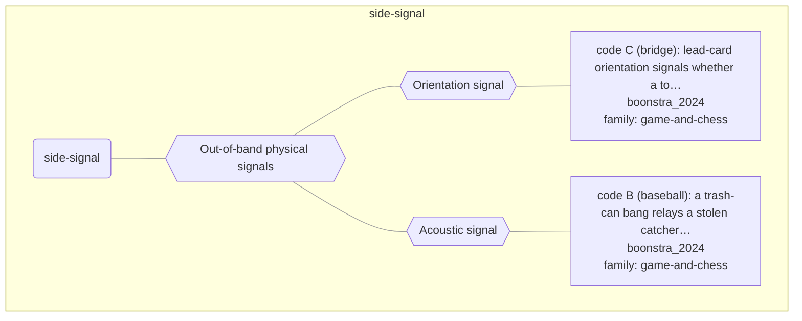

# Approach map — mechanism class side-signal

Built by `tools/build_approach_map.py` from `C:\Users\user\Documents\GitHub\hypersteg_chess\hypersteg_novelty_kit_20261108\literature\verified_claims`, the features table `C:\Users\user\Documents\GitHub\hypersteg_chess\hypersteg_novelty_kit_20261108\maps\approach_features.tsv` and the mechanism taxonomy `C:\Users\user\Documents\GitHub\hypersteg_chess\hypersteg_novelty_kit_20261108\maps\mechanism_taxonomy.tsv`. Mechanism overview: [approach_map_mechanisms.md](approach_map_mechanisms.md). Each approach leaf names its paper family.

- mechanisms: 3
- approaches: 2
- families: 1 (game-and-chess)

## Mechanisms

| mechanism | parent | class | name | definition | grounded by | landing | approaches |
| --- | --- | --- | --- | --- | --- | --- | --- |
| `m-acoustic-signal` | m-side-signal | side-signal | Acoustic signal | A sound, or its absence, relays the information. | `boonstra_2024:surveyed-trash-can-code-b` | yes | 1 |
| `m-orientation-signal` | m-side-signal | side-signal | Orientation signal | The orientation in which an object is placed (a card led horizontally or vertically) carries the information. | `boonstra_2024:surveyed-card-orientation-code-c` | yes | 1 |
| `m-side-signal` | — | side-signal | Out-of-band physical signals | An agreed physical act outside the moves of the game carries the information. | `boonstra_2024:surveyed-card-orientation-code-c` | yes | 2 |

## Approaches

| address | name | family | technique | channel | key | access | capacity | mechanism | landable | mechanism_evidence | carrier | acquisition |
| --- | --- | --- | --- | --- | --- | --- | --- | --- | --- | --- | --- | --- |
| `boonstra_2024:surveyed-card-orientation-code-c` | code C (bridge): lead-card orientation signals whether a top honour is held, and the opposing declarer is unaware of the signal | game-and-chess | gc-side-signals | other (physical card orientation) | codebook | — | one bit per lead | m-orientation-signal | yes | own | orientation of the lead card | negotiated |
| `boonstra_2024:surveyed-trash-can-code-b` | code B (baseball): a trash-can bang relays a stolen catcher's sign for any non-fastball, silence for a fastball | game-and-chess | gc-side-signals | other (acoustic signal) | codebook | — | one bit per pitch | m-acoustic-signal | yes | own | trash-can bangs | negotiated |
