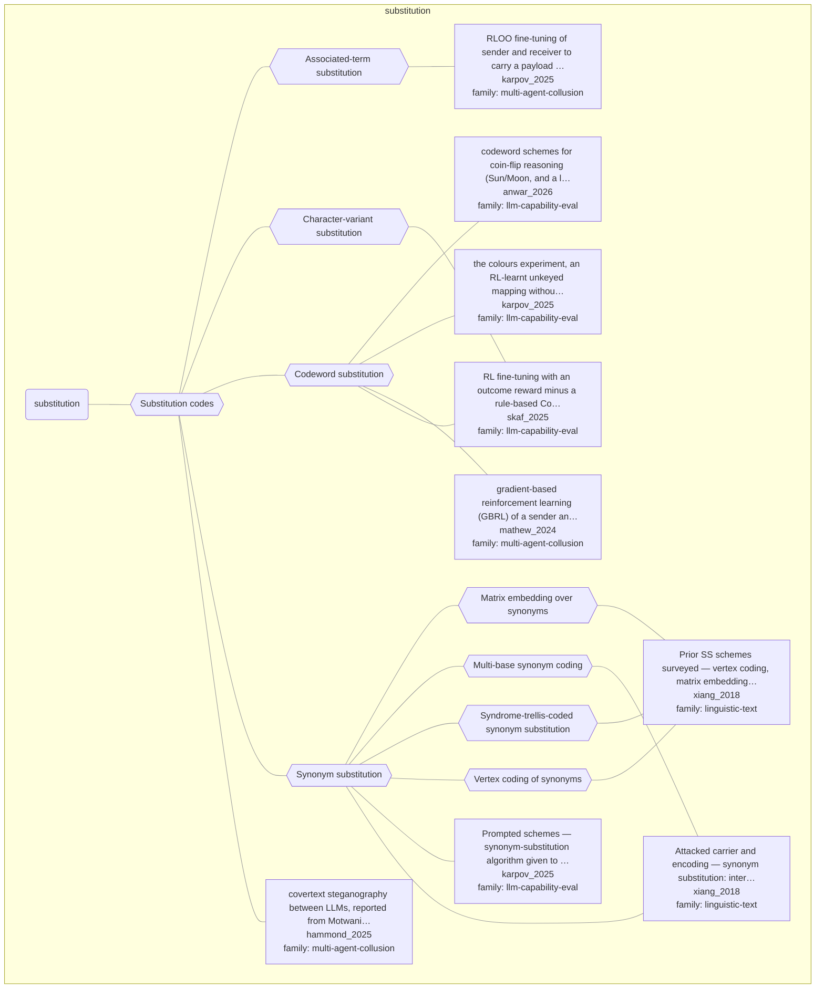

# Approach map — mechanism class substitution

Built by `tools/build_approach_map.py` from `C:\Users\user\Documents\GitHub\hypersteg_chess\hypersteg_novelty_kit_20261108\literature\verified_claims`, the features table `C:\Users\user\Documents\GitHub\hypersteg_chess\hypersteg_novelty_kit_20261108\maps\approach_features.tsv` and the mechanism taxonomy `C:\Users\user\Documents\GitHub\hypersteg_chess\hypersteg_novelty_kit_20261108\maps\mechanism_taxonomy.tsv`. Mechanism overview: [approach_map_mechanisms.md](approach_map_mechanisms.md). Each approach leaf names its paper family.

- mechanisms: 9
- approaches: 9
- families: 3 (linguistic-text, llm-capability-eval, multi-agent-collusion)

## Mechanisms

| mechanism | parent | class | name | definition | grounded by | landing | approaches |
| --- | --- | --- | --- | --- | --- | --- | --- |
| `m-associated-term-substitution` | m-substitution | substitution | Associated-term substitution | The payload is replaced by a closely associated term, such as the name of a product that implements it. | `karpov_2025:capacity-semantic-association` | yes | 1 |
| `m-character-variant` | m-substitution | substitution | Character-variant substitution | A variant character, such as a Unicode variant of an asterisk, replaces a string that a monitor penalises. | `skaf_2025:arithmetic-semantic-substitutes` | yes | 1 |
| `m-codeword-substitution` | m-substitution | substitution | Codeword substitution | Agreed codewords, which need not be synonyms, stand in for the hidden states. | `anwar_2026:surveyed-codeword-codebook` | yes | 4 |
| `m-substitution` | — | substitution | Substitution codes | An agreed or commonly known stand-in replaces a word, phrase, string or symbol in otherwise ordinary text, and which stand-in appears carries the message. | `xiang_2018:ss-carrier-substitution-sets` | yes | 9 |
| `m-synonym-matrix-embedding` | m-synonym-substitution | substitution | Matrix embedding over synonyms | Matrix embedding raises embedding efficiency by reducing the number of synonym substitutions needed. | `xiang_2018:ss-scheme-family` | yes | 1 |
| `m-synonym-multibase` | m-synonym-substitution | substitution | Multi-base synonym coding | Synonyms taken from WordNet are encoded by a multi-base coding method. | `xiang_2018:ss-carrier-substitution-sets` | yes | 1 |
| `m-synonym-stc` | m-synonym-substitution | substitution | Syndrome-trellis-coded synonym substitution | A double-layered syndrome-trellis code chooses the substitutions so as to minimise statistical and linguistic distortion. | `xiang_2018:ss-scheme-family` | yes | 1 |
| `m-synonym-substitution` | m-substitution | substitution | Synonym substitution | Interchangeable synonyms form substitution sets, and the choice among them in a cover text carries the bits. | `xiang_2018:ss-carrier-substitution-sets` | yes | 3 |
| `m-synonym-vertex-coding` | m-synonym-substitution | substitution | Vertex coding of synonyms | Collected synonyms are encoded into unrepeated bit strings by vertex coding. | `xiang_2018:ss-scheme-family` | yes | 1 |

## Approaches

| address | name | family | technique | channel | key | access | capacity | mechanism | landable | mechanism_evidence | carrier | acquisition |
| --- | --- | --- | --- | --- | --- | --- | --- | --- | --- | --- | --- | --- |
| `anwar_2026:surveyed-codeword-codebook` | codeword schemes for coin-flip reasoning (Sun/Moon, and a larger codebook) | llm-capability-eval | lce-codeword-substitution | lexical | codebook | prompt | one binary state per codeword | m-codeword-substitution | yes | own | words in a reasoning trace | prompted |
| `hammond_2025:surveyed-llm-covertext-steganography` | covertext steganography between LLMs, reported from Motwani et al. (2024) | multi-agent-collusion | mac-covertext-codebooks | lexical | codebook | prompt | — | m-substitution | yes | own | word choice and phrasing in text | prompted |
| `karpov_2025:approach-colours-rl` | the colours experiment, an RL-learnt unkeyed mapping without step-by-step reasoning | llm-capability-eval | lce-rl-learned-codes | lexical | none | training | — | m-codeword-substitution | yes | partial | proper names in short generated text | rl-trained |
| `karpov_2025:approach-rloo-summary-stego` | RLOO fine-tuning of sender and receiver to carry a payload in a news summary under an overseer | multi-agent-collusion | mac-gradient-rl | topic-semantic | none | training | about 3 bits of entropy; ~20% gain in undetected accuracy | m-associated-term-substitution | yes | sibling:capacity-semantic-association | wording of a news summary | rl-trained |
| `karpov_2025:synonym-scheme-given` | Prompted schemes — synonym-substitution algorithm given to encoder and decoder, not the overseer | llm-capability-eval | — | — | — | — | — | m-synonym-substitution | yes | partial | synonym choice in covertext | prompted |
| `mathew_2024:approach-gbrl` | gradient-based reinforcement learning (GBRL) of a sender and receiver against an overseer | multi-agent-collusion | mac-gradient-rl | lexical | shared-model | training | — | m-codeword-substitution; m-codebook | yes | sibling:coding-lexical-stylistic;sibling:coding-lexical-stylistic | word and phrase choice in cover letters | rl-trained |
| `skaf_2025:approach-cot-penalty-rl` | RL fine-tuning with an outcome reward minus a rule-based CoT penalty on task-critical strings | llm-capability-eval | lce-rl-learned-codes | lexical | none | training | — | m-training-elicitation; m-codeword-substitution; m-character-variant | yes | own;sibling:coinflip-arbitrary-codebook;sibling:arithmetic-semantic-substitutes | tokens in a chain-of-thought trace | rl-trained |
| `xiang_2018:ss-carrier-substitution-sets` | Attacked carrier and encoding — synonym substitution: interchangeable synonyms form a substitution set, and the choice among them carries the bits | linguistic-text | — | lexical | — | — | — | m-synonym-substitution; m-synonym-multibase | yes | own;own | choice among synonyms in a cover text | specified |
| `xiang_2018:ss-scheme-family` | Prior SS schemes surveyed — vertex coding, matrix embedding and syndrome-trellis codes to reduce embedding distortion | linguistic-text | — | lexical | — | — | matrix coding: k bits per 2^k - 1 cover synonyms | m-synonym-vertex-coding; m-synonym-matrix-embedding; m-synonym-stc | yes | own;own;own | choice among synonyms in a cover text | specified |
