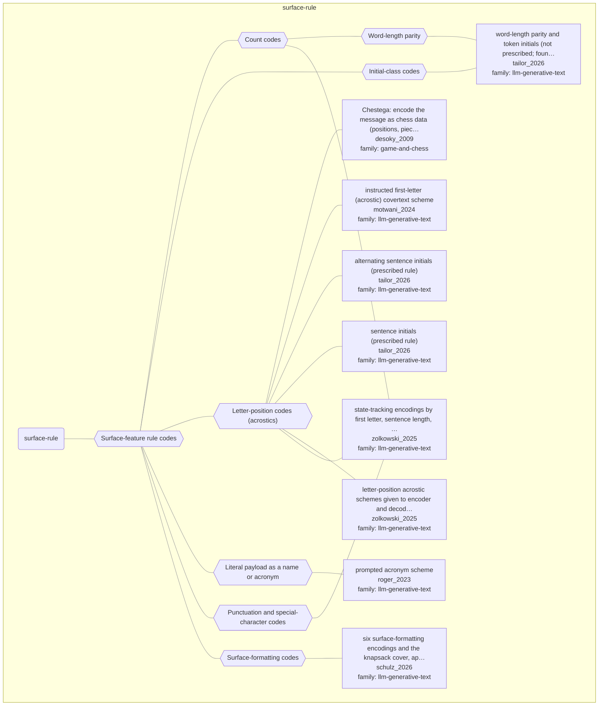

# Approach map — mechanism class surface-rule

Built by `tools/build_approach_map.py` from `C:\Users\user\Documents\GitHub\hypersteg_chess\hypersteg_novelty_kit_20261108\literature\verified_claims`, the features table `C:\Users\user\Documents\GitHub\hypersteg_chess\hypersteg_novelty_kit_20261108\maps\approach_features.tsv` and the mechanism taxonomy `C:\Users\user\Documents\GitHub\hypersteg_chess\hypersteg_novelty_kit_20261108\maps\mechanism_taxonomy.tsv`. Mechanism overview: [approach_map_mechanisms.md](approach_map_mechanisms.md). Each approach leaf names its paper family.

- mechanisms: 8
- approaches: 9
- families: 2 (game-and-chess, llm-generative-text)

## Mechanisms

| mechanism | parent | class | name | definition | grounded by | landing | approaches |
| --- | --- | --- | --- | --- | --- | --- | --- |
| `m-count-code` | m-surface-rule | surface-rule | Count codes | The count of some unit in successive segments of text (words or characters per sentence, letters per word), taken modulo the number of states, carries each state. | `zolkowski_2025:surveyed-state-tracking-encodings` | yes | 2 |
| `m-initial-class` | m-surface-rule | surface-rule | Initial-class codes | The class of a token's initial letter (A-M against N-Z) carries a bit, rather than the letter itself. | `tailor_2026:surveyed-word-length-parity-token-initials` | yes | 1 |
| `m-length-parity` | m-count-code | surface-rule | Word-length parity | The parity of each word's length carries one bit. | `tailor_2026:word-length-parity-capacity` | yes | 1 |
| `m-letter-position` | m-surface-rule | surface-rule | Letter-position codes (acrostics) | Message letters are placed at agreed positions, such as the first letter of each sentence, of alternate sentences or of every third word. | `zolkowski_2025:surveyed-letter-position-acrostics` | yes | 6 |
| `m-literal-payload-name` | m-surface-rule | surface-rule | Literal payload as a name or acronym | The payload is written directly into the text as an imagined acronym or name. | `roger_2023:acronym-literal-payload` | yes | 1 |
| `m-punctuation-symbol` | m-surface-rule | surface-rule | Punctuation and special-character codes | The choice of terminal punctuation, or of special characters inserted into the text, carries each state. | `zolkowski_2025:surveyed-state-tracking-encodings` | yes | 1 |
| `m-surface-formatting` | m-surface-rule | surface-rule | Surface-formatting codes | Each formatting unit (a word, a whitespace run or a sentence) carries one symbol from the start of the answer, leaving the meaning of the text untouched. | `schulz_2026:formatting-and-knapsack-carriers` | yes | 1 |
| `m-surface-rule` | — | surface-rule | Surface-feature rule codes | An explicit rule maps message symbols onto positional, countable or typographic features of the text, such as first letters, sentence lengths or punctuation. | `zolkowski_2025:surveyed-state-tracking-encodings` | yes | 9 |

## Approaches

| address | name | family | technique | channel | key | access | capacity | mechanism | landable | mechanism_evidence | carrier | acquisition |
| --- | --- | --- | --- | --- | --- | --- | --- | --- | --- | --- | --- | --- |
| `desoky_2009:approach-chestega` | Chestega: encode the message as chess data (positions, pieces, moves, tournaments, players) inside a chess-related document, preferably authentic games or tool-generated analysis, with a public method and an agreed configuration instead of a key | game-and-chess | gc-chess-data-codebook | other (chess-data content: target squares, pieces, players' initials, via an agreed codebook) | codebook | — | example: 7 bits per move as a target-square index; 4-bit slices as letters via player initials | m-reference-code; m-authentic-record-selection; m-letter-position | yes | partial;sibling:target-square-index;sibling:player-initial-codebook | chess data (squares, pieces, players) in chess-related text | specified |
| `motwani_2024:surveyed-first-letter-acrostic` | instructed first-letter (acrostic) covertext scheme | llm-generative-text | lgt-letter-position-codes | lexical | codebook | prompt | one character per word | m-letter-position | yes | own | first letters of words in text | prompted |
| `roger_2023:surveyed-acronyms` | prompted acronym scheme | llm-generative-text | lgt-literal-payload-names | lexical | — | prompt | 30 bits per answer | m-literal-payload-name | yes | sibling:acronym-literal-payload | an acronym or name in the answer text | prompted |
| `schulz_2026:approach-formatting-and-knapsack-encodings` | six surface-formatting encodings and the knapsack cover, applicable programmatically to existing text | llm-generative-text | lgt-surface-formatting; lgt-task-choice-codes | structural-format | codebook | prompt | one symbol per word, whitespace run or sentence; one bit per knapsack item | m-surface-formatting; m-item-inclusion-bits | yes | own;own | formatting of answer text; item choices in a knapsack solution | prompted;rl-trained;weight-trained |
| `tailor_2026:surveyed-alternating-sentence-initials` | alternating sentence initials (prescribed rule) | llm-generative-text | lgt-letter-position-codes | lexical | codebook | prompt | one letter per two sentences | m-letter-position | yes | own | first letters of alternate sentences | prompted |
| `tailor_2026:surveyed-sentence-initials` | sentence initials (prescribed rule) | llm-generative-text | lgt-letter-position-codes | lexical | codebook | prompt | one letter per sentence | m-letter-position | yes | own | first letters of sentences | prompted |
| `tailor_2026:surveyed-word-length-parity-token-initials` | word-length parity and token initials (not prescribed; found in model outputs) | llm-generative-text | lgt-count-state-codes; lgt-initial-class-codes | lexical | none | prompt | word-length parity: one bit per word | m-length-parity; m-initial-class | yes | own;own | word lengths and initial letters in text | prompted+unprescribed |
| `zolkowski_2025:surveyed-letter-position-acrostics` | letter-position acrostic schemes given to encoder and decoder | llm-generative-text | lgt-letter-position-codes | lexical | codebook | prompt | — | m-letter-position | yes | own | first letters of sentences or words | prompted |
| `zolkowski_2025:surveyed-state-tracking-encodings` | state-tracking encodings by first letter, sentence length, special characters and terminal punctuation | llm-generative-text | lgt-count-state-codes; lgt-letter-position-codes; lgt-surface-formatting | syntactic | codebook | prompt | one state per sentence | m-letter-position; m-count-code; m-punctuation-symbol | yes | own;own;own | sentence initials, sentence lengths and punctuation in text | prompted |
