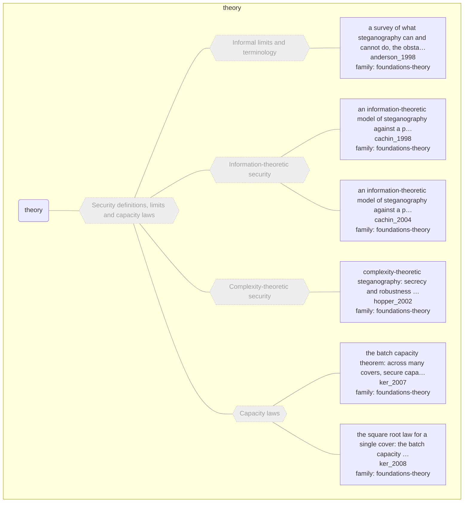

# Approach map — mechanism class theory

Built by `tools/build_approach_map.py` from `C:\Users\user\Documents\GitHub\hypersteg_chess\hypersteg_novelty_kit_20261108\literature\verified_claims`, the features table `C:\Users\user\Documents\GitHub\hypersteg_chess\hypersteg_novelty_kit_20261108\maps\approach_features.tsv` and the mechanism taxonomy `C:\Users\user\Documents\GitHub\hypersteg_chess\hypersteg_novelty_kit_20261108\maps\mechanism_taxonomy.tsv`. Mechanism overview: [approach_map_mechanisms.md](approach_map_mechanisms.md). Each approach leaf names its paper family.

- mechanisms: 5
- approaches: 6
- families: 1 (foundations-theory)

Muted, dashed nodes are marked not a landing node: they group the tree, and a novelty audit does not place a scheme at one. A child of such a node is one too unless its row says `landing: yes`.

## Mechanisms

| mechanism | parent | class | name | definition | grounded by | landing | approaches |
| --- | --- | --- | --- | --- | --- | --- | --- |
| `m-capacity-laws` | m-theory | theory | Capacity laws (not a landing node) | Under stated assumptions (covers of uniform capacity, a quantitative steganalyser) and asymptotically, secure capacity grows only as the square root of the number of covers. | `ker_2007:approach-batch-square-root-capacity` | no | 2 |
| `m-complexity-theoretic-security` | m-theory | theory | Complexity-theoretic security (not a landing node) | Security is computational indistinguishability; one-way functions suffice for secure steganography. | `hopper_2002:computational-indistinguishability-owf` | no | 1 |
| `m-informal-limits` | m-theory | theory | Informal limits and terminology (not a landing node) | A survey-level account of what steganography is and can do. | `anderson_1998:approach-limits-of-steganography` | no | 1 |
| `m-information-theoretic-security` | m-theory | theory | Information-theoretic security (not a landing node) | Detection is a hypothesis test, and security is the relative entropy between cover and stego distributions. | `cachin_2004:relative-entropy-security` | no | 2 |
| `m-theory` | — | theory | Security definitions, limits and capacity laws (not a landing node) | Definitions of undetectability and results on how much can be hidden; no scheme is judged against them. | `cachin_2004:approach-information-theoretic-model` | no | 6 |

## Approaches

| address | name | family | technique | channel | key | access | capacity | mechanism | landable | mechanism_evidence | carrier | acquisition |
| --- | --- | --- | --- | --- | --- | --- | --- | --- | --- | --- | --- | --- |
| `anderson_1998:approach-limits-of-steganography` | a survey of what steganography can and cannot do, the obstacles to a Shannon-style theory, and the practical ideas that theory yields | foundations-theory | ft-informal-limits | other (general model: key-selected subset of redundant bits) | shared-key | — | upper bound: gap between lossy and lossless compression; safe rate may tend to zero as the warden sees more stegotext | m-informal-limits | no | own | — | — |
| `cachin_1998:approach-information-theoretic-model` | an information-theoretic model of steganography against a passive adversary, with security measured as relative entropy between cover and stego distributions | foundations-theory | ft-information-theoretic | other (model, any channel) | shared-key | — | — | m-information-theoretic-security | no | own | — | — |
| `cachin_2004:approach-information-theoretic-model` | an information-theoretic model of steganography against a passive adversary; detection is hypothesis testing and a stegosystem is perfect when cover and stego distributions have zero relative entropy | foundations-theory | ft-information-theoretic | other (model, any channel) | shared-key | — | — | m-information-theoretic-security | no | own | — | — |
| `hopper_2002:approach-complexity-theoretic-steganography` | complexity-theoretic steganography: secrecy and robustness defined by computational indistinguishability, with secure protocols built from one-way functions; positioned against Simmons' problem and the information-theoretic models | foundations-theory | ft-complexity-theoretic | other (any channel) | shared-key | — | one hidden bit per channel block | m-complexity-theoretic-security | no | own | — | — |
| `ker_2007:approach-batch-square-root-capacity` | the batch capacity theorem: across many covers, secure capacity grows only as the square root of their number, proved under the shift hypothesis with a security definition taken from Cachin | foundations-theory | ft-capacity-laws | other (any; capacity theorem) | — | — | secure capacity proportional to the square root of the number of covers | m-capacity-laws | no | own | — | — |
| `ker_2008:approach-square-root-law` | the square root law for a single cover: the batch capacity results are carried over to one object treated as a batch of near-independent regions, then tested on spatial and DCT-domain embedding | foundations-theory | ft-capacity-laws | other (pixel-spatial and transform-domain experiments) | — | — | secure capacity grows as the square root of cover size, counted in embedding changes | m-capacity-laws | no | own | — | — |
