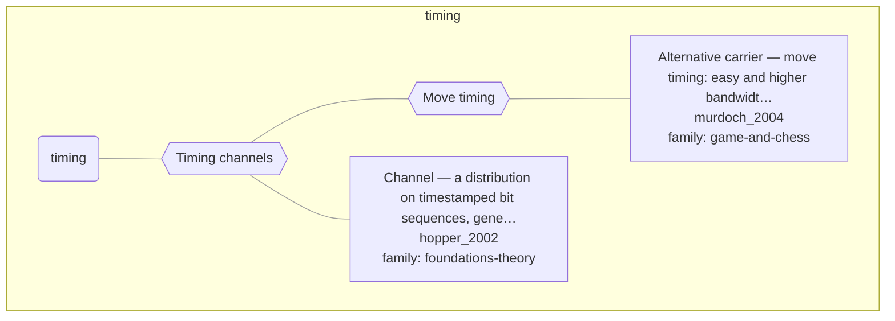

# Approach map — mechanism class timing

Built by `tools/build_approach_map.py` from `C:\Users\user\Documents\GitHub\hypersteg_chess\hypersteg_novelty_kit_20261108\literature\verified_claims`, the features table `C:\Users\user\Documents\GitHub\hypersteg_chess\hypersteg_novelty_kit_20261108\maps\approach_features.tsv` and the mechanism taxonomy `C:\Users\user\Documents\GitHub\hypersteg_chess\hypersteg_novelty_kit_20261108\maps\mechanism_taxonomy.tsv`. Mechanism overview: [approach_map_mechanisms.md](approach_map_mechanisms.md). Each approach leaf names its paper family.

- mechanisms: 2
- approaches: 2
- families: 2 (foundations-theory, game-and-chess)

## Mechanisms

| mechanism | parent | class | name | definition | grounded by | landing | approaches |
| --- | --- | --- | --- | --- | --- | --- | --- |
| `m-move-timing` | m-timing | timing | Move timing | The sender delays making a move and the recipient measures the delay. | `murdoch_2004:move-timing-channel` | yes | 1 |
| `m-timing` | — | timing | Timing channels | The times at which symbols are sent carry the information, not their content. | `hopper_2002:timestamped-channel` | yes | 2 |

## Approaches

| address | name | family | technique | channel | key | access | capacity | mechanism | landable | mechanism_evidence | carrier | acquisition |
| --- | --- | --- | --- | --- | --- | --- | --- | --- | --- | --- | --- | --- |
| `hopper_2002:timestamped-channel` | Channel — a distribution on timestamped bit sequences, general enough to include timing-only channels | foundations-theory | — | — | — | — | — | m-timing | yes | partial | timing of emails | unknown |
| `murdoch_2004:move-timing-channel` | Alternative carrier — move timing: easy and higher bandwidth, but unreliable under jitter and removable by fixing move times | game-and-chess | — | — | — | — | relatively high bandwidth | m-move-timing | yes | own | delay before each move | unknown |
