# Approach map — multi-agent-collusion

Built by `tools/build_approach_map.py` from `C:\Users\user\Documents\GitHub\hypersteg_chess\hypersteg_novelty_kit_20261108\literature\verified_claims`, the features table `C:\Users\user\Documents\GitHub\hypersteg_chess\hypersteg_novelty_kit_20261108\maps\approach_features.tsv` and the technique taxonomy `C:\Users\user\Documents\GitHub\hypersteg_chess\hypersteg_novelty_kit_20261108\maps\technique_taxonomy.tsv`. View: `both`. Overview: [approach_map.md](approach_map.md).

- approaches: 22
- techniques: 18

```mermaid
flowchart LR
  subgraph fam_multi_agent_collusion_g["multi-agent-collusion"]
    fam_multi_agent_collusion("multi-agent-collusion")
    tech_mac_authenticated_throwing{{"Authenticate, then throw games"}}
    tech_mac_collusion_audits{{"Collusion audits and taxonomies"}}
    tech_mac_collusion_benchmarks{{"Collusion benchmarks"}}
    tech_mac_covertext_codebooks{{"Natural-language covertext codebooks"}}
    tech_mac_emergent_codes{{"Emergent codes in interaction"}}
    tech_mac_focality_prompts{{"Focality prompts"}}
    tech_mac_gradient_rl{{"Gradient-based RL"}}
    tech_mac_in_context_rl{{"In-context RL"}}
    tech_mac_input_triggers{{"Input triggers"}}
    tech_mac_learned_codes{{"Codes learned by optimisation"}}
    tech_mac_learned_tacit{{"Learned tacit collusion"}}
    tech_mac_output_signals{{"Output signals"}}
    tech_mac_pre_agreed_codes{{"Pre-agreed codes and signals"}}
    tech_mac_risk_taxonomies{{"Risk taxonomies"}}
    tech_mac_schelling_prompted{{"Prompted Schelling coordination"}}
    tech_mac_tacit_coordination{{"Tacit coordination"}}
    tech_mac_trigger_signals{{"Collusion trigger signals"}}
    tech_mac_zero_shot_conventions{{"Symmetry-robust conventions"}}
    n_aharon_2026_approach_focal_point_evaluation["a large-scale study of focal points in LLMs, comparing taci…<br/>aharon_2026"]
    n_aharon_2026_surveyed_all_features_prompt["the #quot;all-features#quot; prompt: reason over Kraus et al.'s focal…<br/>aharon_2026"]
    n_aharon_2026_surveyed_culture_prompt["the #quot;culture#quot; prompt: choose the option most culturally rel…<br/>aharon_2026"]
    n_aharon_2026_surveyed_saliency_prompt["the #quot;saliency#quot; prompt: choose the option most salient to hu…<br/>aharon_2026"]
    n_buscemi_2026_approach_numeric_covert_games["numeric covert communication in canonical games, where agen…<br/>buscemi_2026"]
    n_greenblatt_2023_approach_action_collusion_code_signal["action collusion, a one-bit signal written into the code (v…<br/>greenblatt_2023"]
    n_greenblatt_2023_approach_input_collusion["input collusion on a shared feature of the problem, a focal…<br/>greenblatt_2023"]
    n_hammond_2025_approach_multi_agent_risk_taxonomy["a taxonomy of multi-agent risks: three failure modes and se…<br/>hammond_2025"]
    n_hammond_2025_surveyed_algorithmic_pricing_collusion["tacit algorithmic pricing collusion, as in the German retai…<br/>hammond_2025"]
    n_hammond_2025_surveyed_compression_emergent_communication["secret communication by text compression or by emergent sym…<br/>hammond_2025"]
    n_hammond_2025_surveyed_llm_covertext_steganography["covertext steganography between LLMs, reported from Motwani…<br/>hammond_2025"]
    n_hu_2020_approach_other_play["other-play, self-play against symmetry-relabelled copies of…<br/>hu_2020"]
    n_jarviniemi_2025_approach_meta_model_focal_collusion["meta-models that independently design policy and monitor pr…<br/>jarviniemi_2025"]
    n_karpov_2025_approach_rloo_summary_stego["RLOO fine-tuning of sender and receiver to carry a payload …<br/>karpov_2025"]
    n_mathew_2024_approach_gbrl["gradient-based reinforcement learning (GBRL) of a sender an…<br/>mathew_2024"]
    n_mathew_2024_approach_icrl["in-context reinforcement learning (ICRL), with centralised …<br/>mathew_2024"]
    n_motwani_2024_approach_common_knowledge_covertext["group covertext steganography, hiding a secret word in comm…<br/>motwani_2024"]
    n_murdoch_2004_approach_league_collusion_strategy["the league collusion strategy: once authenticated, colluder…<br/>murdoch_2004"]
    n_nakamura_2026_approach_colosseum["Colosseum: cooperative tasks cast as DCOPs, collusion measu…<br/>nakamura_2026"]
    n_rippin_2026_approach_tacit_stego_agreement_cci["tacit steganographic agreement as Schelling coordination, m…<br/>rippin_2026"]
    n_rose_2026_approach_blackjack_table_talk["the Stego tier's blackjack table-talk channel, with a schem…<br/>rose_2026"]
    n_rose_2026_approach_narcbench["NARCBench, a three-tier benchmark for collusion detection u…<br/>rose_2026"]
    paper_mathew_2024(["mathew_2024<br/>(paper)"])
  end
  subgraph other_families["other families"]
    n_greenblatt_2023_approach_untrusted_monitoring_signal_jamming["untrusted monitoring guarded by signal jamming<br/>greenblatt_2023<br/>family: steganalysis"]
    n_mallen_2024_approach_subversion_strategy_eval["Subversion Strategy Eval, eight environments and six afford…<br/>mallen_2024<br/>family: llm-capability-eval"]
    n_motwani_2024_approach_case_framework["CASE, a framework for evaluating secret collusion in indivi…<br/>motwani_2024<br/>family: llm-capability-eval"]
    paper_karpov_2025(["karpov_2025<br/>(paper)<br/>family: llm-capability-eval"])
    paper_molinari_2026(["molinari_2026<br/>(paper)<br/>family: steganalysis"])
    paper_rippin_2026(["rippin_2026<br/>(paper)<br/>family: llm-capability-eval"])
    n_roger_2023_approach_paraphrase_defence["a conservative evaluation of paraphrasing as a defence agai…<br/>roger_2023<br/>family: steganalysis"]
    n_tailor_2026_approach_rolewise_decomposition["rolewise decomposition: score what the encoder put in the t…<br/>tailor_2026<br/>family: llm-capability-eval"]
  end
  tech_mac_pre_agreed_codes --- tech_mac_authenticated_throwing
  fam_multi_agent_collusion --- tech_mac_collusion_audits
  tech_mac_collusion_audits --- tech_mac_collusion_benchmarks
  tech_mac_pre_agreed_codes --- tech_mac_covertext_codebooks
  tech_mac_learned_codes --- tech_mac_emergent_codes
  tech_mac_schelling_prompted --- tech_mac_focality_prompts
  tech_mac_learned_codes --- tech_mac_gradient_rl
  tech_mac_learned_codes --- tech_mac_in_context_rl
  tech_mac_trigger_signals --- tech_mac_input_triggers
  fam_multi_agent_collusion --- tech_mac_learned_codes
  tech_mac_tacit_coordination --- tech_mac_learned_tacit
  tech_mac_trigger_signals --- tech_mac_output_signals
  fam_multi_agent_collusion --- tech_mac_pre_agreed_codes
  tech_mac_collusion_audits --- tech_mac_risk_taxonomies
  tech_mac_tacit_coordination --- tech_mac_schelling_prompted
  fam_multi_agent_collusion --- tech_mac_tacit_coordination
  tech_mac_pre_agreed_codes --- tech_mac_trigger_signals
  tech_mac_tacit_coordination --- tech_mac_zero_shot_conventions
  fam_multi_agent_collusion --- n_aharon_2026_approach_focal_point_evaluation
  tech_mac_focality_prompts --- n_aharon_2026_surveyed_all_features_prompt
  tech_mac_focality_prompts --- n_aharon_2026_surveyed_culture_prompt
  tech_mac_focality_prompts --- n_aharon_2026_surveyed_saliency_prompt
  tech_mac_emergent_codes --- n_buscemi_2026_approach_numeric_covert_games
  tech_mac_output_signals --- n_greenblatt_2023_approach_action_collusion_code_signal
  tech_mac_input_triggers --- n_greenblatt_2023_approach_input_collusion
  tech_mac_risk_taxonomies --- n_hammond_2025_approach_multi_agent_risk_taxonomy
  tech_mac_learned_tacit --- n_hammond_2025_surveyed_algorithmic_pricing_collusion
  tech_mac_emergent_codes --- n_hammond_2025_surveyed_compression_emergent_communication
  tech_mac_covertext_codebooks --- n_hammond_2025_surveyed_llm_covertext_steganography
  tech_mac_zero_shot_conventions --- n_hu_2020_approach_other_play
  tech_mac_schelling_prompted --- n_jarviniemi_2025_approach_meta_model_focal_collusion
  tech_mac_gradient_rl --- n_karpov_2025_approach_rloo_summary_stego
  tech_mac_gradient_rl --- n_mathew_2024_approach_gbrl
  tech_mac_in_context_rl --- n_mathew_2024_approach_icrl
  tech_mac_covertext_codebooks --- n_motwani_2024_approach_common_knowledge_covertext
  tech_mac_authenticated_throwing --- n_murdoch_2004_approach_league_collusion_strategy
  tech_mac_collusion_benchmarks --- n_nakamura_2026_approach_colosseum
  tech_mac_schelling_prompted --- n_rippin_2026_approach_tacit_stego_agreement_cci
  tech_mac_covertext_codebooks --- n_rose_2026_approach_blackjack_table_talk
  tech_mac_collusion_benchmarks --- n_rose_2026_approach_narcbench
  n_buscemi_2026_approach_numeric_covert_games -->|Refines| n_motwani_2024_approach_case_framework
  n_hammond_2025_approach_multi_agent_risk_taxonomy <-->|Restates| n_motwani_2024_approach_common_knowledge_covertext
  n_jarviniemi_2025_approach_meta_model_focal_collusion -->|Refines| n_greenblatt_2023_approach_untrusted_monitoring_signal_jamming
  n_jarviniemi_2025_approach_meta_model_focal_collusion -->|Supports| n_mallen_2024_approach_subversion_strategy_eval
  paper_karpov_2025 -->|Refines| n_mathew_2024_approach_gbrl
  paper_mathew_2024 -->|Refines| n_motwani_2024_approach_case_framework
  paper_mathew_2024 -.->|Qualifies| n_roger_2023_approach_paraphrase_defence
  paper_molinari_2026 ==>|Depends-on| n_rose_2026_approach_narcbench
  paper_rippin_2026 -->|Refines| n_aharon_2026_approach_focal_point_evaluation
  n_tailor_2026_approach_rolewise_decomposition -.->|Qualifies| n_mathew_2024_approach_gbrl
  n_tailor_2026_approach_rolewise_decomposition -.->|Qualifies| n_mathew_2024_approach_icrl
  linkStyle 0,1,2,3,4,5,6,7,8,9,10,11,12,13,14,15,16,17,18,19,20,21,22,23,24,25,26,27,28,29,30,31,32,33,34,35,36,37,38,39 stroke:#9e9e9e,stroke-width:1px
  linkStyle 40,42,44,45,48 stroke:#1565c0,stroke-width:2.5px,color:#1565c0
  linkStyle 41 stroke:#00838f,stroke-width:2.5px,color:#00838f
  linkStyle 43 stroke:#2e7d32,stroke-width:2.5px,color:#2e7d32
  linkStyle 46,49,50 stroke:#ef6c00,stroke-width:2.5px,color:#ef6c00
  linkStyle 47 stroke:#6a1b9a,stroke-width:2.5px,color:#6a1b9a
  classDef stub fill:#f5f5f5,stroke:#9e9e9e,stroke-dasharray:4 3,color:#424242
  class n_greenblatt_2023_approach_untrusted_monitoring_signal_jamming,n_mallen_2024_approach_subversion_strategy_eval,n_motwani_2024_approach_case_framework,paper_karpov_2025,paper_molinari_2026,paper_rippin_2026,n_roger_2023_approach_paraphrase_defence,n_tailor_2026_approach_rolewise_decomposition stub
  classDef nonlanding fill:#eeeeee,stroke:#bdbdbd,stroke-dasharray:2 2,color:#9e9e9e
  class tech_mac_collusion_audits,tech_mac_collusion_benchmarks,tech_mac_emergent_codes,tech_mac_focality_prompts,tech_mac_input_triggers,tech_mac_learned_tacit,tech_mac_risk_taxonomies,tech_mac_schelling_prompted,tech_mac_tacit_coordination,tech_mac_zero_shot_conventions nonlanding
```

## Legend

| link | arrow | colour | source |
| --- | --- | --- | --- |
| taxonomy (family → technique → approach) | `---` | #9e9e9e, thin | technique taxonomy and features table |
| Supports | `-->` | #2e7d32, thick | stated by a paper (ledger edge) |
| Rebuts | `-.->` | #c62828, thick | stated by a paper (ledger edge) |
| Depends-on | `==>` | #6a1b9a, thick | stated by a paper (ledger edge) |
| Refines | `-->` | #1565c0, thick | stated by a paper (ledger edge) |
| Qualifies | `-.->` | #ef6c00, thick | stated by a paper (ledger edge) |
| Restates | `<-->` | #00838f, thick | stated by a paper (ledger edge) |
| Duplicate-of | `o--o` | #757575, thick | stated by a paper (ledger edge) |
| Supersedes | `--x` | #4e342e, thick | stated by a paper (ledger edge) |

Muted, dashed nodes are marked not a landing node: they group the tree, and a novelty audit does not place a scheme at one. A child of such a node is one too unless its row says `landing: yes`.

## Techniques

| technique | parent | name | definition | grounded by | approaches |
| --- | --- | --- | --- | --- | --- |
| `mac-authenticated-throwing` | mac-pre-agreed-codes | Authenticate, then throw games | Colluders identify one another through a keyed signal and then lose deliberately to a designated winner. | `murdoch_2004:approach-league-collusion-strategy` | 1 |
| `mac-collusion-audits` | — | Collusion audits and taxonomies (not a landing node) | Frameworks, benchmarks and detectors that measure or classify collusion rather than perform it. | `nakamura_2026:approach-colosseum` | 3 |
| `mac-collusion-benchmarks` | mac-collusion-audits | Collusion benchmarks (not a landing node) | Scenario suites in which collusion can occur are scored by outcome measures such as coalition regret or detection. | `nakamura_2026:approach-colosseum` | 2 |
| `mac-covertext-codebooks` | mac-pre-agreed-codes | Natural-language covertext codebooks | Agents hide a message in ordinary-looking text through word choice or topic, using a codebook or knowledge the overseer lacks. | `motwani_2024:approach-common-knowledge-covertext` | 3 |
| `mac-emergent-codes` | mac-learned-codes | Emergent codes in interaction (not a landing node) | Meaning arises in an unprescribed channel (numbers, symbols, compressed text) through repeated interaction. | `buscemi_2026:approach-numeric-covert-games` | 2 |
| `mac-focality-prompts` | mac-schelling-prompted | Focality prompts (not a landing node) | The prompt tells the model what kind of salience to aim at (cultural, perceptual or a list of focality principles). | `aharon_2026:surveyed-saliency-prompt` | 3 |
| `mac-gradient-rl` | mac-learned-codes | Gradient-based RL | The sender's weights are updated by RL to maximise the receiver's success minus an overseer's suspicion. | `mathew_2024:approach-gbrl` | 2 |
| `mac-in-context-rl` | mac-learned-codes | In-context RL | An LLM learner revises natural-language strategies between episodes while the weights stay fixed. | `mathew_2024:approach-icrl` | 1 |
| `mac-input-triggers` | mac-trigger-signals | Input triggers (not a landing node) | Both colluders misbehave only when an agreed feature is present in the input, so no message passes between them. | `greenblatt_2023:approach-input-collusion` | 1 |
| `mac-learned-codes` | — | Codes learned by optimisation | The sender and receiver discover their scheme by optimisation against task reward and an overseer, rather than being given it. | `mathew_2024:schemes-from-optimisation` | 5 |
| `mac-learned-tacit` | mac-tacit-coordination | Learned tacit collusion (not a landing node) | Learning agents drift into collusive strategies through interaction alone, with no message and no plan to collude. | `hammond_2025:surveyed-algorithmic-pricing-collusion` | 1 |
| `mac-output-signals` | mac-trigger-signals | Output signals | The sender puts an agreed mark in its own output, such as a variable name, so the receiver knows to act. | `greenblatt_2023:approach-action-collusion-code-signal` | 1 |
| `mac-pre-agreed-codes` | — | Pre-agreed codes and signals | Colluders fix a code or signal in advance and use it to recognise each other or to pass a message. | `greenblatt_2023:control-input-and-action-collusion` | 6 |
| `mac-risk-taxonomies` | mac-collusion-audits | Risk taxonomies (not a landing node) | Multi-agent failures are sorted into modes and risk factors. | `hammond_2025:approach-multi-agent-risk-taxonomy` | 1 |
| `mac-schelling-prompted` | mac-tacit-coordination | Prompted Schelling coordination (not a landing node) | Isolated copies of a model independently choose the same scheme, signal or parameters because the choice is salient to both. | `rippin_2026:approach-tacit-stego-agreement-cci` | 5 |
| `mac-tacit-coordination` | — | Tacit coordination (not a landing node) | Agents coordinate without exchanging a message, by converging on the same choice. | `hammond_2025:explicit-tacit-distinction-breaks-down` | 7 |
| `mac-trigger-signals` | mac-pre-agreed-codes | Collusion trigger signals | An agreed feature of the input or the output tells a colluding monitor when to look away; often a single bit. | `greenblatt_2023:approach-input-collusion` | 2 |
| `mac-zero-shot-conventions` | mac-tacit-coordination | Symmetry-robust conventions (not a landing node) | Training against relabelled copies of a partner removes arbitrary conventions so that agents coordinate with partners they have not met. | `hu_2020:approach-other-play` | 1 |

## Lineage edges (11)

| source | kind | target | lifted_from | ledger line |
| --- | --- | --- | --- | --- |
| `buscemi_2026:approach-numeric-covert-games` | Refines | `motwani_2024:approach-case-framework` | — | buscemi_2026.md:192 |
| `hammond_2025:approach-multi-agent-risk-taxonomy` | Restates | `motwani_2024:approach-common-knowledge-covertext` | `hammond_2025:motwani-covert-rates-shared-knowledge` | hammond_2025.md:196 |
| `jarviniemi_2025:approach-meta-model-focal-collusion` | Refines | `greenblatt_2023:approach-untrusted-monitoring-signal-jamming` | — | jarviniemi_2025.md:158 |
| `jarviniemi_2025:approach-meta-model-focal-collusion` | Supports | `mallen_2024:approach-subversion-strategy-eval` | `jarviniemi_2025:compatible-with-mallen` | jarviniemi_2025.md:170 |
| `paper:karpov_2025` | Refines | `mathew_2024:approach-gbrl` | `karpov_2025:extends-mathew-multibit` | karpov_2025.md:219 |
| `paper:mathew_2024` | Qualifies | `roger_2023:approach-paraphrase-defence` | `mathew_2024:builds-on` | mathew_2024.md:157 |
| `paper:mathew_2024` | Refines | `motwani_2024:approach-case-framework` | `mathew_2024:builds-on` | mathew_2024.md:156 |
| `paper:molinari_2026` | Depends-on | `rose_2026:approach-narcbench` | `molinari_2026:relation-rose-narcbench` | molinari_2026.md:212 |
| `paper:rippin_2026` | Refines | `aharon_2026:approach-focal-point-evaluation` | `rippin_2026:builds-on` | rippin_2026.md:189 |
| `tailor_2026:approach-rolewise-decomposition` | Qualifies | `mathew_2024:approach-gbrl` | `tailor_2026:prior-e2e-recovery-named` | tailor_2026.md:204 |
| `tailor_2026:approach-rolewise-decomposition` | Qualifies | `mathew_2024:approach-icrl` | `tailor_2026:prior-e2e-recovery-named` | tailor_2026.md:205 |

## Approaches

| address | name | family | technique | channel | key | access | capacity | mechanism | landable | mechanism_evidence | carrier | acquisition |
| --- | --- | --- | --- | --- | --- | --- | --- | --- | --- | --- | --- | --- |
| `aharon_2026:approach-focal-point-evaluation` | a large-scale study of focal points in LLMs, comparing tacit coordination with humans across cooperative and competitive games, and testing learning-free prompts that improve it | multi-agent-collusion | — | other (none: coordination without communication) | none | prompt | — | m-coordination-eval | no | own | — | — |
| `aharon_2026:surveyed-all-features-prompt` | the "all-features" prompt: reason over Kraus et al.'s focality principles (little effect) | multi-agent-collusion | mac-focality-prompts | other (none: tacit coordination) | none | prompt | — | m-focality-prompt | no | own | — | — |
| `aharon_2026:surveyed-culture-prompt` | the "culture" prompt: choose the option most culturally relevant to humans (lifts heterogeneous models to human level where culture is part of focality) | multi-agent-collusion | mac-focality-prompts | other (none: tacit coordination) | none | prompt | — | m-focality-prompt | no | own | — | — |
| `aharon_2026:surveyed-saliency-prompt` | the "saliency" prompt: choose the option most salient to humans (little effect) | multi-agent-collusion | mac-focality-prompts | other (none: tacit coordination) | none | prompt | — | m-focality-prompt | no | own | — | — |
| `buscemi_2026:approach-numeric-covert-games` | numeric covert communication in canonical games, where agents exchange ten numbers a round with no given code | multi-agent-collusion | mac-emergent-codes | numeric-annotation | none | prompt | ten numbers per round | m-emergent-convention; m-payoff-anchored-symbols | yes | own;sibling:payoff-anchored-decimal-code | ten-number messages each round | focal;negotiated |
| `greenblatt_2023:approach-action-collusion-code-signal` | action collusion, a one-bit signal written into the code (variable name or while loop) | multi-agent-collusion | mac-output-signals | structural-format | codebook | prompt | one bit per solution | m-output-signal | yes | own | a feature of the submitted code (variable name, loop form) | prompted |
| `greenblatt_2023:approach-input-collusion` | input collusion on a shared feature of the problem, a focal point needing no message | multi-agent-collusion | mac-input-triggers | other (shared input feature, focal point) | codebook | prompt | no message sent; a shared trigger | m-input-trigger | no | own | a feature of the problem statement (no message sent) | prompted |
| `hammond_2025:approach-multi-agent-risk-taxonomy` | a taxonomy of multi-agent risks: three failure modes and seven risk factors | multi-agent-collusion | mac-risk-taxonomies | — | — | — | — | m-risk-taxonomy | no | own | — | — |
| `hammond_2025:surveyed-algorithmic-pricing-collusion` | tacit algorithmic pricing collusion, as in the German retail gasoline market | multi-agent-collusion | mac-learned-tacit | other (price signals, tacit) | none | — | — | m-learned-tacit-collusion | no | own | market prices | — |
| `hammond_2025:surveyed-compression-emergent-communication` | secret communication by text compression or by emergent symbols without predefined meaning | multi-agent-collusion | mac-emergent-codes | other (compression or emergent code) | — | — | — | m-emergent-convention | no | own | agent messages | negotiated |
| `hammond_2025:surveyed-llm-covertext-steganography` | covertext steganography between LLMs, reported from Motwani et al. (2024) | multi-agent-collusion | mac-covertext-codebooks | lexical | codebook | prompt | — | m-substitution | yes | own | word choice and phrasing in text | prompted |
| `hu_2020:approach-other-play` | other-play, self-play against symmetry-relabelled copies of the partner, so that no agent can rely on an arbitrary way of breaking symmetry | multi-agent-collusion | mac-zero-shot-conventions | other (convention formation in cooperative play: hints and actions) | none | training | — | m-coordination-learning | no | own | — | — |
| `jarviniemi_2025:approach-meta-model-focal-collusion` | meta-models that independently design policy and monitor prompts, set in Greenblatt et al.'s untrusted monitoring | multi-agent-collusion | mac-schelling-prompted | numeric-annotation | none | prompt | one bit (collude or not) | m-schelling-choice; m-focal-magic-number | yes | sibling:schelling-no-key;sibling:coding-magic-numbers | features of Python code (comments stripped) | focal |
| `karpov_2025:approach-rloo-summary-stego` | RLOO fine-tuning of sender and receiver to carry a payload in a news summary under an overseer | multi-agent-collusion | mac-gradient-rl | topic-semantic | none | training | about 3 bits of entropy; ~20% gain in undetected accuracy | m-associated-term-substitution | yes | sibling:capacity-semantic-association | wording of a news summary | rl-trained |
| `mathew_2024:approach-gbrl` | gradient-based reinforcement learning (GBRL) of a sender and receiver against an overseer | multi-agent-collusion | mac-gradient-rl | lexical | shared-model | training | — | m-codeword-substitution; m-codebook | yes | sibling:coding-lexical-stylistic;sibling:coding-lexical-stylistic | word and phrase choice in cover letters | rl-trained |
| `mathew_2024:approach-icrl` | in-context reinforcement learning (ICRL), with centralised and decentralised learners devising strategies in natural language | multi-agent-collusion | mac-in-context-rl | other (strategy chosen by learner; lexical and stylistic) | — | prompt | — | m-phrase-codebook | yes | sibling:coding-lexical-stylistic | phrase choice in cover letters | in-context-optimised |
| `motwani_2024:approach-common-knowledge-covertext` | group covertext steganography, hiding a secret word in common knowledge the overseer lacks | multi-agent-collusion | mac-covertext-codebooks | other (covertext modification against shared common knowledge) | codebook | prompt | one secret word per message | m-codebook | yes | partial | text over a public channel, keyed by shared common knowledge | prompted |
| `murdoch_2004:approach-league-collusion-strategy` | the league collusion strategy: once authenticated, colluders act on that knowledge so that one designated player wins, which guarantees victory when only one team colludes and the players are strong | multi-agent-collusion | mac-authenticated-throwing | other (strategic losing to authenticated colluders) | shared-key | — | — | m-authenticate-then-act | yes | own | moves in tournament games, then game results | specified |
| `nakamura_2026:approach-colosseum` | Colosseum: cooperative tasks cast as DCOPs, collusion measured as coalition regret, with a secret channel opened between agents as a controlled probe | multi-agent-collusion | mac-collusion-benchmarks | other (explicit secret channel, as audit probe) | — | — | — | m-collusion-benchmark | no | own | — | — |
| `rippin_2026:approach-tacit-stego-agreement-cci` | tacit steganographic agreement as Schelling coordination, measured by algorithm, hyperparameter and complete coordination indices | multi-agent-collusion | mac-schelling-prompted | other (choice of stegosystem and parameters) | — | prompt | — | m-coordination-eval | no | own | choice of stegosystem, key and parameters | focal |
| `rose_2026:approach-blackjack-table-talk` | the Stego tier's blackjack table-talk channel, with a scheme the colluders invent per shoe | multi-agent-collusion | mac-covertext-codebooks | topic-semantic | codebook | prompt | three count levels per hand | m-utterance-category-code | yes | partial | kind of remark in table talk | negotiated |
| `rose_2026:approach-narcbench` | NARCBench, a three-tier benchmark for collusion detection under distribution shift | multi-agent-collusion | mac-collusion-benchmarks | — | — | prompt | — | m-collusion-benchmark | no | own | — | — |
