# Approach map — steganalysis

Built by `tools/build_approach_map.py` from `C:\Users\user\Documents\GitHub\hypersteg_chess\hypersteg_novelty_kit_20261108\literature\verified_claims`, the features table `C:\Users\user\Documents\GitHub\hypersteg_chess\hypersteg_novelty_kit_20261108\maps\approach_features.tsv` and the technique taxonomy `C:\Users\user\Documents\GitHub\hypersteg_chess\hypersteg_novelty_kit_20261108\maps\technique_taxonomy.tsv`. View: `both`. Overview: [approach_map.md](approach_map.md).

- approaches: 13
- techniques: 12

```mermaid
flowchart LR
  subgraph fam_steganalysis_g["steganalysis"]
    fam_steganalysis("steganalysis")
    tech_sa_activation_probes{{"Activation probes"}}
    tech_sa_active_warden{{"Active-warden defences"}}
    tech_sa_concept_lens{{"Concept-lens readout and intervention"}}
    tech_sa_game_record_inference{{"Game-record inference"}}
    tech_sa_game_statistics{{"Game-statistics attacks"}}
    tech_sa_internal_states{{"Internal-state detection"}}
    tech_sa_likelihood_ratio_forensics{{"Likelihood-ratio forensics"}}
    tech_sa_llm_classifiers{{"LLM-based classifiers"}}
    tech_sa_prompted_llm_monitors{{"Prompted LLM monitors"}}
    tech_sa_statistical_features{{"Statistical and feature steganalysis"}}
    tech_sa_text_features{{"Text feature steganalysis"}}
    tech_sa_utility_gap{{"Decision-theoretic utility gap"}}
    n_anwar_2026_approach_steganographic_gap["a decision-theoretic view of steganography, detected and qu…<br/>anwar_2026"]
    n_bai_2024b_approach_generative_llm_steganalysis["generation-based linguistic steganalysis: an LLM fine-tuned…<br/>bai_2024b"]
    n_boonstra_2024_approach_bayesian_hidden_code_forensics["a Bayesian forensic framework for alleged hidden codes in s…<br/>boonstra_2024"]
    n_greenblatt_2023_approach_untrusted_monitoring_signal_jamming["untrusted monitoring guarded by signal jamming<br/>greenblatt_2023"]
    n_hernandezcastro_2006_approach_game_steganalysis["statistical attacks on game length, playing level and resul…<br/>hernandezcastro_2006"]
    n_molinari_2026_approach_j_pact["J-PACT, unsupervised pairwise collusion detection from shar…<br/>molinari_2026"]
    n_molinari_2026_approach_j_space_steering["causal steering of steganographic decoding by swapping J-le…<br/>molinari_2026"]
    n_roger_2023_approach_paraphrase_defence["a conservative evaluation of paraphrasing as a defence agai…<br/>roger_2023"]
    n_rose_2026_approach_helios["HELIOS, group-level collusion detection from per-agent acti…<br/>rose_2026"]
    n_tang_2024_approach_lsgc["LSGC, linguistic steganalysis by a LoRA-fine-tuned LLM, in …<br/>tang_2024"]
    n_westphal_2026_approach_probe_detection_recontextualisation["mechanistic probe detection, extended from ridge to a held-…<br/>westphal_2026"]
    n_xiang_2018_approach_wes["WES, word-embedding steganalysis: context fitness of each s…<br/>xiang_2018"]
    n_yan_2010_approach_inference_engine_collusion_detector["an inference engine over complete game records that flags b…<br/>yan_2010"]
    paper_molinari_2026(["molinari_2026<br/>(paper)"])
  end
  subgraph other_families["other families"]
    n_cachin_2004_approach_information_theoretic_model["an information-theoretic model of steganography against a p…<br/>cachin_2004<br/>family: foundations-theory"]
    n_ding_2023_approach_discop["Discop, sampling from one of several rotated #quot;distribution …<br/>ding_2023<br/>family: llm-generative-text"]
    n_greenblatt_2023_approach_control_evaluation["control evaluations, in which a red team's attack policy st…<br/>greenblatt_2023<br/>family: llm-capability-eval"]
    n_hopper_2002_approach_complexity_theoretic_steganography["complexity-theoretic steganography: secrecy and robustness …<br/>hopper_2002<br/>family: foundations-theory"]
    n_jarviniemi_2025_approach_meta_model_focal_collusion["meta-models that independently design policy and monitor pr…<br/>jarviniemi_2025<br/>family: multi-agent-collusion"]
    paper_mathew_2024(["mathew_2024<br/>(paper)<br/>family: multi-agent-collusion"])
    n_regan_2011_approach_intrinsic_rating_model["an intrinsic-rating model of human move choice: engine eval…<br/>regan_2011<br/>family: non-steganography-foundation"]
    n_rose_2026_approach_narcbench["NARCBench, a three-tier benchmark for collusion detection u…<br/>rose_2026<br/>family: multi-agent-collusion"]
    n_zhang_2021_approach_adg["ADG, equal-probability grouping of the vocabulary at each s…<br/>zhang_2021<br/>family: llm-generative-text"]
    n_zhou_2026_approach_conceptual_steganography["conceptual steganography: each chain-of-thought step carrie…<br/>zhou_2026<br/>family: llm-generative-text"]
    n_ziegler_2019_approach_arithmetic_coding["arithmetic-coding steganography over a large neural languag…<br/>ziegler_2019<br/>family: llm-generative-text"]
  end
  tech_sa_internal_states --- tech_sa_activation_probes
  fam_steganalysis --- tech_sa_active_warden
  tech_sa_internal_states --- tech_sa_concept_lens
  fam_steganalysis --- tech_sa_game_record_inference
  tech_sa_statistical_features --- tech_sa_game_statistics
  fam_steganalysis --- tech_sa_internal_states
  tech_sa_statistical_features --- tech_sa_likelihood_ratio_forensics
  fam_steganalysis --- tech_sa_llm_classifiers
  fam_steganalysis --- tech_sa_prompted_llm_monitors
  fam_steganalysis --- tech_sa_statistical_features
  tech_sa_statistical_features --- tech_sa_text_features
  fam_steganalysis --- tech_sa_utility_gap
  tech_sa_utility_gap --- n_anwar_2026_approach_steganographic_gap
  tech_sa_llm_classifiers --- n_bai_2024b_approach_generative_llm_steganalysis
  tech_sa_likelihood_ratio_forensics --- n_boonstra_2024_approach_bayesian_hidden_code_forensics
  tech_sa_active_warden --- n_greenblatt_2023_approach_untrusted_monitoring_signal_jamming
  tech_sa_prompted_llm_monitors --- n_greenblatt_2023_approach_untrusted_monitoring_signal_jamming
  tech_sa_game_statistics --- n_hernandezcastro_2006_approach_game_steganalysis
  tech_sa_concept_lens --- n_molinari_2026_approach_j_pact
  tech_sa_concept_lens --- n_molinari_2026_approach_j_space_steering
  tech_sa_active_warden --- n_roger_2023_approach_paraphrase_defence
  tech_sa_activation_probes --- n_rose_2026_approach_helios
  tech_sa_llm_classifiers --- n_tang_2024_approach_lsgc
  tech_sa_activation_probes --- n_westphal_2026_approach_probe_detection_recontextualisation
  tech_sa_text_features --- n_xiang_2018_approach_wes
  tech_sa_game_record_inference --- n_yan_2010_approach_inference_engine_collusion_detector
  n_anwar_2026_approach_steganographic_gap -->|Refines| n_cachin_2004_approach_information_theoretic_model
  n_anwar_2026_approach_steganographic_gap -.->|Qualifies| n_hopper_2002_approach_complexity_theoretic_steganography
  n_bai_2024b_approach_generative_llm_steganalysis -.->|Qualifies| n_zhang_2021_approach_adg
  n_bai_2024b_approach_generative_llm_steganalysis -.->|Qualifies| n_ziegler_2019_approach_arithmetic_coding
  n_bai_2024b_approach_generative_llm_steganalysis -.->|Qualifies| n_ding_2023_approach_discop
  n_boonstra_2024_approach_bayesian_hidden_code_forensics ==>|Depends-on| n_regan_2011_approach_intrinsic_rating_model
  n_jarviniemi_2025_approach_meta_model_focal_collusion -->|Refines| n_greenblatt_2023_approach_untrusted_monitoring_signal_jamming
  paper_mathew_2024 -.->|Qualifies| n_roger_2023_approach_paraphrase_defence
  paper_molinari_2026 ==>|Depends-on| n_rose_2026_approach_narcbench
  paper_molinari_2026 -.->|Qualifies| n_rose_2026_approach_helios
  n_rose_2026_approach_helios -->|Refines| n_greenblatt_2023_approach_control_evaluation
  n_zhou_2026_approach_conceptual_steganography -.->|Qualifies| n_roger_2023_approach_paraphrase_defence
  linkStyle 0,1,2,3,4,5,6,7,8,9,10,11,12,13,14,15,16,17,18,19,20,21,22,23,24,25 stroke:#9e9e9e,stroke-width:1px
  linkStyle 26,32,36 stroke:#1565c0,stroke-width:2.5px,color:#1565c0
  linkStyle 27,28,29,30,33,35,37 stroke:#ef6c00,stroke-width:2.5px,color:#ef6c00
  linkStyle 31,34 stroke:#6a1b9a,stroke-width:2.5px,color:#6a1b9a
  classDef stub fill:#f5f5f5,stroke:#9e9e9e,stroke-dasharray:4 3,color:#424242
  class n_cachin_2004_approach_information_theoretic_model,n_ding_2023_approach_discop,n_greenblatt_2023_approach_control_evaluation,n_hopper_2002_approach_complexity_theoretic_steganography,n_jarviniemi_2025_approach_meta_model_focal_collusion,paper_mathew_2024,n_regan_2011_approach_intrinsic_rating_model,n_rose_2026_approach_narcbench,n_zhang_2021_approach_adg,n_zhou_2026_approach_conceptual_steganography,n_ziegler_2019_approach_arithmetic_coding stub
  classDef nonlanding fill:#eeeeee,stroke:#bdbdbd,stroke-dasharray:2 2,color:#9e9e9e
  class tech_sa_activation_probes,tech_sa_active_warden,tech_sa_concept_lens,tech_sa_game_record_inference,tech_sa_game_statistics,tech_sa_internal_states,tech_sa_likelihood_ratio_forensics,tech_sa_llm_classifiers,tech_sa_prompted_llm_monitors,tech_sa_statistical_features,tech_sa_text_features,tech_sa_utility_gap nonlanding
```

## Legend

| link | arrow | colour | source |
| --- | --- | --- | --- |
| taxonomy (family → technique → approach) | `---` | #9e9e9e, thin | technique taxonomy and features table |
| Supports | `-->` | #2e7d32, thick | stated by a paper (ledger edge) |
| Rebuts | `-.->` | #c62828, thick | stated by a paper (ledger edge) |
| Depends-on | `==>` | #6a1b9a, thick | stated by a paper (ledger edge) |
| Refines | `-->` | #1565c0, thick | stated by a paper (ledger edge) |
| Qualifies | `-.->` | #ef6c00, thick | stated by a paper (ledger edge) |
| Restates | `<-->` | #00838f, thick | stated by a paper (ledger edge) |
| Duplicate-of | `o--o` | #757575, thick | stated by a paper (ledger edge) |
| Supersedes | `--x` | #4e342e, thick | stated by a paper (ledger edge) |

Muted, dashed nodes are marked not a landing node: they group the tree, and a novelty audit does not place a scheme at one. A child of such a node is one too unless its row says `landing: yes`.

## Techniques

| technique | parent | name | definition | grounded by | approaches |
| --- | --- | --- | --- | --- | --- |
| `sa-activation-probes` | sa-internal-states | Activation probes (not a landing node) | Linear or small probes on hidden states read deception or reconstruct the secret. | `westphal_2026:approach-probe-detection-recontextualisation` | 2 |
| `sa-active-warden` | — | Active-warden defences (not a landing node) | The overseer rewrites, redacts or paraphrases messages to destroy any hidden payload instead of only detecting it. | `roger_2023:approach-paraphrase-defence` | 2 |
| `sa-concept-lens` | sa-internal-states | Concept-lens readout and intervention (not a landing node) | Concepts read through a Jacobian lens are compared across agents or swapped to test causal use. | `molinari_2026:approach-j-pact` | 2 |
| `sa-game-record-inference` | — | Game-record inference (not a landing node) | Complete game records are analysed for actions too good for the information the player legitimately had. | `yan_2010:approach-inference-engine-collusion-detector` | 1 |
| `sa-game-statistics` | sa-statistical-features | Game-statistics attacks (not a landing node) | Game length, playing level and result are tested against games without hidden data. | `hernandezcastro_2006:approach-game-steganalysis` | 1 |
| `sa-internal-states` | — | Internal-state detection (not a landing node) | Hidden communication is detected from model activations rather than from the text. | `rose_2026:approach-helios` | 4 |
| `sa-likelihood-ratio-forensics` | sa-statistical-features | Likelihood-ratio forensics (not a landing node) | The hypothesis that players used a specified method to transmit information is weighed against the hypothesis that they did not. | `boonstra_2024:likelihood-ratio-detector` | 1 |
| `sa-llm-classifiers` | — | LLM-based classifiers (not a landing node) | A fine-tuned LLM judges whether a text carries hidden data. | `tang_2024:approach-lsgc` | 2 |
| `sa-prompted-llm-monitors` | — | Prompted LLM monitors (not a landing node) | A model given the cover task and answer, but not the secret, rates suspicion, and a threshold set at a fixed false-positive rate decides. | `zolkowski_2025:monitor-threshold-fpr` | 1 |
| `sa-statistical-features` | — | Statistical and feature steganalysis (not a landing node) | A detector compares measured features of suspect objects with those of covers. | `xiang_2018:approach-wes` | 3 |
| `sa-text-features` | sa-statistical-features | Text feature steganalysis (not a landing node) | Hand-built features of word choice, such as synonym context fitness, feed a classifier. | `xiang_2018:approach-wes` | 1 |
| `sa-utility-gap` | — | Decision-theoretic utility gap (not a landing node) | Steganography is detected by the gap in downstream usefulness of a message to a party who can decode it and one who cannot. | `anwar_2026:approach-steganographic-gap` | 1 |

## Lineage edges (12)

| source | kind | target | lifted_from | ledger line |
| --- | --- | --- | --- | --- |
| `anwar_2026:approach-steganographic-gap` | Qualifies | `hopper_2002:approach-complexity-theoretic-steganography` | `anwar_2026:classical-shortcomings-generalised` | anwar_2026.md:188 |
| `anwar_2026:approach-steganographic-gap` | Refines | `cachin_2004:approach-information-theoretic-model` | `anwar_2026:classical-shortcomings-generalised` | anwar_2026.md:187 |
| `bai_2024b:approach-generative-llm-steganalysis` | Qualifies | `ding_2023:approach-discop` | `bai_2024b:general-steganalysis-discop` | bai_2024b.md:189 |
| `bai_2024b:approach-generative-llm-steganalysis` | Qualifies | `zhang_2021:approach-adg` | `bai_2024b:detects-ac-adg-near-zero-deviation` | bai_2024b.md:187 |
| `bai_2024b:approach-generative-llm-steganalysis` | Qualifies | `ziegler_2019:approach-arithmetic-coding` | `bai_2024b:detects-ac-adg-near-zero-deviation` | bai_2024b.md:188 |
| `boonstra_2024:approach-bayesian-hidden-code-forensics` | Depends-on | `regan_2011:approach-intrinsic-rating-model` | `boonstra_2024:chess-extension-move-quality` | boonstra_2024.md:185 |
| `jarviniemi_2025:approach-meta-model-focal-collusion` | Refines | `greenblatt_2023:approach-untrusted-monitoring-signal-jamming` | — | jarviniemi_2025.md:158 |
| `paper:mathew_2024` | Qualifies | `roger_2023:approach-paraphrase-defence` | `mathew_2024:builds-on` | mathew_2024.md:157 |
| `paper:molinari_2026` | Depends-on | `rose_2026:approach-narcbench` | `molinari_2026:relation-rose-narcbench` | molinari_2026.md:212 |
| `paper:molinari_2026` | Qualifies | `rose_2026:approach-helios` | `molinari_2026:relation-rose-narcbench` | molinari_2026.md:213 |
| `rose_2026:approach-helios` | Refines | `greenblatt_2023:approach-control-evaluation` | — | rose_2026.md:217 |
| `zhou_2026:approach-conceptual-steganography` | Qualifies | `roger_2023:approach-paraphrase-defence` | `zhou_2026:paraphrase-defence-exploited` | zhou_2026.md:171 |

## Approaches

| address | name | family | technique | channel | key | access | capacity | mechanism | landable | mechanism_evidence | carrier | acquisition |
| --- | --- | --- | --- | --- | --- | --- | --- | --- | --- | --- | --- | --- |
| `anwar_2026:approach-steganographic-gap` | a decision-theoretic view of steganography, detected and quantified by the steganographic gap over generalised V-information | steganalysis | sa-utility-gap | other (detection from downstream actions) | — | prompt | — | m-utility-gap | no | own | — | — |
| `bai_2024b:approach-generative-llm-steganalysis` | generation-based linguistic steganalysis: an LLM fine-tuned with LoRA writes its verdict on a text as readable output, with no added classifier module | steganalysis | sa-llm-classifiers | other (detector of distributional-sampling stegos) | — | training | — | m-llm-classifier | no | own | — | — |
| `boonstra_2024:approach-bayesian-hidden-code-forensics` | a Bayesian forensic framework for alleged hidden codes in sport: weigh the likelihood of the observed events under a named code against their likelihood under no code | steganalysis | sa-likelihood-ratio-forensics | other (detector of pre-agreed side-channel codes) | none | — | — | m-likelihood-ratio-forensics | no | sibling:likelihood-ratio-detector | — | — |
| `greenblatt_2023:approach-untrusted-monitoring-signal-jamming` | untrusted monitoring guarded by signal jamming | steganalysis | sa-active-warden; sa-prompted-llm-monitors | other (active-warden redaction and paraphrase) | — | prompt | — | m-prompted-llm-monitor; m-active-warden | no | own;own | — | — |
| `hernandezcastro_2006:approach-game-steganalysis` | statistical attacks on game length, playing level and result, and stripping variations and comments; countered by encryption, raised komi and both sides embedding | steganalysis | sa-game-statistics | move choice | none | — | — | m-game-statistics; m-active-warden | no | own;own | — | — |
| `molinari_2026:approach-j-pact` | J-PACT, unsupervised pairwise collusion detection from shared J-space concepts | steganalysis | sa-concept-lens | other (relational activation readout) | — | weights | — | m-concept-lens | no | own | — | — |
| `molinari_2026:approach-j-space-steering` | causal steering of steganographic decoding by swapping J-lens concept coordinates | steganalysis | sa-concept-lens | other (activation intervention) | — | weights | — | m-concept-lens | no | own | — | — |
| `roger_2023:approach-paraphrase-defence` | a conservative evaluation of paraphrasing as a defence against steganography | steganalysis | sa-active-warden | other (active-warden paraphrase defence) | — | prompt | below about 2 bits per answer (3 bits per KB) survive paraphrasing | m-active-warden | no | own | — | — |
| `rose_2026:approach-helios` | HELIOS, group-level collusion detection from per-agent activation probes | steganalysis | sa-activation-probes | other (activation probing) | — | weights | — | m-activation-probe | no | own | — | — |
| `tang_2024:approach-lsgc` | LSGC, linguistic steganalysis by a LoRA-fine-tuned LLM, in a generation mode that explains its verdict and a classification mode that reads features in one pass | steganalysis | sa-llm-classifiers | other (detector of generative text stego) | — | training | — | m-llm-classifier | no | own | — | — |
| `westphal_2026:approach-probe-detection-recontextualisation` | mechanistic probe detection, extended from ridge to a held-out two-layer MLP probe, and restored against evasive trojans by a recontextualisation dataset that removes the slack the secret is routed through | steganalysis | sa-activation-probes | other (detector) | — | weights | — | m-activation-probe | no | own | — | — |
| `xiang_2018:approach-wes` | WES, word-embedding steganalysis: context fitness of each synonym, three features from it, and an SVM | steganalysis | sa-text-features | lexical | — | training | — | m-text-feature-steganalysis | no | own | — | — |
| `yan_2010:approach-inference-engine-collusion-detector` | an inference engine over complete game records that flags bids and plays too good for the information a player legitimately held | steganalysis | sa-game-record-inference | move choice | — | — | — | m-game-record-inference | no | own | — | — |
