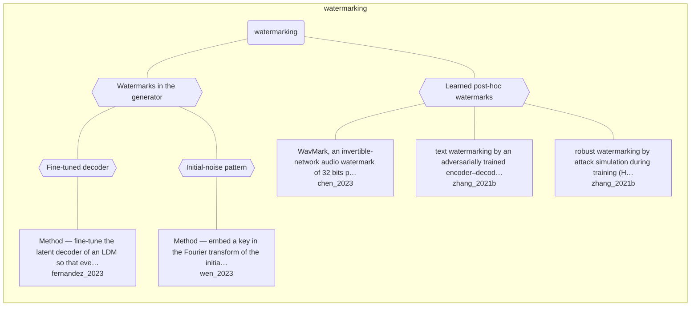

# Approach map — watermarking

Built by `tools/build_approach_map.py` from `C:\Users\user\Documents\GitHub\hypersteg_chess\hypersteg_novelty_kit_20261108\literature\verified_claims`, the features table `C:\Users\user\Documents\GitHub\hypersteg_chess\hypersteg_novelty_kit_20261108\maps\approach_features.tsv` and the technique taxonomy `C:\Users\user\Documents\GitHub\hypersteg_chess\hypersteg_novelty_kit_20261108\maps\technique_taxonomy.tsv`. View: `both`. Overview: [approach_map.md](approach_map.md).

- approaches: 5
- techniques: 4

## Legend

| link | arrow | colour | source |
| --- | --- | --- | --- |
| taxonomy (family → technique → approach) | `---` | #9e9e9e, thin | technique taxonomy and features table |
| Supports | `-->` | #2e7d32, thick | stated by a paper (ledger edge) |
| Rebuts | `-.->` | #c62828, thick | stated by a paper (ledger edge) |
| Depends-on | `==>` | #6a1b9a, thick | stated by a paper (ledger edge) |
| Refines | `-->` | #1565c0, thick | stated by a paper (ledger edge) |
| Qualifies | `-.->` | #ef6c00, thick | stated by a paper (ledger edge) |
| Restates | `<-->` | #00838f, thick | stated by a paper (ledger edge) |
| Duplicate-of | `o--o` | #757575, thick | stated by a paper (ledger edge) |
| Supersedes | `--x` | #4e342e, thick | stated by a paper (ledger edge) |

## Techniques

| technique | parent | name | definition | grounded by | approaches |
| --- | --- | --- | --- | --- | --- |
| `wm-decoder-finetune` | wm-generative-model | Fine-tuned decoder | The latent decoder is fine-tuned so all generated images carry a fixed signature. | `fernandez_2023:approach-stable-signature` | 1 |
| `wm-generative-model` | — | Watermarks in the generator | The generative model is altered so that every output carries the mark. | `fernandez_2023:approach-stable-signature` | 2 |
| `wm-initial-noise` | wm-generative-model | Initial-noise pattern | A key is written into the initial noise of a diffusion model and detected after inversion. | `wen_2023:approach-tree-ring` | 1 |
| `wm-learned-post-hoc` | — | Learned post-hoc watermarks | A trained network adds a robust mark to existing media (audio, image or text). | `chen_2023:approach-wavmark` | 3 |

## Lineage edges (0)

| source | kind | target | lifted_from | ledger line |
| --- | --- | --- | --- | --- |

## Approaches

| address | name | family | technique | channel | key | access | capacity | mechanism | landable | mechanism_evidence | carrier | acquisition |
| --- | --- | --- | --- | --- | --- | --- | --- | --- | --- | --- | --- | --- |
| `chen_2023:approach-wavmark` | WavMark, an invertible-network audio watermark of 32 bits per 1-second segment, with encoder and decoder sharing parameters | watermarking | wm-learned-post-hoc | transform-domain | shared-model | training | 32 bits per 1-second segment (32 bps); 10 of 32 bits spent on pattern bits for locating | m-invertible-encoder | yes | own | audio waveform (1-second segments) | weight-trained |
| `fernandez_2023:approach-stable-signature` | Method — fine-tune the latent decoder of an LDM so that every generated image carries a binary signature | watermarking | wm-decoder-finetune | latent-generative | shared-key | training | 48-bit signature | m-decoder-finetune-mark | yes | own | images from a latent diffusion model | weight-trained |
| `wen_2023:approach-tree-ring` | Method — embed a key in the Fourier transform of the initial diffusion noise; detect by DDIM inversion | watermarking | wm-initial-noise | latent-generative | shared-key | weights | zero-bit (presence test); capacity for multiple keys stated as open | m-initial-noise-mark | yes | own | initial diffusion noise (Fourier space) | specified |
| `zhang_2021b:surveyed-adversarial-watermarking-transformer` | text watermarking by an adversarially trained encoder–decoder transformer (AWT), set apart from generative text methods | watermarking | wm-learned-post-hoc | other (unobtrusive modification of an input text; edit type not stated) | — | training | binary message | m-adversarial-text-editing | yes | own | edited text | weight-trained |
| `zhang_2021b:surveyed-noise-augmentation-watermarking` | robust watermarking by attack simulation during training (HiDDeN and successors); JPEG's non-differentiability is the chief obstacle | watermarking | wm-learned-post-hoc | pixel-spatial | — | training | — | m-attack-simulated-training | yes | own | image pixels | weight-trained |
